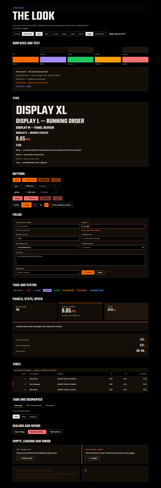
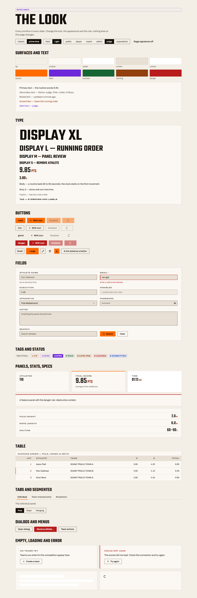
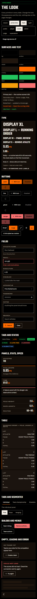
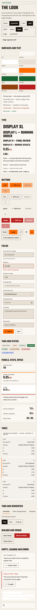

# The design language: how to build a screen

The plan and its progress log: [PLAN.md](PLAN.md). This file is the working guide. Read it before restyling or building any screen.

## The one rule

**Pages decide layout. Primitives and tokens decide the look.**

| Layer | It may decide | It may not |
|---|---|---|
| Look pack (`src/styles/looks/*.js`) | every value | — |
| Primitive (`src/components/ui/*`) | anatomy and states, from tokens | hex values, font names, look ids |
| Page | layout with Tailwind (grid, flex, gap, padding, width, position); which primitives to use | colour, type, borders, radius, shadow, blur; inline visual styles |

A restyle then means editing a pack. If a restyle needs a page edit, a token is missing: add it to `src/styles/looks/contract.js`, and the contract test lists every pack that must define it.

## The primitives

Import them from `@/components/ui`:

| Need | Use |
|---|---|
| An action | `Button` (`solid` · `line` · `ghost` · `danger`; `sm` · `md` · `lg`; `loading`; `icon`; `as={Link}`). **One `solid` per view.** |
| An icon-only action | `IconButton label="…"`: the label is required, it is the accessible name |
| A form control | `Field` around `Input`, `Select`, `Textarea` or `PasswordInput`. Field wires the label, the help text and the error. Mark fields: `<Input numeric inputMode="decimal" />`, never `type="number"` |
| A surface | `Panel` (`plain` · `band` · `feature`; `rule="danger"`) |
| A heading | `Heading level={…} step="display-l"`. The level is the outline; the step is the look |
| A label or role | `Tag` (`neutral` · `accent` · `ident`, `solid`) |
| A status | `StatusTag status="success\|warning\|danger\|info"`. Always text, never a coloured dot alone |
| A key number | `Stat` (label, value, unit) · `SpecList` (label/value rows) |
| A table | `DataTable`: every column kept; labelled cards below `md`; `activeKey` marks the current row |
| Views of one thing | `Tabs` + `TabPanel` · `Segmented` for a choice among a few |
| A modal | `Dialog` · `ConfirmDialog`. Focus moves in, stays in, and comes back |
| A list of actions | `Menu` |
| Nothing, loading, failure | `EmptyState` · `Skeleton` · `Spinner` · `ErrorState` |
| Stage screens only | `Grain`, `Heading sting` |
| Toasts | `toastOptions` (App's `<Toaster>` uses them on prime-time routes) |

The shell, from `@/components/shell`:

| Need | Use |
|---|---|
| A signed-in screen's masthead | `AppHeader role segment nav onLogout profileTo`. The wordmark, the role ident, the competition as the "segment", tabs and the account cluster. On phones, one menu button opens a drawer holding the tabs and the account cluster, so the Light/Dark switch is always reachable |
| The page's title row | `PageHeader eyebrow title lede actions`: the page's `h1` |
| The role | `RoleIdent role`: text and colour, never colour alone |
| Light/Dark, Profile, Log out | `AccountControls` |
| Route tabs | `TabNav items label` (NavLink; the current page carries the bar) |

The brand, from `@/components/brand/Brand`: `Wordmark` (the mark and "Mallakhamb India") and `PoleMark` (decorative, or `title` when it stands alone). Never the old name or `BHA.png`.

**A component never puts a Tailwind layout utility on its own root** (`flex`, `grid`, `hidden`…). Utilities win ties by design, so a utility on the root overrides the component's own breakpoint rules. This is how the masthead once showed its desktop account cluster on phones.

The type steps are Tailwind utilities: `type-display-xl/l/m/s`, `type-num-l/m`, `type-body`, `type-body-s`, `type-caption`, `type-tag`, `type-button`, `type-input`.

## Rules the tests hold you to

- **Teko only at 24 px and up.** Never in inputs, body text, COP wording or table cells.
- **Uppercase only on text the site writes:** display steps and tags. Never on COP wording, stored values or people's names.
- **Inputs are 16 px on touch**, so iOS doesn't zoom.
- **Every target is ≥ 44 px on touch.** A mouse on a desktop-width screen gets the compact 36 px.
- **Every text colour meets 4.5:1** (3:1 when large) on every surface, in both appearances and for every role. `looks.contrast.test.js` checks this without a browser; `e2e/look-specimen.spec.js` checks it on the real page.
- **No sideways page scroll**, at any width.

## Cascade order

`src/components/ui/ui.css` is imported at the top of `index.css`, before Tailwind's layers:
- the primitives' single-class rules beat preflight's element resets;
- a page's layout utilities, which come later, win ties.

Never import a primitive's CSS from its component. A lazy chunk would load after the utilities and override a page's layout.

The `@font-face` rules are the exception, and the opposite way round. They live in `src/styles/look-fonts.js` and load only with what is drawn in them (Home, prime-time routes, the primitives). Declaring them in the entry moved pixels on a classic screen.

## Seeing it

The specimen at `/__look` shows every primitive in every state. It exists only in dev and in builds made with `VITE_LOOK_OVERRIDE=1`.

```
/__look?look=prime-time&appearance=light&role=judge
```

To photograph it and audit contrast, layout and targets:

```
E2E_BASE_URL=http://localhost:4175 npx playwright test e2e/look-specimen.spec.js --project=chromium
```

To preview any route in a look, add `?look=prime-time` in dev or an override build. It applies to that browser tab only; `?look=off` clears it.

| Dark, 1366 | Light, 1366 |
|---|---|
|  |  |

| Dark, 375 | Light, 375 |
|---|---|
|  |  |
