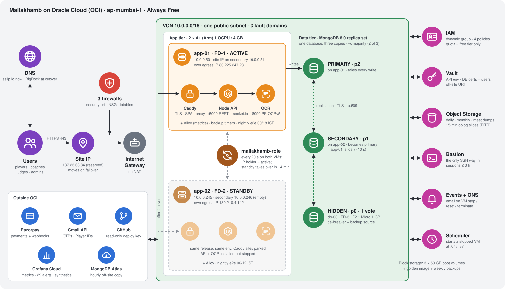
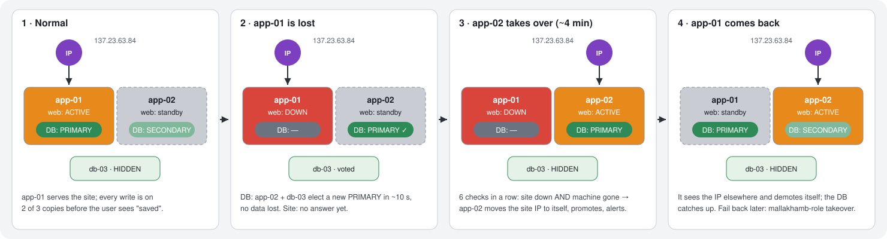

# Mallakhamb on Oracle Cloud (OCI): architecture

OCI only (Render is left out). As running on **2026-10-30**: both app VMs on master, automatic failover on and drilled (hard power-off of app-01 → app-02 took over by itself in 3 min 40 s, no data lost).

## How a request travels

1. **DNS** turns the site name into **137.23.63.84**, the *site IP*. Today that's `sslip.io`; at the cutover it will be `mallakhambcompetition.com` at BigRock.
2. The request passes **three firewalls**: the OCI security list (only 80/443 from the internet), the NSG (database port only inside the network) and the VM's own `iptables`.
3. The **Internet Gateway** delivers it to whichever VM holds the site IP. Today that's **app-01**.
4. **Caddy** terminates HTTPS, serves the web app (the SPA) as files, and forwards `/api` and live-scoring sockets to the **Node API**.
5. The API reads and writes the **MongoDB replica set**. A write counts as saved only once **2 of the 3** copies hold it. For walk-in paper forms it calls the **OCR** sidecar on the same VM.
6. It sends mail through the **Gmail API** and payments through **Razorpay**, which calls back with webhooks.

## The pieces

| Group | Piece | Full form / what it is | What it does here | Why |
|---|---|---|---|---|
| Edge | DNS | Domain Name System | Name → 137.23.63.84 | The IP moves on failover, so DNS never has to change |
| | Site IP | OCI *reserved* public IP `pip-app-01` | Sits on a **secondary** private IP of the active VM (10.0.0.51 or 10.0.0.246) | Moving it is the failover. Each VM keeps its **own** egress IP, so no VM ever loses its internet |
| | 3 firewalls | Security list · NSG (Network Security Group) · `iptables` | Only 80/443 from the internet; 27017 (MongoDB) only inside the VCN; everything else rejected | Defence in depth |
| | Internet Gateway | OCI IGW | The VCN's door to the internet. There's no NAT (Network Address Translation) gateway | NAT isn't free; per-VM public IPs do the same job |
| App tier | app-01, app-02 | Ampere A1 (Arm) VMs, 1 OCPU (Oracle CPU) / 4 GB, fault domains 1 and 2 | One **active**, one **warm standby** (same code and config, API stopped) | Survive a VM or rack failure |
| | Caddy | Web server | HTTPS with free Let's Encrypt certificates, the SPA (Single-Page App), reverse proxy | The only process facing the internet |
| | Node API | The app's server (Node.js 24), port 5000 | REST + socket.io live scoring | All the rules live here |
| | OCR | Optical Character Recognition (PP-OCRv5), port 8090 | Reads walk-in paper forms. Photos stay in memory only | Free, on our own CPU, nothing sent out |
| | mallakhamb-role | Our role reconciler, every 20 s on both VMs | **The VM holding the site IP is the active.** The standby takes the IP when the active machine is gone | Automatic web failover ([AUTO-FAILOVER.md](AUTO-FAILOVER.md)) |
| | Alloy | Grafana's metrics agent | Ships host + app metrics | Monitoring |
| Data tier | MongoDB replica set `mallakhamb` | One database, **three copies**, kept in sync by the oplog (operations log) | PRIMARY on app-01 (priority 2), SECONDARY on app-02 (1), HIDDEN on **db-03** (0, a tiny E2.1.Micro in fault domain 3) | Any one VM can die with no data lost; db-03 is the tie-breaking vote and the backup source |
| OCI services | IAM | Identity and Access Management | VMs may read secrets, write backups, move the site IP. Nothing else. A quota keeps it all Always Free | Least privilege, ₹0 |
| | Vault | Key Management + secrets | API env file, DB certificates and passwords, off-site address | No secret in Git or on a laptop |
| | Object Storage | Bucket `bkt-backups` (VMs may write, never delete) | Daily / monthly / meet-day dumps + 15-minute oplog slices | Restore to any minute (PITR, Point-In-Time Recovery) |
| | Bastion | Managed SSH (Secure Shell) gateway | The only way into a VM (3-hour sessions) | Port 22 never open to the internet |
| | Events + ONS | OCI Events → Oracle Notification Service | Email when a VM is stopped, reset or terminated | A second alarm path besides Grafana |
| | Scheduler | OCI Resource Scheduler | Starts a stopped VM at :07 / :37 | Always Free VMs can be stopped by Oracle when idle |
| | Block storage | 3 × 50 GB boot volumes + backups | OS, code and database files | Free tier: 200 GB |
| Outside | Grafana Cloud | Metrics, dashboards, **29 alert rules**, synthetic checks | Pages us | Free tier |
| | MongoDB Atlas | Hosted MongoDB at a different company | **Hourly off-site copy** | The way out if Oracle is lost |
| | Razorpay · Gmail API · GitHub | Payments · mail · code | GitHub uses a read-only deploy key | — |

## Failover

| What fails | What happens by itself | Users see | Data lost |
|---|---|---|---|
| API process crashes | systemd restarts it in 5 s | a few seconds of errors | none |
| **app-01 VM / fault domain 1** | DB elects app-02 in ~10 s. The standby moves the site IP to itself and promotes after **6 checks** | **3 min 40 s** (drilled) | **none** |
| app-02 or db-03 | nothing to do: 2 of 3 copies remain | nothing | none |
| app-01 comes back | it sees the IP elsewhere and **demotes itself**; its DB catches up | nothing | none |
| Network splits app-01 off | app-01's DB steps down (no split brain); the standby takes over if app-01 looks gone from **both** app-02 and db-03 | ~4 min | none acknowledged |
| Two VMs at once | no majority → no writes until one returns | errors | none if they return |
| Bad deploy / broken web stack | **no automatic failover** (the standby would fail the same way); roll back | until rolled back | none |
| Accidental delete / bad data | restore any minute from oplog slices into a side database | — | back to that minute |
| Whole region / account | rebuild elsewhere from the Atlas copy | hours | ≤ 1 h |

Planned switch or failback: `sudo mallakhamb-role takeover` on the VM that should be active. **About 5–8 s** of errors (drilled). Pause automatic takeover for maintenance: `sudo touch /etc/mallakhamb/NO_AUTO_FAILOVER` on the standby.

## Backups

| Copy | How often | Where | Kept |
|---|---|---|---|
| Replica set | every write | 3 VMs, 3 fault domains | live |
| Oplog slices + daily base | every 15 min | Object Storage | 35 days |
| Full dump | daily 20:30 UTC (+ every 15 min on meet days) | Object Storage | 35 days, monthly 400 days |
| Off-site copy | hourly | MongoDB Atlas | latest |
| Boot volumes | weekly + golden image | OCI block storage | 3 |

All backup jobs read **db-03**, so they never load the live primary. They run only on the VM that holds the site IP.

## Known limits

1. **Automatic failover covers a lost machine, not a broken web stack** on a live VM (deliberate). systemd restarts the API, and a human rolls back a bad release.
2. **One availability domain** in Mumbai: fault domains protect against rack failures, not the building. The Atlas copy is the escape hatch.
3. **Two VMs down = no writes.** That's the price of never allowing split brain.
4. **db-03 is tiny** (1 GB RAM): fine for a few MB of data. An alert fires at 250 MB.
5. **MongoDB member certificates expire 2028-10-22.** Grafana alerts 60 days ahead; re-issuing is a manual step.
6. **The public `ocr-` host** exists only for Render and goes away at the cutover.

## More detail

[AUTO-FAILOVER.md](AUTO-FAILOVER.md) (failover rules, commands, alerts) · [MONGODB-SELF-HOSTED-PLAN.md](MONGODB-SELF-HOSTED-PLAN.md) (replica set, drills, backups) · [MONGODB-DB-LAYOUT-PLAN.md](MONGODB-DB-LAYOUT-PLAN.md) · [IDLE-RECLAIM-PLAN.md](IDLE-RECLAIM-PLAN.md) · [PRODUCTION-READINESS.md](PRODUCTION-READINESS.md) · [PLAN.md](PLAN.md). The earlier long version of this file (glossary, file-by-file inventory, 20 scenarios) is in git history at commit `03290c2`.
