# Mallakhamb on Oracle Cloud (OCI): the complete architecture

As built and running on **2026-10-30** (both app VMs on master `81061ed`). This file covers **OCI only**. Render, which still serves production until the cutover (C7), is left out on purpose.

Sources: [PLAN.md](PLAN.md), [MONGODB-SELF-HOSTED-PLAN.md](MONGODB-SELF-HOSTED-PLAN.md), [MONGODB-DB-LAYOUT-PLAN.md](MONGODB-DB-LAYOUT-PLAN.md), [IDLE-RECLAIM-PLAN.md](IDLE-RECLAIM-PLAN.md), [PRODUCTION-READINESS.md](PRODUCTION-READINESS.md), and the scripts in `deploy/server/` and `deploy/oci/scripts/`. If one of those files disagrees with this one, check the live system and fix whichever file is stale.

How to read this file:

| Part | What it answers |
|---|---|
| [§0 Glossary](#0-glossary-every-abbreviation-its-full-form-what-it-means-and-why-we-need-it) | Every abbreviation: its full form, what it means, and why we use it |
| [§1 The whole picture](#1-the-whole-picture) | One diagram of everything |
| [§2 The two database questions](#2-the-two-database-questions) | "Does app-01 have its own database?" and "Why is there a db-03?" |
| [§3–§13 The layers](#3-tenancy-and-governance) | Tenancy, network, compute, storage, software, database, secrets, backups, timers, monitoring, access, cost |
| [§14 Failure scenarios](#14-failure-scenarios-what-breaks-what-happens-what-the-user-sees) | 20 scenarios, each with a diagram or timeline, what happens automatically, what a human does, and what data can be lost |
| [§15 Summary tables](#15-summary-recovery-time-and-data-loss-for-every-failure) | Recovery time and data loss for every failure |
| [§16 Known gaps](#16-known-gaps-and-honest-limits) | What this design does *not* protect against |
| [§17 Cutover](#17-what-still-changes-at-the-production-cutover-c7) | What changes when production moves here |

---

## 0. Glossary: every abbreviation, its full form, what it means, and why we need it

### 0.1 Cloud and network

| Short | Full form | What it means | Why we need it |
|---|---|---|---|
| **OCI** | Oracle Cloud Infrastructure | Oracle's public cloud: rented computers, disks, networks | Its **Always Free** tier gives us 4 Arm cores, 24 GB RAM and 200 GB disk forever, at no cost. That is more than any other free tier |
| **Tenancy** | — | Our whole OCI account (`mallakhambindia`) | Everything we own lives inside it |
| **Region** | — | A city where Oracle has data centres. Ours is **ap-mumbai-1** (Asia-Pacific, Mumbai) | Close to our users in India, so pages load fast |
| **AD** | Availability Domain | One or more separate data-centre buildings inside a region. Mumbai has **one** | Tells us what can fail together. With one AD, a whole-building disaster takes the region down (see §16) |
| **FD** | Fault Domain | A group of racks inside an AD with its own power and network hardware. Each AD has **three** (FD-1, FD-2, FD-3) | We put each VM in a **different FD**, so a rack power failure or hardware fault can only take down one of them |
| **Compartment** | — | A folder inside the tenancy (`mallakhamb-prod`) | Lets us apply quotas and permissions to only our resources |
| **VM** | Virtual Machine | A computer simulated on Oracle's hardware. We rent three | Runs our software |
| **A1 / Ampere A1** | — | Oracle's Arm-processor VM shape (`VM.Standard.A1.Flex`) | The generous free shape: app-01 and app-02 |
| **E2.1.Micro** | — | A tiny AMD x86 free VM: 1/8 of a core, 1 GB RAM | Free, and good enough to hold the third database copy (db-03) |
| **OCPU** | Oracle CPU | One physical core (on A1 that's one Arm core) | Sizing unit. We use 1 per app VM |
| **VCN** | Virtual Cloud Network | Our private network inside OCI (`10.0.0.0/16`) | The VMs talk to each other privately, never over the internet |
| **Subnet** | — | A slice of the VCN (`-snet-public-01`) | VMs get their private IPs here |
| **IGW** | Internet Gateway | The VCN's door to the internet | Lets the public reach Caddy, and lets the VMs reach GitHub, Gmail, Razorpay |
| **NAT** | Network Address Translation (gateway) | A door that lets private VMs go *out* without being reachable *in* | We **don't** have one, because it isn't free. That is why every VM needs a public IP to reach the internet, and why a VM with no public IP is cut off (see §14.3) |
| **CIDR** | Classless Inter-Domain Routing | The `/16`, `/24`, `/32` notation for a range of IP addresses | How firewall rules say "only from inside the VCN" |
| **Security List** | — | A firewall attached to the whole subnet | Opens 80/443 to the world. Port 22 is VCN-only |
| **NSG** | Network Security Group | A firewall attached to individual VMs | Opens database port 27017 only between our three VMs |
| **Reserved IP** | Reserved Public IP | A public IP address that **we own** and can move from one VM to another | The core of failover. DNS (Domain Name System) points at the IP, and we move the IP, so DNS never has to change |
| **Ephemeral IP** | — | A public IP that belongs to one VM and dies with it | db-03 uses one only to reach apt and Grafana. Nothing listens on it |
| **DNS** | Domain Name System | The internet's phone book: name → IP address | Today we use **sslip.io**, a free service that turns `app-137-23-63-84.sslip.io` into `137.23.63.84` with no setup. At cutover: `mallakhambcompetition.com` at BigRock |
| **Bastion** | OCI Bastion service | A managed, logged gateway for SSH (Secure Shell). You open a session that lasts up to 3 hours, then SSH through it | Port 22 is **never** open to the internet. Only someone who can sign in to OCI *and* holds our private key can reach a VM |
| **Cloud Shell** | OCI Cloud Shell | A Linux terminal in the browser, already signed in as the owner, with the OCI CLI | Every OCI change (move an IP, edit a secret) is done from here. No API keys exist anywhere to leak |
| **CLI** | Command-Line Interface | The `oci` command | Scripts in `deploy/oci/scripts/` |
| **IAM** | Identity and Access Management | Who may do what in OCI | The VMs may only read secrets and write backups |
| **Dynamic group / Instance principal** | — | A group whose members are VMs. A VM in it proves its identity to OCI with no password stored on it | app-01 and app-02 read the Vault with no key on disk |
| **Quota** | — | A hard limit: OCI refuses to create anything above it | Our guarantee that we never leave the free tier. **A quota blocks; a budget only warns** |
| **Budget** | — | A spending alert | SGD 1.50 a month; emails us if any money is ever spent |
| **PAYG** | Pay As You Go | A paid account | The owner's rule: **never**. We stay Always Free |
| **Resource Scheduler** | — | OCI's scheduled actions | Starts the VMs again (at :07 and :37 each hour) if Oracle ever stops one |
| **Events / Notifications / ONS** | Oracle Notification Service | OCI's event rules and email topic | Emails us when a VM is stopped, reset or terminated |

### 0.2 Storage

| Short | Full form | What it means | Why we need it |
|---|---|---|---|
| **Boot volume** | — | The VM's disk (50 GB each). Holds the OS, our code **and the MongoDB data files** | Network-attached and encrypted by Oracle. It survives a VM reboot or stop |
| **Block storage** | Block Volume service | The family that boot volumes belong to | 150 of our free 200 GB used |
| **Volume backup** | Boot volume backup | A snapshot of a whole disk | Weekly snapshot of app-01 + a "golden" image to rebuild a VM from |
| **Object Storage / bucket** | — | Cheap file storage with no folders or disks to manage (`bkt-backups`) | Holds the database dumps. The VMs can **write but never delete**, so a hacked VM can't wipe the backups |
| **Lifecycle rule** | — | "Delete objects older than N days" set on the bucket | Retention happens by itself (35 days, 400 for monthly) |
| **Vault / KMS** | Key Management Service | OCI's safe for secrets, protected by an encryption key | Passwords and keys never live in Git or on a laptop |
| **Swap** | Swap file | Disk space used as overflow RAM | 2 GB on each VM, so a memory spike slows a VM down instead of killing a process |

### 0.3 The application

| Short | Full form | What it means | Why we need it |
|---|---|---|---|
| **SPA** | Single-Page Application | Our React website (`Web/dist`): one HTML file plus JavaScript that draws every screen in the browser | Fast after the first load. Caddy only has to serve static files |
| **API** | Application Programming Interface | Our Node.js server (`Server/`) on port 5000. The SPA calls it for every piece of data | All the rules (registration, scoring, payments) live here |
| **REST** | Representational State Transfer | The style of the API: `GET /api/competitions` and so on | Normal web requests |
| **socket.io / WebSocket** | — | A connection that stays open so the server can **push** updates | Live scoring: judges' marks appear on the scorer's screen instantly |
| **Node.js** | — | The JavaScript runtime the API runs in (version 24) | The API is written in JavaScript |
| **OCR** | Optical Character Recognition | Reading printed or handwritten text from a photo | The walk-in desk photographs a paper registration form and fills the screen from it |
| **PP-OCRv5** | PaddlePaddle OCR version 5 | Baidu's open-source OCR models | Free, runs on our own CPU, no data sent to a third party |
| **Sidecar** | — | A small helper process running next to the main one | The OCR is Python, the API is Node. Separate process, own memory limit (1 GB) |
| **Caddy** | — | A web server and reverse proxy | The **only** thing listening on the internet. It handles HTTPS, serves the SPA and forwards `/api` to Node |
| **Reverse proxy** | — | A server that receives requests and passes them to another server behind it | Node never faces the internet directly |
| **HTTPS / TLS** | HyperText Transfer Protocol Secure / Transport Layer Security | Encrypted web traffic | Passwords and payments must be encrypted. Browsers require it |
| **ACME / Let's Encrypt** | Automatic Certificate Management Environment | The protocol (and free authority) that issues HTTPS certificates | Caddy gets and renews certificates by itself, for free |
| **HSTS** | HTTP Strict Transport Security | A header telling browsers "only ever use HTTPS here" | Stops downgrade attacks |
| **CSP** | Content Security Policy | A header listing what the page may load | Stops injected scripts and clickjacking |
| **CORS** | Cross-Origin Resource Sharing | Browser rules for one site calling another | The SPA (app host) calls the API (api host). Only our app host is allowed |
| **CSRF** | Cross-Site Request Forgery | A trick where another site makes your browser send a request | The API checks a CSRF token on every write |
| **JWT** | JSON Web Token | A signed token proving who you are | Login sessions |
| **systemd** | — | Linux's service manager | Starts our services at boot, restarts them if they crash, runs timers |
| **Timer** | systemd timer | Linux's scheduled job (like cron) | Backups, metrics, nightly tests |
| **Release** | — | One built copy of the code for one Git commit (SHA, Secure Hash Algorithm id) | Deploys switch a symlink, so rollback is instant |
| **Migration** | — | A one-time script that changes the database shape | Applied by the API when it starts |
| **e2e** | end-to-end (test) | A test that uses the real app the way a person would | Every 6 hours a whole season (meets, teams, judges, scoring) is played on a throw-away copy, to prove the app still works |

### 0.4 The database

| Short | Full form | What it means | Why we need it |
|---|---|---|---|
| **MongoDB / mongod** | — / Mongo daemon | Our database. `mongod` is the server process | Stores everything: users, competitions, scores |
| **Replica set** | — | Several mongod servers that hold **the same data**, kept in sync automatically. One is **PRIMARY** (takes writes); the others are **SECONDARY** (copy every write) | If one server dies, another takes over by itself, with no data lost |
| **Primary / Secondary** | — | The member that accepts writes / a member that copies them | Only one primary at a time, so there's never a conflict |
| **Hidden member** | — | A secondary the application never sees or reads from | db-03 is hidden: it holds a copy and votes, but serves no traffic |
| **Priority** | — | How much a member wants to be primary (0 = never) | app-01 = 2 (preferred), app-02 = 1, db-03 = 0 |
| **Vote / Election / Majority** | — | Members vote for a primary. A primary needs votes from **more than half** of the set (2 of 3) | This is what makes automatic failover safe |
| **Split brain** | — | Two servers both thinking they're primary and accepting different writes | Impossible here: only the side with 2 of 3 votes can have a primary |
| **Arbiter** | — | A member that votes but holds no data | **Not** used. See §2.2 for why |
| **Oplog** | Operations log | A rolling log of every write, which secondaries replay to stay in sync | Also our point-in-time restore source. 2048 MB |
| **Write concern `w: majority`** | — | "Only tell the API a write succeeded once 2 of 3 members have it" | An acknowledged write survives the loss of any one VM |
| **Initial sync** | — | A member that is too far behind copies everything from scratch | Automatic. Our data is a few MB, so it takes seconds |
| **x.509** | ITU-T standard X.509 | The certificate format used by TLS | Members prove they're members with certificates, not passwords |
| **CA** | Certificate Authority | The key that signs certificates. Ours is private, valid 10 years | Only certificates we signed can join the set |
| **SCRAM-SHA-256** | Salted Challenge Response Authentication Mechanism, Secure Hash Algorithm 256 | MongoDB's password login | Each user (app, backup, monitor) has its own password and only its own rights |
| **mongodump / mongorestore** | — | MongoDB's export and import tools | Backups |
| **PITR** | Point-In-Time Recovery | Restore the database as it was at an exact minute | Recover from "someone deleted a meet at 14:32" |
| **RPO** | Recovery Point Objective | How much data you can lose (measured in time) | §15 |
| **RTO** | Recovery Time Objective | How long you are down | §15 |
| **Atlas** | MongoDB Atlas | MongoDB's own hosted cloud database | Our **off-site** copy, at a different company, refreshed hourly |
| **AVX** | Advanced Vector Extensions | A CPU instruction set | MongoDB 8 requires it. db-03's AMD CPU has it |

### 0.5 Monitoring and outside services

| Short | Full form | What it means | Why we need it |
|---|---|---|---|
| **Grafana Cloud** | — | Hosted dashboards, alerts and metric storage (free tier) | We see CPU, memory, errors and replica-set health, and get emailed when something is wrong |
| **Alloy** | Grafana Alloy | Grafana's collector agent, running on each VM | Sends host and textfile metrics to Grafana |
| **Prometheus / remote-write** | — | The metrics format, and "push metrics to a remote store" | How Alloy delivers metrics |
| **Textfile metrics** | — | `.prom` files our scripts write, which Alloy picks up | Backup times, release, role, e2e result, replica-set state |
| **Synthetic check** | — | Grafana pinging our public URL from outside | Proves the site is reachable from the internet, not only "the VM is alive" |
| **Razorpay** | — | Indian payment gateway | Registration fees. It calls us back through **webhooks** (HTTP requests it sends to our API) |
| **Gmail API** | — | Google's mail-sending API | Outgoing mail (OTPs, Player IDs) |
| **OTP** | One-Time Password | A code sent by email | Sign-in and verification |
| **UTC / IST** | Coordinated Universal Time / Indian Standard Time (UTC+5:30) | Time zones | Server timers are in UTC except the e2e timer, which is in IST |

---

## 1. The whole picture

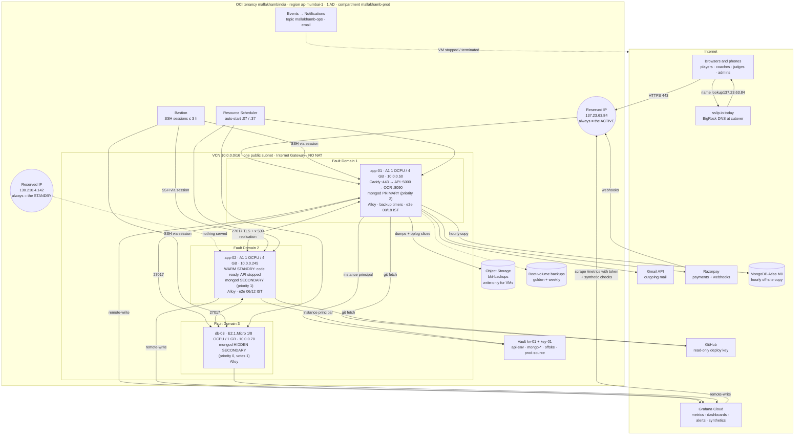

**In one sentence:** one active VM serves the whole site; a warm standby in a different fault domain can take over in about a minute; and the database is **one** replica set whose three copies sit in all three fault domains, so it survives any single VM failure on its own.

---

## 2. The two database questions

### 2.1 "If app-01 has its own MongoDB and app-01 fails, how does app-02 have app-01's data?"

**app-01 does not have its own database.** Neither does app-02. There is **one** database, the replica set called `mallakhamb`, and it is **stored three times**: on app-01, app-02 and db-03. The three mongod processes are not three databases. They are three members of one database.

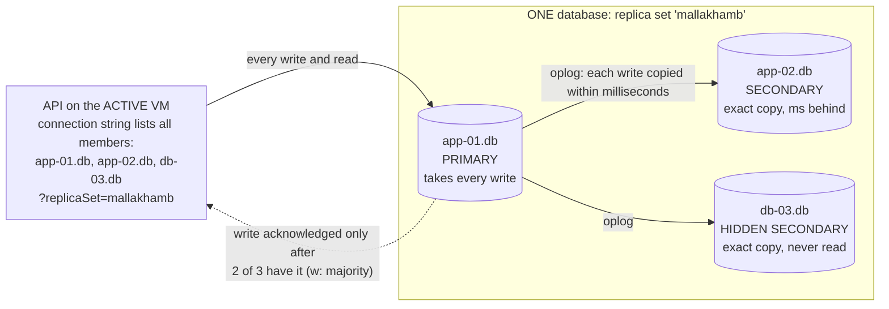

How a single write travels (say a judge submits a mark):

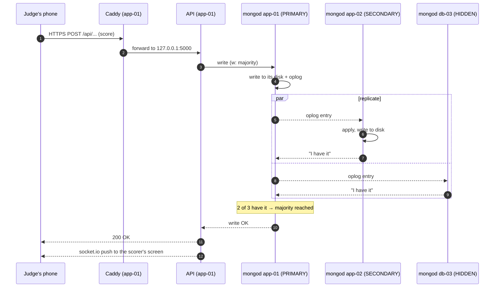

So when the API tells a judge "saved", that mark is **already on at least two VMs in two different fault domains**. If app-01 then dies, the mark is on app-02 (and/or db-03). Nothing has to be copied after the failure. The data was copied *before* the success message.

What happens to the database when app-01 dies:

1. app-02 and db-03 stop hearing app-01's heartbeat (they check every 2 s; after 10 s it counts as dead).
2. They hold an **election**. app-02 has priority 1, db-03 has priority 0 (can never win), so app-02 asks for votes. It has its own vote plus db-03's = **2 of 3 = majority**. app-02 becomes PRIMARY. Measured: about **10 s** after a hard kill; **23 ms** after a graceful stop.
3. The MongoDB driver inside the API is already connected to all members. It notices the new primary and sends writes there. Writes that were in flight are **retried once automatically** (retryable writes). In the kill -9 drill one write waited 11 s and **0 writes were lost**.

The database half of a failover is **fully automatic**. The application half (moving the public IP and starting the API on app-02) is a short **manual** step, described in §14.3.

What happens when app-01 comes back:

1. Its mongod starts, sees app-02 is primary, and rejoins as a **secondary**.
2. It replays from app-02's oplog everything it missed. The oplog holds 2 GB of history, which for a ~3 MB database means weeks, so it never falls off.
3. Because app-01 has **priority 2** (higher than app-02's 1), once it has caught up it calls an election and **takes primary back** by itself. This is called a *priority takeover*.
4. If the API is still running on app-02 at that point, nothing breaks. The API on app-02 just sends its writes across the VCN to app-01's mongod. The API never cares which VM the primary is on.

### 2.2 "If app-01 and app-02 each hold the data, why is there a db-03?"

Because **two members cannot fail over safely**. A primary needs votes from more than half of the members:

| Members | Majority needed | One member dies → survivors | Can the survivors elect a primary? |
|---|---|---|---|
| 2 (app-01, app-02) | 2 of 2 | 1 vote | **No.** The survivor goes read-only. The site can't save anything |
| 3 (app-01, app-02, db-03) | 2 of 3 | 2 votes | **Yes.** Writes keep working |

Why the rule is "more than half": if app-01 and app-02 simply lost the network between them, each would see the other as "dead". If either could make itself primary alone, **both** would, and they would accept different scores at the same time (split brain). Requiring a majority means at most one side can ever have a primary. db-03 is the **tie-breaker** that makes a majority possible after one loss.

Why db-03 is a full data-holding member and not an **arbiter** (a voter with no data):

- With an arbiter, if one data member died only **one** copy would be left. `w: majority` writes need 2 copies, so every write would wait and then fail. MongoDB warns against this "PSA" (Primary-Secondary-Arbiter) layout for exactly that reason.
- db-03 holds a full copy, so with any one member down there are still **two** copies and writes are acknowledged normally.
- It's a third copy in a third fault domain. That's extra safety for free.

Why db-03 is **hidden** and **priority 0**:

- It has 1/8 of a CPU core and 1 GB of RAM. Far too small to serve the API, so it must never become primary (priority 0) and the driver must never read from it (hidden).
- It still **votes** and **acknowledges writes**, which is all it's for.

Why db-03 is a **separate VM** and not a third mongod on app-01 or app-02: a member on app-01 would die together with app-01, taking two votes out of three with it. A separate VM in FD-3 is the only way losing any one machine leaves a majority.

db-03 is also the **backup source**. A replica-set connection never selects a hidden member, so `mallakhamb-backup-source` reaches it directly (`directConnection=true`). It falls back to app-02 (`secondaryPreferred`) when db-03 is down or more than 120 s behind (§9). Until 2026-10-30 the backups quietly read app-02, because of exactly that rule.

---

## 3. Tenancy and governance

| Item | Value | Why |
|---|---|---|
| Tenancy / region | `mallakhambindia`, **ap-mumbai-1** (one AD `xEPU:AP-MUMBAI-1-AD-1`, three FDs) | Closest region to users |
| Billing | **Always Free / Free Trial, never PAYG** (owner). Bills in **SGD** (Singapore dollars) | ₹0 hosting |
| Compartment | `mallakhamb-prod` | Quotas and policies apply to our things only |
| Naming | `mallakhamb-prod-bom-<type>-<role>-<nn>` (`bom` = Mumbai's airport code). VM names never say "active" or "standby", because the roles swap | Names stay true after a failover |
| Quota `mallakhamb-prod-quota-free-tier` | A1 2 OCPU / 12 GB (per-AD **and** regional counters), E2 micro 1 core, block storage 200 GB, everything else 0 | It's impossible to create anything that costs money |
| Budget `mallakhamb-guard` | SGD 1.50 / month. Alerts at ACTUAL > 1 % and FORECAST > 100 % | A second line of defence: email if a single cent is spent |
| IAM | Dynamic group `mallakhamb-prod-dg-app` (app-01, app-02) + policy `mallakhamb-prod-pol-app`: read Vault secrets, **write** the bucket (never delete). `mallakhamb-prod-pol-metrics-read` for the cost and idle collectors | Least privilege. A hacked VM can't delete backups or create resources |
| Identity | One user, MFA (Multi-Factor Authentication) on, **no API keys** | Nothing on a laptop can leak OCI access |

---

## 4. Network

| Resource | Setting | Why |
|---|---|---|
| VCN `-vcn-01` | `10.0.0.0/16` | Our private address space |
| Subnet `-snet-public-01` | One public subnet. No private subnet, no NAT | NAT isn't free. The firewall does the protecting instead |
| IGW `-igw-01` + route table `-rt-public-01` | `0.0.0.0/0 → IGW` | Traffic in and out of the internet |
| Security list `-sl-public-01` | **80 and 443 from the world**. 22 and ICMP (Internet Control Message Protocol, i.e. ping) from the VCN only | Only the web server is public |
| NSG `-nsg-mongo` | TCP **27017 from 10.0.0.0/24**, on the three VNICs (Virtual Network Interface Cards) | The database can't be reached from the internet at all |
| Reserved IPs | `-pip-app-01` **137.23.63.84** (always the active), `-pip-app-02` **130.210.4.142** (always the standby) | Failover moves the IP, not DNS. DNS caches can't slow failover down |
| db-03 public IP | Ephemeral, outbound only | apt updates and Alloy, because there's no NAT |
| Host firewall | Oracle Ubuntu `iptables` + `netfilter-persistent` (**not UFW**): 80/443 open, 27017 from the VCN only, 5001 and 8090 closed | A second layer if a cloud rule is ever wrong |
| SSH | **Only through the Bastion.** Port 22 never open to the internet | No brute-force surface |
| Private names | `/etc/hosts` on all three: `app-01.db` → 10.0.0.50, `app-02.db` → 10.0.0.245, `db-03.db` → 10.0.0.70 | Private IPs never change, so the DB address never changes |

Every port in one place:

| Port | Who listens | Reachable from |
|---|---|---|
| 443 | Caddy | Internet (active only; the standby serves no site) |
| 80 | Caddy | Internet: only redirects to 443 and answers Let's Encrypt challenges |
| 5000 | Node API | 127.0.0.1 only (Caddy) |
| 8090 | OCR sidecar | 127.0.0.1 only (the API). Also published through Caddy's `ocr-` host until the cutover, for Render |
| 27017 | mongod | 127.0.0.1 + the VCN, TLS required |
| 5001 / 27027 | e2e API / throw-away mongod | 127.0.0.1, only while a nightly run is going |
| 27099 | scratch mongod for PITR | 127.0.0.1, only during a restore |

---

## 5. Compute and block storage

| VM | Shape | FD | Private IP | Role today | Boot volume |
|---|---|---|---|---|---|
| `-vm-app-01` | A1.Flex **1 OCPU / 4 GB** (Arm) | FD-1 | 10.0.0.50 | **ACTIVE** (the owner wants app-01 as the main) | `-bv-app-01` 50 GB |
| `-vm-app-02` | A1.Flex **1 OCPU / 4 GB** (Arm) | FD-2 | 10.0.0.245 | **Warm STANDBY** | `-bv-app-02` 50 GB |
| `-vm-db-03` | E2.1.Micro **1/8 OCPU / 1 GB** (x86, AVX2) | FD-3 | 10.0.0.70 | Database member only | `-bv-db-03` 50 GB |

- **"Warm" standby** means: same OS, same code release, same env file, Caddy installed with its site files parked, mongod running as a live secondary. Only the API process is stopped and Caddy serves nothing. Promoting it is starting one service, not building a server.
- **OS:** Ubuntu 24.04, pinned to the **6.8 LTS (Long-Term Support) kernel** (`linux-oracle-lts-24.04`). MongoDB 8.0 refuses kernels 6.19 and later, and Oracle's image follows the newest kernel. Rebuild order: `kernel-lts.sh` → reboot → `kernel-lts.sh` → `install-mongo.sh`.
- **Runtime:** Node 24, a Python venv (virtual environment) per release for the OCR, 2 GB swap.
- **Disk:** 150 of the free 200 GB. Everything, including MongoDB's files, lives on the boot volumes. Oracle encrypts them at rest.
- **Volume backups:** golden image `-bvb-app-golden-20261015` + weekly policy `-bkp-weekly` (Sundays 21:00 UTC, keep 3) on app-01 = 4 of the 5 free backups.
- **Why 4 GB and not 6:** Oracle may stop an Always Free VM whose CPU p95 (95th percentile), network **and** memory all stay under 20 % for 7 days. Real use is ~0.9 GB, so 4 GB reads 22–25 %. Never go past 12 GB of A1 in total. Exceeding the free allowance disables every A1 VM.

---

## 6. What runs on each VM

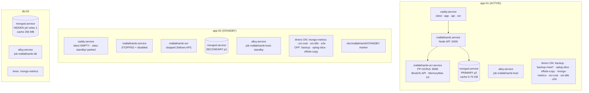

### 6.1 The request path

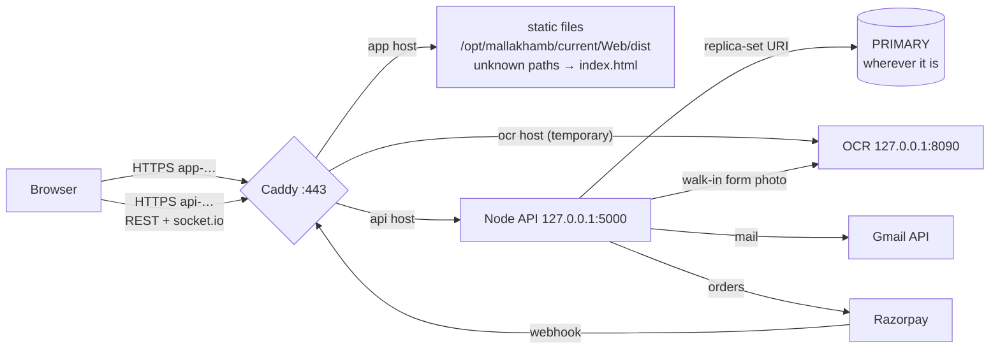

### 6.2 Caddy (the edge)

- `/etc/caddy/Caddyfile` imports `/etc/caddy/sites/*.caddy`. The **standby keeps its site files in `sites-standby/`** and serves nothing. `mallakhamb-promote` copies them into `sites/` and reloads.
- **Let's Encrypt** certificates, issued and renewed by Caddy (every ~60 days, automatically). When the IP moves to the other VM, that VM obtains its own certificate within seconds.
- **API site:** 404 for `/api/docs*` and `/api/debug*`, 2 MB request-body limit. `/metrics` is reachable but needs Grafana's token.
- **Web site:** HSTS, `X-Frame-Options DENY`, nosniff, CSP `frame-ancestors 'none'`, Permissions-Policy. zstd/gzip compression. `/assets/*` cached for a year (file names contain a hash), everything else `no-cache` so a deploy is seen at once.
- **OCR site:** only `/health` and `/v1/read`, 12 MB limit, 90 s timeout. Temporary, for Render.
- Logs: `/var/log/caddy/*-access.log` (rolled). That directory must be owned by `caddy`. Run `caddy validate` as `sudo -u caddy`, because running it as root creates root-owned logs and the reload then fails.
- **Hosts today:** `app-137-23-63-84.sslip.io`, `api-137-23-63-84.sslip.io`, `ocr-137-23-63-84.sslip.io`.

### 6.3 Application services (systemd)

| Unit | What | Protection |
|---|---|---|
| `mallakhamb.service` | Node API `Server/scripts/startup.js` on :5000 as user `mallakhamb`. `ExecStartPre` = `mallakhamb-render-env` (Vault → `/etc/mallakhamb/app.env`; if the Vault can't be reached it **keeps the last good file**) | `Restart=always` after 5 s. NoNewPrivileges, ProtectSystem=full, PrivateTmp, writes only `/var/log/mallakhamb` |
| `mallakhamb-ocr.service` | Python PP-OCRv5 on 127.0.0.1:8090, token-protected. **`BindsTo=mallakhamb.service`**: runs only where the API runs, so failover needs no extra step | MemoryMax 1G, CPUWeight 20, Nice 10. On one core, live scoring always wins over a photo being read |
| `caddy.service` | Edge (§6.2) | |
| `mongod.service` | Replica-set member (§7) | Package held at 8.0.34 so an `apt upgrade` can't change it |
| `alloy.service` | Metrics to Grafana | Token only in `/etc/default/alloy` (root:alloy 0640) |
| `mallakhamb-e2e*.service` | Nightly lifecycle check (§10.1) | Started only by its runner |

### 6.4 Releases and deploys

```
/opt/mallakhamb/repo.git            bare mirror, fetched with the read-only GitHub deploy key
/opt/mallakhamb/releases/<sha>[-<web.env hash>]/
      Server/  (npm ci --omit=dev; .env → /etc/mallakhamb/app.env)
      Web/dist (built ON the VM with web.env, so the build contains the right API host)
      ocr/     (.venv; models pinned by sha256 in /opt/mallakhamb/ocr-models)
      .complete                     marker: this release finished building
/opt/mallakhamb/current → releases/<sha>     one atomic symlink switch; mallakhamb-rollback points it back
/etc/mallakhamb/  app.env  web.env  release.env  ocr.env  platform.sh  mongo-ca.pem  STANDBY (standby only)
```

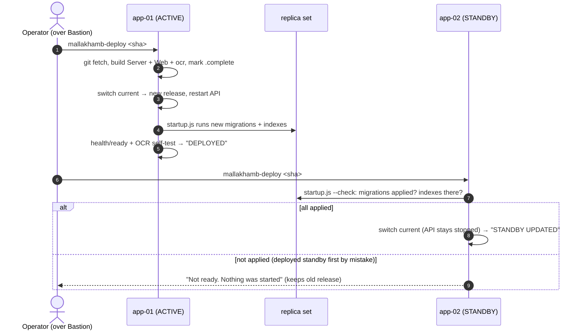

**Rule:** when a release adds a migration, deploy the **ACTIVE first** (it migrates the database), then the standby. The standby refuses to switch to code whose migrations aren't applied yet. That way it can never be promoted onto code the database doesn't match.

---

## 7. Database: self-hosted MongoDB replica set `mallakhamb`

| Member | VM | Priority | Votes | Hidden | Notes |
|---|---|---|---|---|---|
| `app-01.db` | app-01 | **2** | 1 | no | Normal PRIMARY. `cacheSizeGB` 0.75 |
| `app-02.db` | app-02 | **1** | 1 | no | Becomes primary if app-01 is lost |
| `db-03.db` | db-03 | **0** | 1 | **yes** | Tie-breaker + third copy. Never primary, never read. 256 MB cache + 2 GB swap |

- **MongoDB 8.0.34** on all three (arm64 on the A1s, amd64 on db-03). mongosh 2.13.0, database tools 100.19.1. All held.
- **Write concern default `{w: "majority"}`.** A write is confirmed only once 2 of 3 members hold it.
- **Security:** TLS required (no plain connections). A private CA valid 10 years. Member certificates that **expire 2028-10-22** (re-issue before then). Members prove themselves with x.509 certificates; users log in with SCRAM-SHA-256. mongod listens on 127.0.0.1 + its private IP only.
- **Connection string** (fixed, because names and private IPs never change):
  `mongodb://mallakhamb_app:…@app-01.db,app-02.db,db-03.db/mallakhambcompetition_prod?replicaSet=mallakhamb&authSource=admin&tls=true&tlsCAFile=/etc/mallakhamb/mongo-ca.pem`
  Listing all three is only for discovery: the driver asks any reachable one "who is primary?", then talks to the primary.
- **Databases:** `mallakhambcompetition_prod` (the API's; holds staging test data until the cutover swaps in data and keys, never the URI), `mallakhambcompetition_dev` (sandbox), `*_restoretest` (restore drills). The e2e run **never** touches the set.
- **Users (each can do its job and nothing else; `mongo-auth-check.sh` 15/15):**

  | User | Can | Used by |
  |---|---|---|
  | `root_breakglass` | everything | humans, emergencies only |
  | `mallakhamb_app` | read/write `_prod` + `_prod_restoretest` | the API |
  | `mallakhamb_staging` | read/write `_dev` | sandbox |
  | `mallakhamb_backup` | backup + read `local` (the oplog) | dumps, oplog slices, off-site copy |
  | `mallakhamb_monitor` | clusterMonitor | `mallakhamb-mongo-metrics` |

- **Oplog:** 2048 MB. Both the "how far behind may a member fall" window and the point-in-time-restore source.
- **Drills passed (2026-10-24):** graceful stop → new primary in 23 ms; kill -9 → 10 s election, 0 writes lost; network partition → no split brain; two members down → no primary, recovers by itself; disk full on db-03 → crash-loop, recovers by itself.

---

## 8. Secrets

All in **Vault `-kv-01`** with software key `-key-01` (free).

| Secret | Holds | Read by |
|---|---|---|
| `-secret-api-env` (v9) | The whole API env file (DB URI, JWT secret, Razorpay, mail, OCR token…) | `mallakhamb-render-env` on app-01 and app-02, through the instance principal |
| `-secret-mongo-{ca-key,ca-cert,member-app-01,member-app-02,member-db-03,users}` | CA, member certificates, DB passwords | `mongo-tls-fetch`. db-03 isn't in the dynamic group, so app-01 relays its files with `tar \| untar` |
| `-secret-mongo-offsite-uri` | Atlas URI for the off-site copy | `mallakhamb-offsite-copy` |
| `-secret-mongo-prod-source-uri` | Render's production Atlas URI (cutover source) | `mongo-copy-db.sh --from-atlas` |

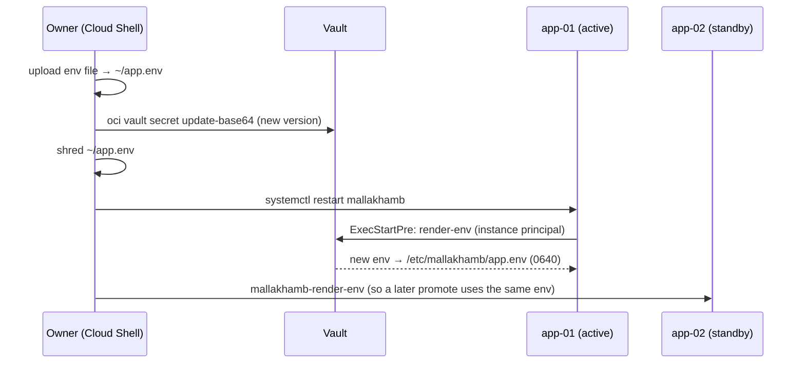

Nobody prints secret values. Checks use `grep -q` on the VM.

---

## 9. Backups and recovery

**Where backups read from.** Every backup job first runs `mallakhamb-backup-source`:

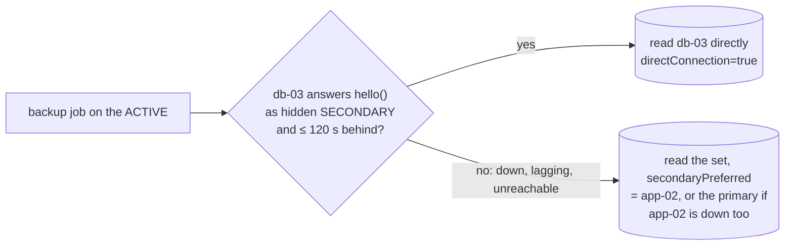

The point is that a dump during a meet loads neither the primary (live scoring) nor app-02 (the failover target). The reason for each choice is logged to the job's journal (`backup-source: …`).

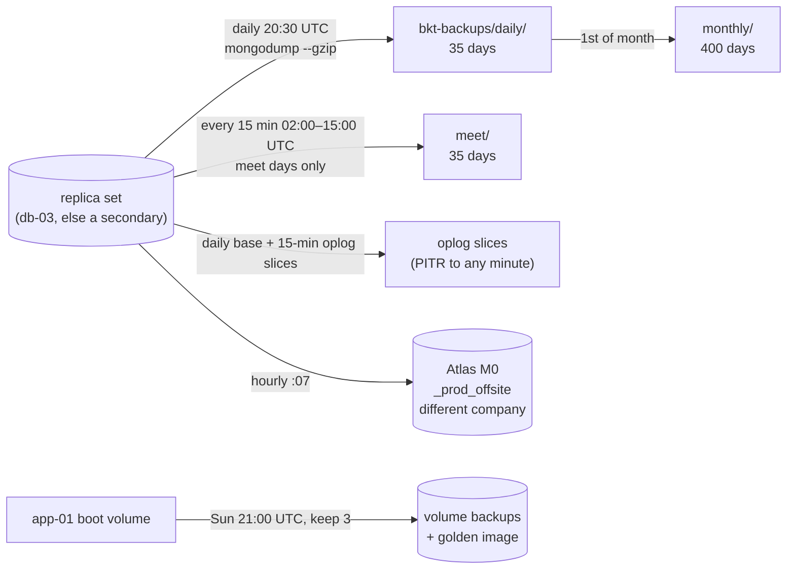

| Layer | Protects against | Worst-case loss (RPO) |
|---|---|---|
| Replica set itself | One VM / one FD lost | **0** (every acknowledged write is on 2 VMs) |
| Oplog slices (15 min) | Bad data: accidental delete, buggy release | ≤ 15 min, to any chosen minute |
| Meet-day dumps (15 min) | Same, on competition days | ≤ 15 min |
| Daily dump | Everything in OCI corrupt | ≤ 24 h |
| Atlas off-site (hourly) | Whole OCI account/region gone | ≤ 1 h |
| Volume backups | Rebuilding a VM's OS and code | Weekly (data comes from the set, not from these) |

- The bucket lets the VMs **write but not delete**. Lifecycle rules handle retention.
- Backup timers run **only on the active**. `promote` turns them on, `demote` turns them off. Two VMs never take the same backup twice.
- Restore tools: `mallakhamb-restore-drill` (into `<db>_restoretest`, compares every collection), `mallakhamb-pitr <time> <side-db>` (replays oplog slices on a scratch mongod :27099 into a side database, so nothing live is overwritten), `mallakhamb-rollback` (previous code release).

---

## 10. Scheduled jobs (systemd timers)

| Timer | Schedule | Runs on |
|---|---|---|
| `mallakhamb-backup` | 20:30 UTC daily (runs on next boot if missed) | active |
| `mallakhamb-backup-meet` | every 15 min 02:00–15:00 UTC | active, **meet days only** (enabled by hand) |
| `mallakhamb-oplog-slice` | every 15 min | active |
| `mallakhamb-offsite-copy` | hourly at :07 | active |
| `mallakhamb-mongo-metrics` | every minute at :15 s | all three |
| `mallakhamb-oci-cost` | hourly :23 | app VMs |
| `mallakhamb-oci-idle` | hourly :41 | app VMs |
| `mallakhamb-e2e` | 00, 06, 12, 18 IST. **Active takes 00 + 18, standby takes 06 + 12** | both app VMs |

### 10.1 Nightly lifecycle check (e2e)

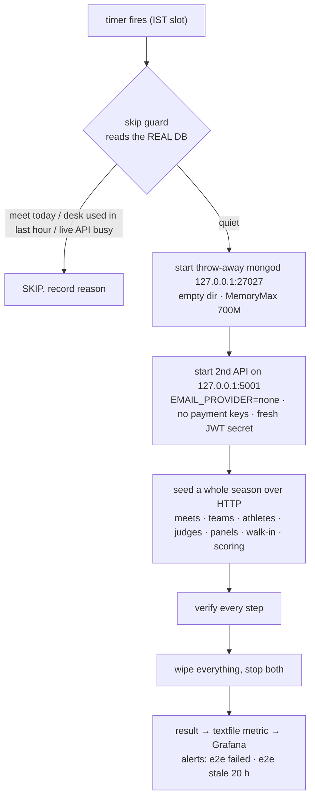

Why it alternates between VMs: it proves **the standby's** code and machine work too. A standby nobody tests is a standby that fails when you need it.

---

## 11. Observability

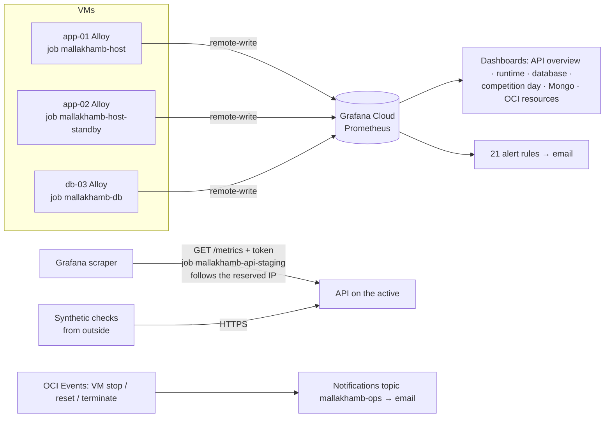

- **Textfile metrics:** release + role (active/standby), backup timestamps, replica-set health and lag, e2e result, OCI cost, Oracle idle-test numbers.
- **Alerts** include: host missing (each VM), disk > 80 % on any member, replica set has no primary, member down or lagging, backup stale, e2e failed or stale, API error rate and latency, synthetic check failing.
- **OCI-native email** is narrow on purpose: only 1,000 free emails a month.

---

## 12. Operator access

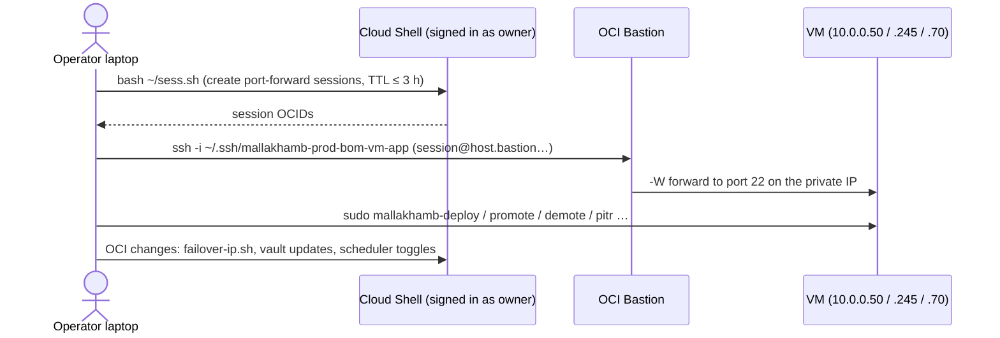

The bastion's allowlist is `0.0.0.0/0` because the owner is on rotating mobile IPs. The real controls are an OCI sign-in (with MFA) to create a session, plus the private key.

---

## 13. Cost

| Item | Monthly |
|---|---|
| 2 × A1 + 1 × micro, 150 GB block, 4 volume backups, 2 reserved IPs, Bastion, Vault, bucket, egress | **₹0** (Always Free, enforced by the quota) |
| MongoDB (self-hosted) + Atlas M0 off-site | ₹0 |
| Grafana Cloud | ₹0 |
| Domain `mallakhambcompetition.com` | ~₹100–150 (renewal due **2026-11-14**) |

---

## 14. Failure scenarios: what breaks, what happens, what the user sees

Legend: **Auto** = happens by itself. **Human** = an operator runs a command. **RTO** = how long users are affected. **RPO** = data that can be lost.

### 14.1 Scenario 0: everything healthy (the baseline)

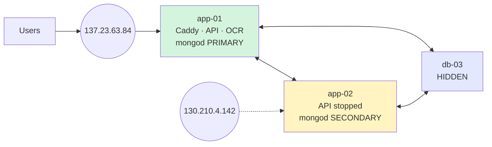

All 21 alerts quiet. Backups on app-01. e2e alternates. The API's writes land on app-01 and are confirmed once app-02 or db-03 has them too.

### 14.2 The API process crashes (bug, out of memory)

| | |
|---|---|
| Auto | systemd restarts it after 5 s. `ExecStartPre` re-renders the env (or keeps the last good one). The OCR sidecar is stopped and restarted with it (`BindsTo`) |
| User sees | ~5–10 s of errors. socket.io reconnects by itself. The judge's slip survives a refresh |
| RPO | 0 for acknowledged writes. A request in flight at the crash gets an error and is retried by the user |
| Human | None. Check `journalctl -u mallakhamb` afterwards |

### 14.3 app-01 dies unexpectedly (VM crash, FD-1 hardware/power failure) — the main scenario

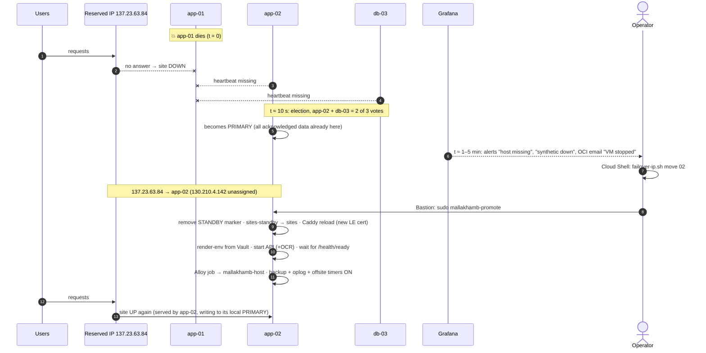

| | |
|---|---|
| Auto | Database: app-02 becomes PRIMARY in ~10 s, no data loss. Alerts and the OCI email fire |
| Human | `failover-ip.sh move 02` (Cloud Shell), then `mallakhamb-promote` on app-02 (Bastion). **Don't** run `demote` or `finish` until app-01 is back |
| RTO | Detection time + **~62–95 s** for the two commands (measured). Target ≤ 10 min |
| RPO | **0** for every acknowledged write (`w: majority`) |
| Running state | 2 of 3 database members. Writes still need 2 confirmations: app-02 + db-03. **Losing either now stops writes** (§14.8), so bring app-01 back promptly |
| Live scoring | Judges' screens reconnect via socket.io. Slips survive a refresh. The running order is in the DB |

**When app-01 comes back** (the Resource Scheduler restarts a stopped VM within 30 min, or the operator starts it):

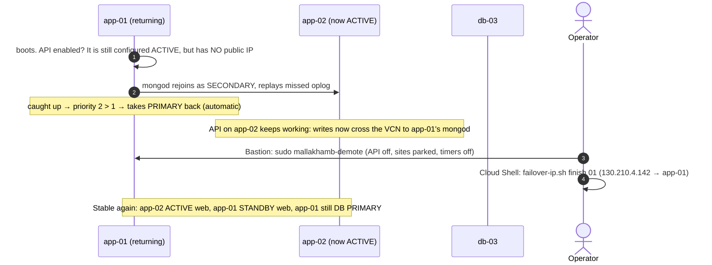

Important points about the return:

- On boot app-01's API may start (it was enabled when it died). It is harmless: it has **no public IP** (the IP is on app-02), so no user reaches it. And it writes to the same replica set, so it can't fork the data. Still, run `demote` as soon as it is reachable, because its backup timers would otherwise also run.
- "Who serves web traffic" and "who is DB primary" are **independent**. After the return, app-02 can serve the site while app-01 is DB primary. That's fully supported; it only adds a sub-millisecond network hop inside the VCN.
- **Fail back** to the owner's preferred layout (app-01 active) later, in a quiet window, as a planned failover (§14.4).

### 14.4 Planned failover / failback (maintenance, OS patching, "make app-01 the main again")

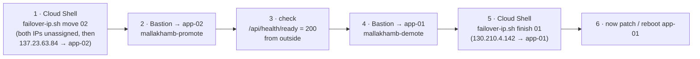

| | |
|---|---|
| RTO | 62–95 s (drilled both ways 2026-10-16) |
| RPO | 0 |
| Traps | **Between step 1 and step 5 the old active has no public IP and therefore no internet** (no NAT). Don't patch it until after `finish`. If patching needs a reboot, **disable both Resource Scheduler auto-start schedules first**, or a planned stop gets "repaired" within 30 min. Avoid meet days. If the primary should move too: `rs.stepDown()` on app-01, or simply let the reboot do it |

### 14.5 app-02 (the standby) dies

| | |
|---|---|
| Auto | Nothing for users. app-01 stays PRIMARY with db-03: 2 of 3 = majority, writes continue |
| Alerts | "standby host missing", "replica member down" |
| Human | Start it (or let the scheduler do it). mongod rejoins and catches up by itself |
| Risk while down | **No failover target for the web half**, and a second loss (app-01 or db-03) stops writes |
| Dumps | Unaffected: they read db-03 |

### 14.6 db-03 dies

| | |
|---|---|
| Auto | Nothing for users. app-01 + app-02 = 2 of 3, writes continue |
| Alerts | "db-03 host missing", "member down" |
| Human | Start it. It catches up by itself |
| Risk while down | Lose either app VM now and there's no majority (§14.8) |
| Dumps | Fall back to app-02 by themselves (logged as `backup-source: FALLBACK`). If app-02 is the active web VM at that moment, they read the primary. Fine; a dump of a few MB takes seconds |

### 14.7 A network partition (VCN problem cuts app-01 off from the other two)

```mermaid
flowchart LR
  subgraph Side_A["Side A: 1 vote"]
    A1["app-01<br/>was PRIMARY<br/>→ steps DOWN to secondary<br/>(can't see a majority)"]
  end
  subgraph Side_B["Side B: 2 votes"]
    A2["app-02<br/>→ elected PRIMARY"]
    D3["db-03"]
  end
  A1 -.x.- A2
  A1 -.x.- D3
  A2 --- D3
```

| | |
|---|---|
| Auto | app-01 **steps down** by itself (it can't reach a majority), so it stops accepting writes. app-02 is elected. **No split brain** (drilled) |
| User sees | The API on app-01 can't reach the new primary across the broken link, so writes fail until the partition heals or a failover moves web traffic to app-02 |
| RPO | 0 for acknowledged writes. Any write app-01 took in the last seconds without majority confirmation is rolled back (saved to a `rollback/` file) when it rejoins. The API never told anyone those writes succeeded |
| Human | If it lasts more than a minute or two, fail the web half over to app-02 (§14.3) |

### 14.8 Two members down at once

| | |
|---|---|
| Auto | The one survivor can't make a majority → **no primary**. Reads from it are possible but the API needs a primary, so the site errors on most actions. When either member returns, the set elects a primary by itself (drilled) |
| Human | Start the stopped VMs. If they are **gone for good**, force-reconfigure the survivor into a one-member set (`rs.reconfig(…, {force: true})` as `root_breakglass`), point the API at it, then rebuild new members from the golden image. Or restore the latest dump / Atlas copy onto it |
| RPO | 0 if the VMs come back. Otherwise whatever the survivor had (normally everything; it was in sync) |

### 14.9 Oracle stops a VM for being idle ("idle reclaim")

| | |
|---|---|
| Cause | Always Free rule: CPU p95, network and memory all under 20 % for 7 days |
| Prevention | 4 GB RAM sizing keeps memory ~22–25 %. The `mallakhamb-oci-idle` timer feeds a Grafana row showing Oracle's three numbers |
| Auto | OCI email "VM stopped" + Grafana "host missing". The Resource Scheduler starts it again at the next :07 or :37 |
| Effect | Same as §14.3 (if app-01), §14.5 or §14.6, for up to 30 min (drill: 20 min stop → running) |

### 14.10 The Vault can't be reached

| | |
|---|---|
| Auto | `mallakhamb-render-env` keeps the last good `/etc/mallakhamb/app.env`. The API starts with it |
| Effect | None, unless a secret was just changed (the new version waits until the Vault is back) |

### 14.11 OCR sidecar crashes or a big photo hogs the CPU

| | |
|---|---|
| Auto | `Restart=on-failure` after 5 s. MemoryMax 1G kills only the sidecar, never the API. CPUWeight 20 + Nice 10 mean live scoring always gets the CPU first |
| User sees | The walk-in desk shows "couldn't read the form", and the operator types it in. Everything else is unaffected |

### 14.12 A bad release

| | |
|---|---|
| Prevention | Every 6 h the e2e plays a whole season on the code. The standby refuses to switch to code whose migrations aren't applied |
| Human | `mallakhamb-rollback` (symlink back to the previous release, restart: seconds). If the release **ran a migration** that changed data, rolling the code back may not be enough: use PITR (§14.13) to a minute before the deploy |
| Spare option | The standby can be deliberately kept one release behind and promoted instead |

### 14.13 Bad data: someone deletes a meet, or a bug corrupts scores

The replica set copies mistakes faithfully, so this is a job for backups, not for failover.

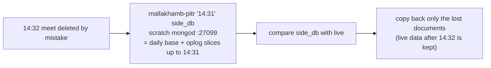

| | |
|---|---|
| RPO | To any minute covered by the slices (≤ 15 min granularity of upload; replay to the exact minute) |
| RTO | Minutes. A restore into a side database doesn't disturb live use |

### 14.14 A member falls far behind (down for a long time)

| | |
|---|---|
| Auto | If its last write is still in the others' oplog (2 GB, which is weeks at our size) it replays the gap. If not, it does an **initial sync**, copying the whole database from scratch: seconds at a few MB |
| Human | None |

### 14.15 A disk fills up

| | |
|---|---|
| Alert | `mk-mongo-disk` (any member > 80 %) and host disk rules |
| Auto | On db-03 (drilled): mongod crash-loops, then recovers by itself once space is freed. On the active it would take the API down with it, which is why the alert fires at 80 % |
| Human | Free space (old releases on the standby are never pruned, so check `/opt/mallakhamb/releases`), or grow the boot volume within the 200 GB free total |

### 14.16 Certificates

| Certificate | Expires | What happens |
|---|---|---|
| Let's Encrypt (Caddy) | Every 90 days | Caddy renews ~30 days early, automatically. After a failover the new active gets its own certificate within seconds |
| MongoDB member certificates | **2028-10-22** | Members refuse each other after that date. **Calendar item:** re-issue from the private CA (secrets `-secret-mongo-*`) and roll them out one member at a time |
| MongoDB CA | 10 years | — |

### 14.17 Operator access problems

| Problem | Fix |
|---|---|
| Bastion session expired (3 h) | `bash ~/sess.sh` in Cloud Shell, use the new session id |
| Cloud Shell recycled mid-script | Long jobs run with `setsid nohup … & disown`. Re-run the same line |
| SSH key lost | Recreate a key and put it on each VM through the OCI console's run-command or serial console (owner only) |

### 14.18 The nightly e2e would collide with a real meet

| | |
|---|---|
| Auto | The skip guard reads the real database: meet today, desk used in the last hour, or a busy API → **skip** and record why. The test also never touches the replica set (own mongod on 27027) and never sends mail or takes payments |

### 14.19 Grafana Cloud, GitHub, Gmail or Razorpay is down

| Service down | Effect |
|---|---|
| Grafana | Site unaffected. We're blind (no alerts) until it's back. OCI's own VM-stop emails still work |
| GitHub | Can't deploy new code. Running site unaffected |
| Gmail API | OTP and notification mails fail. Sign-in by OTP is blocked; everything else works |
| Razorpay | New payments fail. A 100 %-off discount code still registers (bypasses Razorpay) |
| Atlas | Hourly off-site copy fails and an alert fires. Site unaffected |

### 14.20 The whole Mumbai region, or the OCI account, is lost

| | |
|---|---|
| Why possible | Mumbai has **one** AD. A building-level disaster, or Oracle suspending the account, takes all three VMs at once |
| Plan | The escape hatch ([PLAN.md](PLAN.md) §6): new hosting anywhere + restore the **Atlas off-site copy** (≤ 1 h old) or the newest bucket dump (if the account is still readable). Point DNS at the new host |
| RPO / RTO | ≤ 1 h / hours (a rebuild, not a failover) |

---

## 15. Summary: recovery time and data loss for every failure

| # | Failure | Automatic? | User-visible downtime (RTO) | Data loss (RPO) |
|---|---|---|---|---|
| 14.2 | API process crash | Yes | ~5–10 s | 0 |
| 14.3 | app-01 VM / FD-1 lost | DB yes, web half **manual** | detection + ~1–2 min | **0** |
| 14.4 | Planned failover / failback | Manual, scripted | 62–95 s | 0 |
| 14.5 | app-02 lost | Yes | 0 | 0 |
| 14.6 | db-03 lost | Yes | 0 | 0 |
| 14.7 | Network partition | DB yes | until healed or failover | 0 acknowledged |
| 14.8 | Two members lost | Self-heals when one returns | until a VM returns | 0 if they return |
| 14.9 | Idle-reclaim stop | Yes (scheduler) | ≤ 30 min if app-01, else 0 | 0 |
| 14.10 | Vault unreachable | Yes | 0 | 0 |
| 14.11 | OCR crash / overload | Yes | walk-in reading only | 0 |
| 14.12 | Bad release | Manual rollback | seconds | 0 (PITR if a migration changed data) |
| 14.13 | Accidental delete / corruption | Manual PITR | 0 (side restore) | to the chosen minute |
| 14.14 | Member far behind | Yes | 0 | 0 |
| 14.15 | Disk full | Alert at 80 % | 0 if acted on | 0 |
| 14.20 | Region / account lost | Manual rebuild | hours | ≤ 1 h (Atlas) |

---

## 16. Known gaps and honest limits

1. **The web half of a failover is manual.** The database fails over in ~10 s by itself, but moving the IP and promoting app-02 needs a person (~1–2 min once started, plus however long it takes someone to notice the alert). Automating it would need a watcher that can itself fail, and it risks flapping. Deliberately left manual for now.
2. **One availability domain.** Fault domains protect against rack failures, not against losing the Mumbai building. The Atlas off-site copy is the only protection against that.
3. **Two VMs down = no writes.** That's the price of never allowing split brain.
4. **db-03 is tiny** (1 GB RAM). Fine at a few MB of data. Re-check if the database ever reaches hundreds of MB (plan §4a growth limits).
5. **Backups read db-03 only once the 2026-10-30 scripts are installed** on both app VMs. Until then the VMs run the old scripts, which read app-02.
6. **Mongo member certificates expire 2028-10-22.** It must be on a calendar.
7. **Old releases pile up on the standby** (it never prunes).
8. **`/api/health` can say "unhealthy" right after a restart** (heap measured against the current heap, not the limit). Fixed locally, not deployed. Use `/api/health/ready`.
9. **The public `ocr-` host** exists only for Render and goes away at cutover.

---

## 17. What still changes at the production cutover (C7)

The architecture stays as it is. The cutover only changes names and data:

1. **Domain:** `www.mallakhambcompetition.com` (and the API host) → 137.23.63.84, with DNS records at **BigRock** (never move the nameservers). Caddy site files switch from sslip to the real hosts. `web.env` changes, which forces a new web build.
2. **Data (M8 / Stage 2):** drop `mallakhambcompetition_prod`, copy production `BRMC` from Atlas Singapore in, and swap the live Razorpay and mail keys into `-secret-api-env`.
3. **Remove** the public OCR site and its token. The API then uses 127.0.0.1:8090 only.
4. **Monitoring:** rebuild dashboards and alerts with `--platform=oci`. Delete the "(OCI staging)" copies.
5. **After:** narrow the Atlas access list (readiness 4.6). Render becomes pre-prod and fallback on Atlas.
