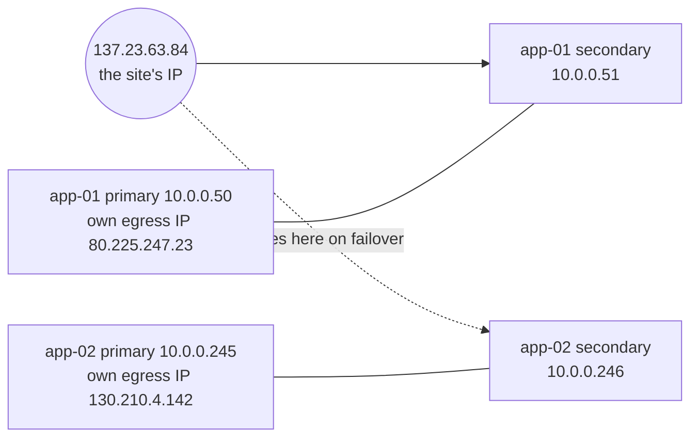
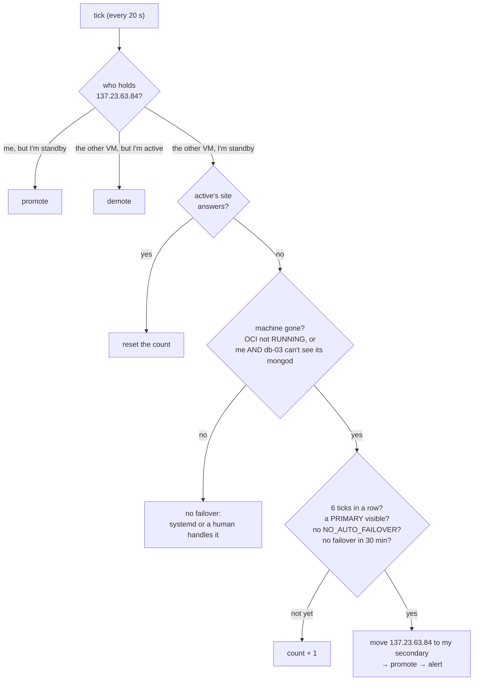

# Automatic failover of the web half (OCI)

Built and switched on **2026-10-30**. Before this, the database failed over by itself in about 10 s, but moving the site's IP and promoting app-02 needed a person. Now the standby does that too, when (and only when) the active **machine** is gone.

## The rule

**Whichever app VM holds the site's reserved IP (`pip-app-01`, 137.23.63.84) is the active.** Everything else follows from it.

- The site's IP sits on a **secondary** private IP (app-01 10.0.0.51, app-02 10.0.0.246), never on a VM's primary one.
- Each VM keeps **its own public IP on its primary address** for going out (app-01: ephemeral 80.225.247.23; app-02: the reserved `pip-app-02` 130.210.4.142).
- So moving the site's IP never cuts a VM off the internet. That is what lets a VM move the IP **itself**, and it removes the old "between `move` and `finish` the old active has no internet" trap. There is no `finish` step any more.
- `mallakhamb-service-ip.service` brings the secondary address up on the network interface at boot (Ubuntu only configures the primary by DHCP). It reads the list from the instance metadata service, so nothing is hard-coded.

## What runs

`mallakhamb-role` on **both app VMs**, every 20 s (`mallakhamb-role.timer`):

1. **Reconcile.** Holds the IP but is a standby → `mallakhamb-promote`. Active but the IP is on the other VM → `mallakhamb-demote`. A VM that comes back after a failover therefore steps aside by itself.
2. **Watch (standby only).** Takes the IP and promotes itself when **all** of these hold on **6 ticks in a row (~2 min)**:

| # | Condition | Why |
|---|---|---|
| a | The active's site doesn't answer `/api/health/ready` over the VCN | Something is wrong |
| b | The active **machine** is gone: OCI says it isn't `RUNNING`, **or** both this VM's mongod **and** db-03's see its replica-set member as unreachable | Two vantage points, the same majority MongoDB trusts. An API crash, a bad deploy or a certificate problem leaves the machine and its mongod up, so (b) fails |
| c | This VM's mongod sees a PRIMARY | Otherwise taking over couldn't serve anything |
| d | No `/etc/mallakhamb/NO_AUTO_FAILOVER`, and no automatic failover in the last 30 min | Maintenance switch; no flapping |

It **never fails back by itself.** Going back is a deliberate `sudo mallakhamb-role takeover` on the VM that should be active.

**Cost.** A steady tick takes ~0.1 s. OCI is asked at most every 60 s (each CLI call costs ~1 s of the single core), and at once when the active looks unwell or a command runs.

**Backups never run twice.** `mallakhamb-backup`, `-oplog-slice` and `-offsite-copy` first ask `mallakhamb-role is-active`, a fresh OCI answer. A VM that has just lost the IP skips. If OCI can't be asked, they fall back to the old STANDBY-marker rule.

## Commands

| Command | Where | What |
|---|---|---|
| `sudo mallakhamb-role status` | either app VM | One-line state: role, IP holder, mode, bad ticks, OCI reachable. Changes nothing |
| `sudo mallakhamb-role takeover` | the VM that should become active | **Planned switch / failback.** Moves the IP here and promotes now. The other VM demotes itself within a minute |
| `sudo touch /etc/mallakhamb/NO_AUTO_FAILOVER` | the standby | Pause automatic takeover (planned work on the active). `rm` it afterwards |
| `ROLE_MODE=observe` in `/etc/mallakhamb/role.env` | either | Decide and log only (`WOULD FAIL OVER`). `act` is the normal setting |
| `journalctl -u mallakhamb-role -n 30` | either | Every decision, with the reason (`site=… oci=… seen-by-me=… seen-by-db03=… primary=…`) |
| `bash ~/service-ip-setup.sh status` | Cloud Shell | Where every public IP sits |
| `bash deploy/oci/scripts/failover-ip.sh move <nn>` | Cloud Shell | Move the IP without a VM (the roles follow within a minute) |

## Permissions

Policy **`mallakhamb-prod-pol-failover`** (`deploy/oci/scripts/auto-failover-iam.sh`) for dynamic group `mallakhamb-prod-dg-app`, in compartment `mallakhamb-prod`: `read instances`, `inspect vnic-attachments`, `use private-ips`, `use public-ips`. Deleting the policy switches automatic failover off (the VMs then report `oci_ok 0` and change nothing). Trade-off: a compromised app VM could move the site's IP. It is the web server already, so it could take the site down anyway. It cannot create, delete or pay for anything.

## Alerts (Grafana, staging group `-stg`)

| Rule | Fires when |
|---|---|
| `mk-role-auto-failover` (critical) | An automatic takeover happened in the last hour |
| `mk-role-no-holder` (critical) | Neither VM holds the site's IP for 3 min |
| `mk-role-two-active` | Both VMs configured active for 5 min |
| `mk-role-judging` | The standby has started counting the active as gone (early warning) |
| `mk-role-stale` | `mallakhamb-role` hasn't run on a VM for 5 min |
| `mk-role-oci-blind` | A VM can't ask OCI for 15 min |
| `mk-role-observe` | A VM is left in observe mode for an hour |
| `mk-mongo-cert-expiry` | A MongoDB member certificate expires within 60 days (2028-10-22 today) |

## What it does not cover

- **The active's VM is up but its web stack is broken** (bad deploy, Caddy or certificate trouble, API crash loop). (b) fails on purpose, because the same release on the standby would fail the same way. systemd restarts the API, and a human rolls back.
- **db-03 and the active both gone.** The database has no majority, so nothing could be served anyway; (c) fails and it waits.
- **A hung active that OCI still reports RUNNING while db-03 is also down.** Only one vantage point is left, so it waits for a human.
- **The whole region or account.** The Atlas off-site copy is the way out.

## Set-up record (2026-10-30, UTC)

1. `service-ip-setup.sh secondaries`: 10.0.0.51 on app-01, 10.0.0.246 on app-02; `mallakhamb-service-ip` brought them up; Caddy on app-01 answered on 10.0.0.51 over the VCN.
2. `service-ip-setup.sh migrate` at 18:11:20: 137.23.63.84 moved from app-01's primary to its secondary. **One failed health check (1 s).** app-01's primary got the ephemeral egress IP 80.225.247.23.
3. `auto-failover-iam.sh`: policy ACTIVE.
4. `mallakhamb-role` in observe mode on both VMs, then `act`. The decision logic was first checked locally against 16 simulated situations (machine loss three ways, API crash, standby partitioned, observe, maintenance switch, cool-down, no primary, OCI down, IP on nobody, returning active, manual takeover, `is-active` in four cases).
