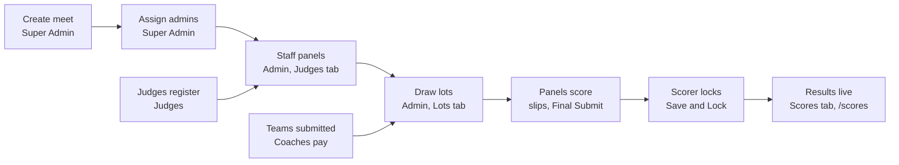

# Mallakhamb India — Admin & Super Admin Guide

Oct 12, 2026 · Atharva Angre

> Source: [Claude Doc](https://claude.ai/code/artifact/2a90cddf-9b5d-4619-924d-0cc9b9874e3f). This file is an export; edit the doc and re-export to keep them in step.

## Admin and Super Admin

The Super Admin owns the whole platform (competitions, admins, coaches, fees); an Admin runs the competitions they are assigned to.

Website: [mallakhamb-web.onrender.com](https://mallakhamb-web.onrender.com/). Every step below was walked on the live site (sign-in screens) and end to end on the same build running locally on 12 Oct 2026, from creating a competition to published results.

| Area | Admin | Super Admin |
| --- | --- | --- |
| Sign in | Home page → **Admin** → **Log in** (`/admin/login`) | Footer link **Super Admin** (`/superadmin/login`) |
| Competitions seen | Only those assigned to them | All |
| Create, edit, delete competitions; set fees and team size | No | Yes |
| Add, edit, delete admins; assign admins to competitions | No | Yes |
| Activate or deactivate coaches | No | Yes |
| Add a player to a team (with payment) | No | Yes |
| Teams, Judges, Lots, Scores, Transactions tabs | Yes, for their competition | Yes, any competition |
| Change a competition after its end date | No | Yes |

Dashboard tabs: Admin has **Dashboard, Teams, Lots, Scores, Judges, Transactions**; Super Admin has **Overview, Management, Teams, Lots, Scores, Judges, Transactions**. Each tab has its own address, for example `/admin/dashboard/judges`.

An admin self-registration page exists at `/admin/register` (full name, email, password of at least 12 characters with upper case, lower case and a number). It is not linked from the home page; the usual route is for the Super Admin to add admins under Management → Admins.

## Running a competition, in order

**Panels need registered judges; lots need submitted teams.**

Panels can be staffed only with judges who have registered, and lots cover only teams that have paid and submitted; results publish when each panel's Scorer locks the sheet.

## Sign in and choose the competition

An Admin picks a level and a competition after signing in; the Super Admin lands straight on the dashboard.

**Admin**

1. `/admin/login`: **Email**, **Password**, **Sign In** ("Login successful!").
2. **Choose your level**: the cards count only competitions assigned to you. Pick one and **Continue**.
3. **Choose your arena**: pick the competition. With only one at that level it opens directly.
4. The **Dashboard** tab shows the competition card (name, place, level, dates, status) and an Overview: Total teams, Total participants, Boys teams, Girls teams, Total boys, Total girls.

**Super Admin**

1. `/superadmin/login` (footer link **Super Admin** on the home page): **Email**, **Password**, **Sign In**.
2. **Overview** opens: Total admins, Total coaches, Total teams, Competitions.
3. **Competition stats – Participation breakdown**: choose **All Competitions** or one competition to see teams, participants, boys and girls teams, boys and girls totals, total and active competitions.
4. On the Teams, Lots, Scores, Judges and Transactions tabs the Super Admin first picks the **Competition** in each tab.

Both: **Forgot password?** sends a 6-digit code by email; **Appearance** switches Dark/Light; **Logout** is in the top bar.

## Super Admin: Management

**Management** has four sub-tabs: Competitions, Admins, Coaches and Add Player.

**Competitions**

The table lists Name, Types, Level, Place, Per player fee, Fee window (for example "Always open", or opening date, base-fee deadline and "+₹200/athlete" late fee), Dates, Status, Admins, and three actions: **Manage Admins**, **Edit**, **Delete**.

Create a competition:

1. Click **Create**. The **Create Competition** form opens.
2. Fill it in:

| Field | Required | Notes |
| --- | --- | --- |
| Competition name | Yes | |
| Level | | District, State, National, International, DSO, University. |
| Place | Yes | |
| Year | | Defaults to the current year. |
| Competition opening date | No | Coaches cannot pay before it. Must be before the start date. Blank = payment open at once. |
| Last date to pay fees | No | Last day the base fee alone is accepted. Must be before the start date. |
| Start date, End date | Yes | The competition locks after the end date. |
| Base fee (per player ₹) | Yes | |
| Late fee (per player ₹) | No | Only after a last date to pay is set. |
| Pole / Hanging / Rope fee (₹) | No | Added on top of the base fee, per player. |
| Max team size (per age group) | Yes | 4 players (best 3 count per apparatus) or 6 players (best 5 count). |
| Competition types & apparatus | Yes | Tick Competition I, II and/or III; under each, tick apparatus for Male and Female. Hanging is not offered to girls. |
| Description | No | |
| Age groups | Yes | Tick Male and/or Female per age group, or **Select All**. |
| Assign admins | Yes | Tick one or more admins; **Search admins** filters. |

3. Click **Create**. You see "Competition created" and the new row.

- **Edit** opens the same form; save shows "Competition updated".
- **Delete** asks for confirmation first; then "Competition deleted".
- **Manage Admins** shows Assigned admins (each with **Remove**) and Available admins (each with **Assign**): "Admin assigned" / "Admin removed".

**Admins**

- The table lists Name, Email, Role (Admin or Super Admin), Status, and **Edit** / **Delete** icons.
- **Add Admin** opens "Add New Admin": Name, Email, Password, Role (Admin or Super Admin). Click **Create**: "Admin created". A new admin sees no competition until you assign one under Manage Admins.
- **Edit** changes the details ("Admin updated"); **Delete** asks for confirmation ("Admin deleted").

**Coaches**

Every registered coach with Name, Email, Phone, Status, and **Deactivate** (or **Activate**). You see "Coach deactivated" / "Coach activated".

**Add Player** (the organiser's override for adding an athlete to a team)

1. Fill First name, Last name, Email, Date of birth, Gender, Age group (after gender), Competition, Team (after competition), Apparatus (after competition), Password and Confirm password.
2. Click **Add Player**. You see "Continue to secure payment to complete registration." and move to **Player registration payment**.
3. Pay through Razorpay. On success: "Payment successful! Player has been added to the team."

This path is never blocked by the fee window (a late fee still applies), and it respects the team-size limit. The coach discount code does not apply here.

## Super Admin: Players (team at each level)

A player's team is **final at each competition level**: one team for District, one for State, and so on. Coaches, the walk-in desk and admins can never move a player another team holds at a level. The **Players** tab is the one place a Super Admin corrects a mistake.

- **Find a player**: search by name, Player ID or email. You see the team at every level (how and when it was set), every squad entry, and entries that break the COP age rule (in red).
- **Correct** (or **Set team**): choose the team and give a reason. If the player is still entered for the current team in an open competition at that level, use **Remove from those squads** first (fees already paid are not refunded there).
- **Conflicts**: players found on two teams at one level when this rule was introduced. Choose **Keep with …** for each.
- **History**: every team set, correction, squad removal, conflict and walk-in "different child", filterable by level.

On screens narrower than 1440 px the Super Admin tabs are in the menu (☰).

## Finals tab (Competition II and III)

Finalists move from Competition I **automatically**, the moment the Senior Judge and Scorer save and lock Competition I. You never pick them.

- **Competition II (All Round Individual):** one final per gender with **all age groups together**: the **top 2 of each age group**, ranked on the sum of their Competition I scores on every apparatus.
- **Competition III (Apparatus Championship):** per age group and apparatus, the **top 10** on that apparatus, **at most 2 from one team**. A team's third player is passed over and the next player gets the place; the card says who was passed over.
- A final shows **Waiting for Competition I** (and which team has not locked yet) until it can be filled.
- **Tie for the last place:** for III, record the lucky draw on the Competition I standing in the Scores tab. For II, tap the tied players on the final's card in the drawn order.
- **Withdraw** a qualifier (before the final's first score): the next in rank takes the place and the coach is emailed. **Reinstate** undoes it.
- If a Competition I score is corrected after a final has started, the list stays as it is and the card warns you.
- Seat the panels in the **Judges** tab: Competition II uses the age group **All ages**; Competition III uses each age group. Draw the running order in the **Lots** tab once the final is filled.
- Meets scored before this feature keep their old Competition II/III entries.

## Teams tab

**Teams** lists every team entered in one gender and age group, with its athletes.

1. Super Admin: pick the **Competition** first. Then pick **Gender** and **Age group**; teams load automatically ("Showing Female — Above 16 (5 teams)").
2. Each card shows the team, coach name and email, number of players, and **View Details →**.
3. **Search teams by name or coach…** filters the cards; **Clear Filters** resets.
4. Click a card to open **Team Details**: coach, email, phone, players, registration date, description, status, and every athlete with gender, age group, date of birth, email, apparatus and Active status. **Close** returns.

## Judges tab: staff the panels

Judges register themselves; here you choose which registered judge sits in each seat, one panel per category and apparatus.

**Staff a panel (Add Judge)**

1. Super Admin: pick the **Competition**.
2. **Judge action**: **Add Judge**. Then **Gender**, **Age group**, **Competition type**, **Apparatus** ("One panel per apparatus — staff each separately.").
3. **Staff the panel** shows seven seats with the rule "Required: Senior Judge, Judge 1, Judge 2 & Scorer · Judge 3 & Judge 4 optional". Time Keeper is also marked required.
4. In each seat, type a name or email in **Search registered judges by name or email** and click the judge. The seat shows the name, email and **Change**.
5. Click **Save Judges**: "Judge panel saved! \<n> judges saved."

Rules: one person per evaluation seat on a panel; the Scorer and Time Keeper seats may be the same person. Filling Judge 3 makes a 4-judge panel, Judge 3 and 4 a 5-judge panel.

**Judge not found?** The box says "No registered judge matches that." and shows the judge registration link; click it to copy ("Registration link copied"), send it to the judge, and search again once they have signed up.

**Check or change a panel (Judge List)**

1. **Judge action**: **Judge List**, then the same four filters.
2. "Judge panel for: \<category>" lists seats 1–7 with name, seat, email and Assigned or Available ("Empty Slot").
3. **Replace** swaps the judge in a filled seat ("Judge replaced"); **Assign** fills an empty seat ("Judge assigned"); the red bin removes a judge from an optional seat ("Judge removed from the panel"). Required seats can be replaced but not emptied.

## Lots tab: draw lots and set the running order

A random draw decides who performs when in each category; you (or the panel's Senior Judge or Scorer) can then adjust it.

1. Super Admin: pick the **Competition**. Then **Gender**, **Age group**, **Competition** type (only the types that competition runs are offered).
2. The page shows "\<n> teams in running order" and "No lots drawn yet".
3. Click **Draw Lots**. The window explains it draws lot numbers for every submitted team in the category and for the athletes inside each team; click **Draw Lots** again to confirm.
4. You see "Lots drawn for \<n> teams" and a stamp such as "Lots drawn 10/12/2026, 8:58 PM by \<admin>". The button becomes **Redraw Lots** (for withdrawals).
5. Drag a team by its grip to change the order; the lot number stays with the team. The athlete icon beside a team opens **Athlete order**, which drags the same way.
6. **Save Order** saves. Every change is pushed live to the judges of that panel.

One running order serves all apparatus of a category.

## Scores tab: score sheets and rankings

**Scores & Rankings** has three views: **Add Score**, **Individual Rankings** and **Team Rankings**. All three need Competition (Super Admin), Gender, Age group, Competition type and Apparatus; results load once the apparatus is picked.

**Add Score (the admin's score sheet)**

1. Under "Add new score", click a team card.
2. **Admin Scoring** opens with a **Live** (or **Locked**) tag: category, team, coach, competition type, number of players, the **Judges panel** (names and emails), and the **Scoring system** notes (how execution is averaged, the base-score tolerance, and Final = average marks − time deduction − other deduction).
3. The **Player scoring** table matches the Scorer's sheet: **Time \***, a column per judge, Average, Time ded., Other ded., Final score, plus **Time Keeper \***, **Scorer \*** and **Remarks**. As judges submit, a notice such as "\<seat> scored \<score> for \<athlete>" appears.
4. To enter scores by hand (for example if a judge's device fails), fill the cells and click **Save & Lock Scores**, then confirm. The same checks apply as for the Scorer (a time for every athlete, both names).
5. Once the panel's Scorer has locked the sheet it opens as **Locked** and read-only. **Back to Scores** returns.

**Individual Rankings**

Every athlete in the category ranked across all teams: position, name, team, time, final score, and the score breakdown (Difficulty, Combination, Execution, Originality, any deduction) with how it was averaged.

**Team Rankings**

Teams ranked by total (gold, silver, bronze, then #4…), each with players scored, team total, average, and the **Counted scores**: the best 3 (team size 4) or best 5 (team size 6) athletes for that apparatus.

## Transactions tab

**Payment history** lists every payment for the competition (Super Admin picks the competition first).

| Column | Example |
| --- | --- |
| Date / Time | 10/12/2026, 8:53 PM |
| Type | Team Submission |
| Source | Coach |
| Competition | DEMO-GUIDE-2026 (2026) — Pune |
| Team, Coach | Demo Akhada, Demo Coach |
| Razorpay order ID, payment ID | "-" when a discount code made the entry free |
| Players | **2 Players**: click to open **Team Players**, the list of athletes paid for |
| Amount | ₹0 with a 100% discount code |
| Status | completed |

## Competition lock, messages, tips and demo-video shots

**Competition lock.** At 23:59 UTC on a competition's end date it becomes read-only for admins, judges, coaches and players, and shows LOCKED. Only the Super Admin can still change it. Moving the end date later (Management → Edit) reopens it.

**Common messages**

| Message | Meaning / what to do |
| --- | --- |
| Level cards show 0 competitions (Admin) | You are not assigned to a competition yet; ask the Super Admin. |
| No registered judge matches that. | The judge has not registered; copy the link shown and send it. |
| No lots drawn yet | Draw lots before judging starts. |
| Cannot save — this entry is already locked | The Scorer (or an admin) has locked that sheet. |
| This competition has closed. Scores can no longer be changed. | The end date has passed. |

**Meet-day checklist**

- [ ] Competition created with dates, fees, team size, types, apparatus, age groups and admins (Super Admin).
- [ ] Every judge registered and every panel staffed, including Scorer and Time Keeper.
- [ ] All teams submitted (check **Transactions** and **Teams**).
- [ ] Lots drawn for every category.
- [ ] Public **Live scores** open on a screen at the venue.

**Demo-video shot list (about 4 minutes)**

1. Super Admin sign-in → Overview.
2. Management → **Create** a competition (fees, team size, apparatus per gender, age groups, admin) → **Manage Admins**.
3. Management → Admins → **Add Admin**; Coaches → Deactivate/Activate.
4. Admin sign-in → level → competition → Dashboard overview.
5. Judges → **Add Judge** → search and seat seven seats → **Save Judges** → **Judge List**.
6. Lots → **Draw Lots** → drag a team.
7. Scores → open a team's sheet while judges score, then Individual and Team Rankings.
8. Transactions → open **Players** on a payment.
