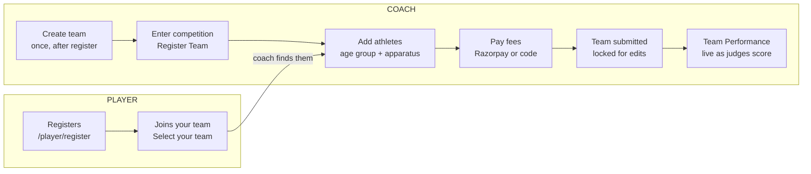

# Mallakhamb India — Coach Guide

Oct 12, 2026 · Atharva Angre

> Source: [Claude Doc](https://claude.ai/code/artifact/187a1684-fe03-4261-be8d-c2f0b07845fa). This file is an export; edit the doc and re-export to keep them in step.

## What a coach does on the site

A coach builds one team, enters it in a competition, places each athlete in an age group and on their apparatus, pays the entry fee, and then follows the team's scores live.

Website: [mallakhamb-web.onrender.com](https://mallakhamb-web.onrender.com/). Every step below was walked on the live site (sign-in and registration screens) and end to end on the same build running locally on 12 Oct 2026, from a new coach account to a submitted, scored team.

The coach journey, in order:

1. Register as a coach (once).
2. Create your team (once).
3. Choose a level and a competition, and register the team in it.
4. Ask your athletes to register as players and join your team.
5. Add each athlete to an age group with their apparatus.
6. Review the Team Summary, pay the fees (or apply a discount code) and submit.
7. After submission the team is locked; watch Team Performance as judges score.

| Screen | Address |
| --- | --- |
| Register | /coach/register |
| Sign in | /coach/login |
| Create team | /coach/create-team |
| Choose level | /coach/select-level |
| Choose competition | /coach/select-competition |
| Team dashboard | /coach/dashboard |
| Team payment | /coach/payment |

## How player and coach steps fit together

**A team is entered only after its athletes join it.**

The coach can only add athletes who have registered and joined the team; payment then locks the squad.

## Register and sign in

One form creates the coach account and signs you in.

**Register** (home page → **Coach** → **Register**, or `/coach/register`)

| Field | Required | Notes |
| --- | --- | --- |
| First name, Last name | Yes | |
| Email address | Yes | Your login. |
| Phone number | Yes | |
| Password | Yes | At least 8 characters, with uppercase, lowercase and a number. |
| Confirm password | Yes | Must match. |

Click **Create Account**. You see "Registration successful!" and go straight to **Create your team**.

**Sign in** (home page → **Coach** → **Log in**, or `/coach/login`)

1. Enter **Email** and **Password**, then **Sign In**. You see "Welcome back, Coach!".
2. Choose your level, then the competition. If your team is already entered in the only competition at that level, you go straight to the dashboard.

**Forgot password?** on the sign-in page sends a 6-digit code to your email: enter it on **Reset Password**, click **Verify**, then set the new password. Repeated wrong passwords lock the account for a short time (15 minutes by default).

## Create your team

A coach has one team; you name it once, right after registering.

1. The page shows three steps across the top: 01 Register, 02 Create team, 03 Select competition.
2. Enter **Team name** (required) and, if you like, **Team description**.
3. Click **Create Team**. You see "Team created successfully! Now register it for a competition." and move to **Choose your level**.

You do not choose a team size. Each competition sets it (4 or 6 athletes per age group) and shows it on your dashboard.

## Choose level and competition, and register the team

Picking a competition you are not yet in registers your team for it.

1. **Choose your level**: click District, State, National, International, DSO or University (each card shows its number of competitions), then **Continue**.
2. **Choose your arena**: click the competition (name, year, place, dates, level, status).
3. Click **Register Team & Continue**. You see "Team registered for competition successfully!" and land on the team dashboard.
4. **· change** next to the level name goes back to the level cards.

Next time you sign in, a competition your team is already in opens directly. To enter another competition later, use the **Competition** switcher in the top bar, or sign in again and pick a different level.

## Team dashboard: build the squad

The dashboard (`/coach/dashboard`) is where you place every athlete in an age group and on their apparatus before paying.

**What is on the page**

| Area | Contents |
| --- | --- |
| Top bar | COACH tag, your name, **Competition** switcher, Appearance (Dark/Light), **Logout**. |
| Competition card | Name, year, place, level, dates, status (UPCOMING, or LOCKED after the end date). |
| Team Dashboard | Team name, the size rule (for example "Max 4 players per age group (best 3 count)"), description, and the buttons **Save Team**, **Add Player**, **Pay Fees**. |
| Totals | Total players, Age groups used. |
| Boys / Girls age groups | One card per age group the competition runs, with a counter (for example "1 / 4") and the athletes in it, each with their apparatus. |
| Team Performance | Live scores for your team (see After submission). |

**Before you add anyone:** each athlete must register as a player, sign in, and join your team (Player guide). Only athletes who joined your team appear in your search.

**Add a player to an age group**

1. Click **Add Player**. The "Add Player to Age Group" window opens.
2. Type a name or email in **Search Players**. Matching athletes show with email, gender and age.
3. Click the athlete. Gender is filled in automatically from their registration.
4. Pick an **Age group**. Only groups the athlete is eligible for by age are listed.
5. Tick every **Apparatus** they will perform (Pole, Hanging, Rope; only those the competition offers for that gender). Each apparatus is judged and ranked separately.
6. Click **Add Player**. You see "Player added to age group successfully!" and the athlete appears in the age-group card, for example "Arjun Demo (Pole Mallakhamb)".

**Change the squad**

- **Move**: drag an athlete's card onto another age-group card of the same gender. The site checks gender and age and shows "\<name> moved to \<age group>!".
- **Remove**: click the remove (×) button on the athlete's card. You see "Player removed successfully!".
- **Save Team**: saves the roster so it is the same on any device. You see "Team draft saved to database! Roster will persist across devices and sessions."

**Limits the site enforces**

- An age group cannot hold more than the competition's team size (4 or 6).
- An athlete too old for an age group cannot be placed in it.
- Girls are not offered Hanging Mallakhamb.

## Scan a paper form (many players at once)

On the team dashboard, **Scan Paper Form** registers a whole filled form in one go, for the competition chosen in the menu bar. It is open until your squad is submitted.

1. **Print blank form** and fill it in English CAPITALS, one box per digit for the date of birth.
2. **Start a form**, then **Take photo** (or **Choose photo**) for each page: flat, well lit, all four corner squares in view. Without the form reader you can **Add a player** by hand.
3. Check every player. The age is the age on 31 December of the competition's year; the age group list starts at the player's own group and you may choose a higher one. Rows in red must be fixed.
4. **Register**: each player gets a Player ID on your team and a place in your squad. The slip lists the Player IDs; players sign in with them and your default player password.
5. Pay as usual with **Pay Fees** on the dashboard.

A player's team is final at each level (District, State, National, …). If a child on your form is already registered with another team at this competition's level, the row says so and cannot be registered — if it is a different child with the same name and date of birth, ask the competition admin.

## Finals (Competition II and III)

You only enter players for **Competition I**. Players move into the finals automatically from Competition I's results, and you are emailed when yours qualify:

- **Competition II (All Round):** the top 2 of each age group (sum of every apparatus), one final for all ages.
- **Competition III (Apparatus):** the top 10 per apparatus in each age group, at most 2 from one team.

Your qualifiers are listed under **Finals: your qualifiers** on the team dashboard. There is no extra fee for the finals.

## Pay fees and submit the team

Paying (or applying a valid discount code) is what submits the team; after that the squad is locked.

**Review**

1. On the dashboard click **Pay Fees**. With no athletes you see "Please add at least one player before submitting."
2. **Team Summary** lists the team, total players, and every boys and girls age group with its athletes and apparatus. Click **Proceed to Payment** (or **Cancel**).
3. **Submit Team for Competition?** warns that after payment the team is locked and players cannot be added or removed without the admin. Click **I Understand, Proceed to Payment**.

**Team Payment page** (`/coach/payment`)

- Left: Team summary (team, total players, age-group distribution such as "Male Above18 – 2 players").
- Right: Payment details, one line per athlete with their fee (base fee per player plus any apparatus add-on), and **Total amount**.

**Pay online**

1. Click **Pay ₹\<total>**. The secure Razorpay checkout opens.
2. Complete the payment. You see "Payment successful! Team submitted for competition."
3. Closing the checkout shows "Payment cancelled. Please try again when ready." Nothing is charged and the team stays editable.
4. If the checkout will not load, turn off ad-blockers or privacy extensions, or try another network.

**Pay with a discount code**

1. Type the code in **Discount code** and click **Apply**.
2. A valid code shows "Discount code applied — 100% off", a minus line for the discount, total ₹0 and "Nothing to pay for this entry". **Remove** takes the code off.
3. Click **Submit Team — No Payment Due**. You see "Discount applied. Team submitted for the competition."
4. A wrong code shows "That discount code is not valid". Codes come from the organisers.

**Fee window (set by the organisers per competition)**

| Situation | What you see |
| --- | --- |
| Before the opening date | "Registration has not opened yet", with the date to come back. |
| Before the last date to pay | The base fee; a note "Pay by \<date> to avoid a late fee" when a late fee exists. |
| After the last date to pay | "Late fee applies": the late fee is added per athlete. |
| After the competition's end date | "Registration is closed". |

## After submission

Once submitted, the squad is read-only for you and the dashboard turns into a live results board for your team.

**What changes**

- **Pay Fees** becomes **Team Submitted**; clicking it shows "Team already submitted. Contact admin to make changes."
- **Save Team**, **Add Player** and every remove button are greyed out.
- A notice reads "Team has been submitted. Contact Admin to make changes."
- Opening the payment page shows "Team already submitted" with **Back to Dashboard**.
- Changes after submission are made by the organisers (Super Admin), not the coach.

**Team Performance**

1. The section is headed "Live scores · updates as judges submit".
2. Click a competition type tab (for example **Competition I – Team Championship & Qualifier**).
3. For each apparatus you see how many athletes are finalised ("2 / 2 finalized") and your athletes ranked with their scores.
4. Click an athlete to see their score breakdown. Before any results: "No finalized scores for this competition yet." A score appears once the panel has finalised it and the Scorer has locked the sheet.

**After the competition ends**

After 23:59 UTC on the competition's end date it is marked LOCKED: nothing in it can be changed, but scores stay visible.

**Other competitions**

Use the **Competition** switcher in the top bar, or sign in again and choose another level, then **Register Team & Continue** on the new competition. Each competition keeps its own squad and payment.

## Messages, tips and demo-video shots

**Common messages**

| Message | Meaning / what to do |
| --- | --- |
| Search shows nobody | The athlete has not registered or has not joined your team yet. |
| This competition allows at most N players per age group — \<group> is full | Remove someone or use another eligible age group. |
| Player is N years old and cannot play in \<group> | Pick an age group the athlete is eligible for. |
| Cannot move \<name> (\<gender>) to \<gender> category | Athletes move only between age groups of their own gender. |
| Please add at least one player before submitting. | Add athletes before **Pay Fees**. |
| That discount code is not valid | Check the code with the organisers. |
| Team already submitted. Contact admin to make changes. | The team is locked after payment. |

**Tips**

- Send athletes the player registration link and your exact team name before entry day.
- Press **Save Team** after building the squad so it is the same on every device.
- Use one browser profile per person; two accounts in one browser sign each other out.

**Demo-video shot list (about 3 minutes)**

1. Coach registration → Create your team.
2. Choose level → competition → **Register Team & Continue**.
3. Dashboard tour: size rule, boys and girls age-group cards.
4. **Add Player**: search, eligible age group, apparatus ticks, **Add Player**; then drag one athlete to another age group.
5. **Save Team**.
6. **Pay Fees** → Team Summary → warning → payment page; show the per-athlete fee lines, then either Razorpay or the discount code and **Submit Team — No Payment Due**.
7. Back on the dashboard: Team Submitted, greyed buttons, and Team Performance filling in as judges score.
