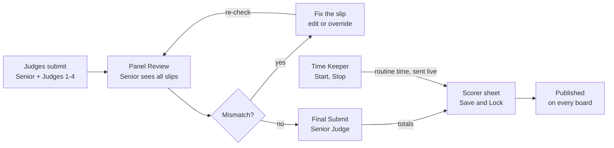

# Mallakhamb India — Judge Guide

Oct 12, 2026 · Atharva Angre

> Source: [Claude Doc](https://claude.ai/code/artifact/5c37d121-4277-4d68-af00-4278d70235a1). This file is an export; edit the doc and re-export to keep them in step.

## Panel seats and who does what

Each panel judges one category (gender, age group, competition type and apparatus); your seat decides which screens you get.

Website: [mallakhamb-web.onrender.com](https://mallakhamb-web.onrender.com/). Every step below was walked on the live site (sign-in and registration screens) and end to end on the same build running locally on 12 Oct 2026, with a full 3-judge panel, a Scorer and a Time Keeper scoring two athletes through to the public board.

| Seat | Required | What you do on the site |
| --- | --- | --- |
| 1 Senior Judge (Chief) | Yes | Fills a slip, sees every judge's slip, fixes mismatches, presses **Final Submit**, can set the running order. |
| 2 Judge 1 | Yes | Fills a slip for each athlete. |
| 3 Judge 2 | Yes | Fills a slip for each athlete. |
| 4 Judge 3 | No | Fills a slip (4- and 5-judge panels). |
| 5 Judge 4 | No | Fills a slip (5-judge panels). |
| 6 Scorer | Yes | Keeps the score sheet: times, deductions, **Save & Lock Scores**; can set the running order. |
| 7 Time Keeper | Yes | Times each routine on the stopwatch and sends the time to the Scorer. |

- Judges create their own account; an organiser (Admin) then seats them on panels. You cannot seat yourself.
- One person can hold different seats in different categories, for example Senior Judge in one age group and Judge 2 in another.
- The Scorer and Time Keeper seats may be the same person; then the dashboard asks which role you are working in.
- A routine runs 60 to 90 seconds and every slip is out of 10.00.

## How a score travels

**A score goes public only after Final Submit and the Scorer lock.**

Judges' slips meet on Panel Review; the Senior Judge's Final Submit sends the totals to the Scorer, who adds the Time Keeper's time and locks the sheet, which publishes the result to the coach, the player and live scores.

## Register, profile and sign in

Register once with your email; an organiser then adds you to a panel.

**Register** (home page → **Judge** → **Register**, or `/judge/register`). The page says "An organiser will add you to a competition panel."

| Field | Required | Notes |
| --- | --- | --- |
| First name, Last name | Yes | |
| Email address | Yes | Your login. Organisers search for you by name or email. |
| Phone number | Yes | |
| State / Unit | No | |
| MFI Reg. No. | No | |
| Certification level | No | National, State, District or Club. |
| Password, Confirm password | Yes | At least 8 characters, with uppercase, lowercase and a number. |

Click **Create Account**. You land on the judge dashboard; until you are seated it has nothing to judge.

**Sign in** (`/judge/login`): **Email**, **Password**, **Sign In**. You see "Welcome \<name>! Assigned to \<competition>". **Forgot password?** works as for every role: a 6-digit code by email, **Verify**, then a new password.

**Your profile** (the **Profile** button in the dashboard header, `/judge/profile`)

- **Change photo**: upload a picture.
- Account: first name, last name, email, phone, State / Unit, MFI Reg. No., Certification level, then **Save changes**. These are the details organisers see when staffing a panel.
- Password: current password, new password, confirm, then **Change password**. Your current password is always required.
- **Dashboard** returns to the dashboard.

## Choose your category and use the dashboard

After sign-in you pick a level and a judging category; the dashboard then lists the teams in running order.

**1. Choose your level.** Click the level of the meet you are judging (District, State, National, International, DSO, University), then **Continue**.

**2. Select Judging Category** (a window over the dashboard)

1. **Competition**: click the meet you are judging today (every meet where you hold a seat is listed).
2. **Assigned gender** and **Assigned age group** fill in from your seat.
3. Pick the **Competition type** (for example Competition I, Team) and the **Apparatus** (for example Pole Mallakhamb).
4. Click **Continue to Dashboard**.

Scorer and Time Keeper held by the same person: a second window, **Select Your Role**, asks Scorer or Time Keeper. **Change Role** on the dashboard switches later.

**3. The dashboard** (`/judge/dashboard`)

| Item | What it is |
| --- | --- |
| Header | Your name and seat (for example Senior Judge), **Profile**, Appearance, **Logout**. |
| Set Sequence | Senior Judge and Scorer only: opens the running order. |
| Change Category | Re-opens the category window (another meet, type or apparatus). |
| Current assignment | Meet, gender, age group, competition, apparatus. |
| Team list | In running order: position, LOT number, team, coach, progress ("1 of 2 scored"), number of players. **Search teams** filters it. |

**4. Open a team.** Click a team row.

- Senior Judge and Judges 1–4 see the team page: athletes in running order with position, LOT, name, category, apparatus and a status: no tag (not started), PARTIAL SCORE SUBMITTED, or FINALIZED with the final score. Click an athlete to open the slip.
- The Scorer goes straight to the team's score sheet; the Time Keeper to the stopwatch.
- The running order updates live if the Senior Judge, Scorer or Admin changes it.

## Running order (Senior Judge and Scorer)

The Admin draws lots; the Senior Judge or the Scorer can then change who performs when, and every judge on the panel sees the new order at once.

1. On the dashboard click **Set Sequence** (`/judge/sequence`).
2. The page shows the category and "Lots drawn \<date, time> by \<admin>".
3. Drag a team by its grip (**Drag to reorder**); the order saves as soon as you drop it. The big number is the running position; the lot the team drew stays with it.
4. **Show athletes** on a team opens its athlete order; drag athletes the same way.
5. **Save Order** saves the team order again. Each save shows "Team order saved — judges updated" (or "Athlete order saved — judges updated"); the other judges see "Running order updated by \<name>".
6. **Back to dashboard** returns.

Any other seat that opens this page sees "Only the Senior Judge or Scorer can set the running order".

## Filling in a score slip (Senior Judge and Judges 1–4)

Each slip has four parts that add up to 10.00; the **Final Score** at the top updates as you mark.

| Part | Maximum | How you mark it |
| --- | --- | --- |
| Difficulty | 3.80 | For classes A (0.20 each), B (0.40) and C (0.60), tap how many elements were performed (1 to 10) or use − / +. Each row shows the sum, for example "3 × 0.60 = 1.80". |
| Combination | 1.60 | A checklist of the apparatus's requirements in the Code's own words (10 for Pole). Tick each one met, or **Select all**; the counter shows "10 / 10". |
| Execution | 4.40 | Type the mark in the number box, in steps of 0.10. |
| Originality | 0.20 | Choose **None** or **+0.20**. |

**Steps**

1. From the team page, click the athlete. The header shows the athlete, team and a **LIVE** tag.
2. Mark Difficulty, Combination, Execution and Originality. **Score Summary** lists all four against their maximums.
3. **COP Rules** opens the Code of Points reference at any time.
4. Click **Submit Score**. You see "Score \<total> submitted for \<athlete>" and move to **Panel Review**.

On a phone the slip is split into three tabs, **Difficulty**, **Combination** and **Exec & Orig**, under a pinned Live Final Score.

Example from the walk-through: A 4, B 3, C 3 (3.80) + all combination requirements (1.60) + execution 3.60 + originality none = 9.00.

## Panel Review and Final Submit

After submitting, every judge waits on Panel Review; the Senior Judge sees all slips, settles any mismatch and locks the athlete's score with **Final Submit**.

**What every judge sees** (`/judge/scoring/panel-review`)

- Progress, for example "2 / 3 judges submitted · 3-judge panel".
- Your own slip: total, Difficulty (A, B, C counts and sum), Combination ("All requirements met" or what is missing), Execution, Originality.
- Judges 1–4 see only their own slip: "Scores are visible to the Senior Judge only", then "Waiting for Senior Judge to Final Submit and lock scores".
- **Edit My Score** reopens your slip to correct it before the score is locked.
- **Return to Team** goes back to the athlete list.

**Mismatch check**

If judges' Difficulty (by value) or Combination differ, a banner reads "Difficulty mismatch detected – View Details". The Senior Judge gets a **Score Mismatch Detected** window listing each judge's value with the odd one marked, and **Understood — Call Judges**.

**Senior Judge only**

1. Read every judge's slip side by side.
2. Settle a mismatch either way:
    - call the judge over to fix it with **Edit My Score** on their screen, or
    - click **Edit Judge N score**, correct their slip in the **Edit Score — Judge N / Senior Judge override** window, and click **Save Override**. You see "Score updated for Judge N: \<total>".
3. While a mismatch remains, the button reads "Final Submit is locked — resolve the Difficulty / Combination mismatch". Before everyone submits: "Final Submit unlocks when all 3 judges have submitted".
4. Click **Final Submit**. You see "Panel score finalized and locked" and "Final score \<score> locked for \<athlete>"; the page shows **Finalized**.

After Final Submit the athlete shows FINALIZED with the final score on every judge's team page, and the judges' totals appear on the Scorer's sheet. The result goes public (coach, player and live scores) when the Scorer presses **Save & Lock Scores**.

**How the panel score is worked out**

| Panel | Public breakdown averaged from |
| --- | --- |
| 3 judges | All 3 slips. |
| 4 or 5 judges | The middle two of Judges 1–4 (Senior Judge excluded, highest and lowest dropped). |

## Time Keeper: the stopwatch

The Time Keeper times each routine on an on-screen stopwatch, and stopping it sends the time straight to the Scorer's sheet.

1. On the dashboard click the team. The **Timing session** page opens: category, team, competition type, apparatus, the athlete being timed, and the list of **Athletes** in running order.
2. Click an athlete in the list (or use **Next** after each one).
3. Click **Start** on the whistle. The watch counts whole seconds; the small dial turns amber in the 60–90 s window and red past 90 s. The phone or laptop beeps once at 60 s and twice at 90 s.
4. **Pause** holds the watch; **Stop** ends the routine.
5. On Stop you see "Sent to the Scorer" and any time deduction, for example "Deduction 0.50 · 56 s short". The athlete list shows the time beside the name.
6. **Reset** clears the watch; **Next** moves to the next athlete; **Back to Dashboard** returns.

If the connection drops you see "Not connected — the time is kept here. Send it again once Live." Use the send-again button when the **LIVE** tag returns.

**Time deductions (applied on the Scorer's sheet)**

| Time outside 60–90 s | Deduction |
| --- | --- |
| 1–3 s short or over | 0.20 |
| 4–5 s | 0.30 |
| 6–9 s | 0.40 |
| 10 s or more | 0.50 |
| Within 60–90 s | none |

## Scorer: the score sheet

The Scorer keeps one sheet per team and apparatus, checks it, and locks it; locking is what publishes the results.

1. On the dashboard click the team. **Scorer Scoring** opens with a **LIVE** tag, **Set Sequence**, and the session details (category, team, coach, competition type, apparatus, number of players).
2. The **Player scoring** table has a row per athlete: **Time \***, one column per judge (named), **Average**, **Time ded.**, **Other ded.** and **Final score**.
3. Judges' totals fill in by themselves as each athlete is finalised. Times arrive from the Time Keeper with "Time \<n> s recorded for \<athlete>", and the time deduction follows the table above.
4. Type or correct a **Time** when needed; the time deduction recalculates. Add an **Other ded.** for any other penalty.
5. **Time Keeper** and **Scorer** names are filled in from the panel; add **Remarks** if needed.
6. Click **Save & Lock Scores**. The **Lock & Submit Scores** window warns that locked scores cannot be changed. Click **Lock & Submit**.
7. The page shows **LOCKED**, "Scoring session is locked" and "Scores saved and locked. Cannot be modified." The results now show for the coach, the players and on public live scores.

**The sheet refuses to lock when**

- a time is missing: "Time is required for all players. Missing for: \<names>";
- the Time Keeper or Scorer name is empty;
- nothing has been scored yet;
- the competition has ended: "This competition has closed. Scores can no longer be changed."

Tip: check that every Time is still filled in just before **Save & Lock Scores**. In the walk-through a time typed by hand was cleared when the next judge's score arrived, and had to be entered again.

## Messages, tips and demo-video shots

**Common messages**

| Message | Meaning / what to do |
| --- | --- |
| Dashboard shows no teams | You are not seated yet for that category, or no team has submitted. Ask the organiser. |
| Team not found or has not been submitted by coach yet | The coach has not paid and submitted the team. |
| Scores locked for \<athlete> (\<score>) | That athlete is finalised; the slip cannot be reopened. |
| Final Submit is locked — resolve the Difficulty / Combination mismatch | Senior Judge: call the judges or use **Edit Judge N score**. |
| This page is only accessible to Scorers / only for the Time Keeper of this category | You opened a screen for another seat. |
| This tab is signed in as a different user than the browser session | Two judges used one browser. Use one browser profile or device per judge. |

**Tips for competition day**

- One device per judge, each signed in to its own account, with the correct category chosen.
- Check the **LIVE** tag before the first athlete; it means the slip is connected to the panel.
- Senior Judge: settle mismatches before **Final Submit**; once locked, a slip cannot be changed.
- After the competition's end date everything is read-only.

**Demo-video shot list (about 4 minutes)**

1. Judge registration (State / Unit, MFI Reg. No., Certification level), then Profile.
2. Sign in → level → **Select Judging Category** → dashboard with teams in running order.
3. Senior Judge: **Set Sequence**, drag a team, then back.
4. Time Keeper (second screen): pick the athlete, **Start**, **Stop**, "Sent to the Scorer".
5. Judge 1 on a phone: the three slip tabs, **Submit Score**, Panel Review waiting.
6. Senior Judge: slip, then Panel Review with a Difficulty mismatch, **Edit Judge 2 score** → **Save Override** → **Final Submit**.
7. Scorer: the sheet filling in live, a time arriving, **Save & Lock Scores** → **Lock & Submit**.
8. Public **Live scores**: the athlete ranked with the score breakdown.
