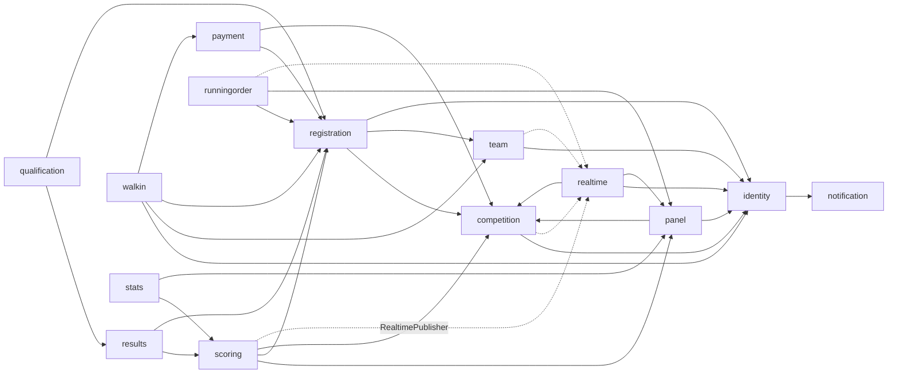

# 02 — Target architecture

## 1. Style

**One Spring Boot application: a modular monolith.** Each module is a
package-by-feature slice with a small public API. Inside a module the layers
are kept apart: **web → application → domain ← infrastructure**. No
microservices, no message broker, no Redis (ADR-001, ADR-006).

Why one process: today's backend is one process, production runs **one active
instance** (app-01, with app-02 as warm standby taking over through
`mallakhamb-role`), and the busiest path (a judge saving a slip, then a socket
broadcast to the panel) touches scoring, panel, competition and realtime in a
single request. Splitting these up would add network hops and partial failures
in exactly the place that has to be dependable on meet day.

```mermaid
flowchart TB
  subgraph Presentation
    REST[REST controllers<br/>/api and /api/v1]
    SIO[Socket.IO event handlers]
    WH[Razorpay webhook]
    SCH[@Scheduled jobs]
  end
  subgraph Application
    UC[Use-case services per module]
  end
  subgraph Domain
    ENG[Pure engines:<br/>Scoring, Ranking+TieBreak,<br/>Fees, Panel, Eligibility, RunningOrder]
    MOD[Domain types + invariants<br/>Competition entry, ScoreSheet, Seat]
  end
  subgraph Infrastructure
    MDB[MongoTemplate adapters]
    RT[netty-socketio adapter]
    EXT[Razorpay, Gmail/SMTP/Resend,<br/>OCR sidecar, PDF/QR]
  end
  REST --> UC
  SIO --> UC
  WH --> UC
  SCH --> UC
  UC --> ENG
  UC --> MOD
  UC -->|ports| MDB
  UC -->|RealtimePublisher| RT
  UC -->|ports| EXT
```

Layer rules (enforced by ArchUnit, 04 §6):

- `kernel`, `engines` and every `domain` package import nothing from Spring, Mongo, Jackson databind or Netty. Engines are pure functions over kernel types.
- **Every shared concept has one definition** (an enum, id, value object or catalogue entry in `kernel`/`platform`), and nothing else spells it out: see [08-SINGLE-SOURCE-DESIGN.md](08-SINGLE-SOURCE-DESIGN.md).
- `application` depends on `domain` and on **ports** (interfaces it owns). It never imports `MongoTemplate` or netty-socketio.
- `infrastructure` implements the ports. `web` calls only `application`.
- A module reaches another module **only through that module's `api` package**. Nothing reaches into another module's `internal`.
- No cycles between modules.

**Pragmatism rule:** a port interface is created only where there is a real
second implementation or a test seam that matters: Mongo access for the two
hard aggregates, realtime, email, payment gateway, OCR, clock. Simple CRUD
modules use a Spring Data repository straight from the application service.
A one-implementation interface for its own sake is not added (YAGNI).

## 2. Modules

Assignments of the 220 operations: [API-MATRIX.md](API-MATRIX.md).

| Module | Owns | Collections | Depends on (api only) |
|---|---|---|---|
| `platform` | health, CSRF token, metrics endpoint, error envelope, correlation, config | `migrations` | — |
| `identity` | 5 account types, login/lockout, JWT, refresh rotation, revocation, OTP and reset, email change, account requests, Player ID, coach default passwords, creating player accounts for other modules | `admins`, `coaches`, `players`, `judges` (accounts), `refreshtokens`, `sessionrevocations`, `accountrequests` | `notification` only. Where it needs competition or seat facts (set-competition, a judge's seats in the principal) it **declares ports** (`CompetitionAccessPolicy`, `PrincipalEnricher`) that `competition` and `panel` implement |
| `competition` | meets, levels, status lifecycle and midnight sweep, end-date lock, category start/end, admin assignment, scope rules, dashboards, "competitions I may act in"; implements `CompetitionAccessPolicy` | `competitions` (except `registeredTeams`) | `identity` |
| `registration` | entries (`registeredTeams[]`), **squads and entry rosters** (add/remove/search athletes, coach-registered no-email players through `identity.api`), submit, "which teams are in this category" (`getSubmittedTeams`), entry-gender-wins, age rule, team-per-level | `competitions.registeredTeams`, `playerteamconflicts` | `competition`, `team`, `identity`, `eligibility` engine |
| `team` | teams only: create, rename, level, coach, delete | `teams` | `identity` |
| `payment` | fee engine, Razorpay orders and verify, webhook, discount code, transactions, one `paymentStatus` writer | `transactions` | `registration`, `competition` |
| `panel` | judge seats, panel composition and readiness, role resolution per seat/category/apparatus, panel plan; implements `PrincipalEnricher` (loads a judge's seats into the principal) | `judgeassignments` | `identity`, `competition` |
| `scoring` | score sheets, slip merge with `__v` guard, locks and unlocks, Scorer and Time Keeper rules, recalculation, superadmin score corrections | `scores` | `panel`, `registration`, `competition`, `realtime` |
| `results` | rankings, tie-break and recorded draws, team championship, published breakdown, public boards, COP rules endpoint | `tiebreakdraws` | `scoring`, `registration` |
| `qualification` | Comp I → II/III finals, Finalize gate | `qualifications` | `results`, `registration` |
| `runningorder` | lot draw, sequencing, roster order | `performanceorders` | `registration`, `panel`, `realtime` |
| `walkin` | paper form PDF, OCR, review, create coach + team + players + pay | `walkinregistrations` | `identity`, `team`, `registration`, `payment` |
| `stats` | profile stats, fairness board | read-only | `scoring`, `panel` |
| `notification` | email providers and templates | — | — |
| `audit` | audit log writes and reads | `auditlogs` | — |
| `realtime` | Socket.IO server, handshake auth, rooms, handlers, `RealtimePublisher` | — | `identity` (token verify), `panel` (seat → rooms), `competition` (lock check) |

The superadmin correction tools (51 routes) are **not** a module. Each
correction is a use case in the module that owns the data (score corrections
in `scoring`, entry corrections in `registration`, and so on). The
`/api/superadmin/...` controllers are thin and call those modules' APIs. This
replaces the 1,286-line `super-admin.service` and keeps every rule in one
place.



`realtime` → `panel`/`competition` and `scoring` → `realtime` would be a cycle
if both pointed at implementations. They don't: `RealtimePublisher` is an
interface in `realtime.api`, and the dependency is only on that interface.
ArchUnit checks that the implementation package is never imported. The same
pattern removes the other two would-be cycles: `identity` owns the
`CompetitionAccessPolicy` and `PrincipalEnricher` interfaces, and
`competition`/`panel` implement them, so `identity` never imports them.

## 3. Package structure

```text
backend/                                   # new top-level dir next to Server/ and Web/
├── settings.gradle                        # includes :kernel, :engines, :app, :tools; build-logic as an included build
├── gradle/libs.versions.toml              # THE version catalog: every dependency version, once (G3)
├── gradle/wrapper/                        # Gradle 9 wrapper, distributionSha256Sum pinned
├── gradle/verification-metadata.xml       # dependency checksums
├── build-logic/                           # Groovy precompiled convention plugin (src/main/groovy/mallakhamb.java-conventions.gradle): toolchain 25, Error Prone + NullAway, Spotless, tests
├── compose.yaml                           # local: mongo replica set (1 node) + ocr sidecar
├── Dockerfile                             # multi-stage, local and CI parity only; prod runs the war under systemd
├── kernel/                                # Gradle subproject: JDK only (08 §2). Nothing else is on its classpath
│   └── src/main/java/com/mallakhamb/kernel/…
├── engines/                               # Gradle subproject: depends on :kernel only (+ a JSON reader for rulebooks)
│   └── src/main/java/com/mallakhamb/engines/…
├── tools/                                 # Gradle subproject for portCheck / copCheck tasks; Node helpers in tools/node/
└── app/                                   # Gradle subproject: Spring Boot; depends on :kernel and :engines
    └── src/main/java/com/mallakhamb/     ← packages of :app (and, for reference, :kernel and :engines) below
│   ├── MallakhambApplication.java
│   ├── platform/
│   │   ├── config/        AppProperties (typed, validated @ConfigurationProperties), JacksonConfig, MongoConfig, SchedulingConfig
│   │   ├── web/           ApiEnvelope, GlobalExceptionHandler, ApiPrefixConfig (/api + /api/v1), CorrelationIdFilter, HealthController, CsrfTokenController
│   │   ├── error/         AppException + subclasses, ErrorCode (code + HTTP status, generated), MessageKey + messages.properties (generated)
│   │   ├── access/        Capability, AccessMatrix (who may do what: the only place), @Requires, Ownership predicates
│   │   ├── web/           ApiRoutes, HeaderNames, CookieNames, PagedResponse   (catalogues, 08 §7)
│   │   ├── cache/         CacheName      ratelimit/ RateLimitPolicy      metrics/ MetricNames
│   │   ├── security/      SecurityConfig, JwtService, AuthTokenFilter, CsrfFilter, AuthPrincipal, CompetitionScope, CompetitionLock, RateLimitFilter
│   │   ├── mongo/         IndexReconciler, MigrationRunner, MongooseCompat (timestamps, __v), WireEnum/EntityId/DisplayForm converters, generated *Fields path constants
│   │   ├── json/          KernelJacksonModule (WireEnum by wire(), EntityId as hex, value objects): the only place the kernel meets Jackson
│   │   ├── json/          JsNumberSerializer, JsDateSerializer, ObjectIdSerializer
│   │   ├── metrics/       HttpMetricsFilter (same names as prom-client), AppInfo
│   │   └── time/          Clock bean, DayBoundary (UTC days)
│   ├── modules/
│   │   ├── identity/
│   │   │   ├── api/                 IdentityApi (interface), AccountView, PrincipalLookup
│   │   │   ├── web/                 AuthController, PlayerAccountController, CoachAccountController, …  + dto/ (request/response records)
│   │   │   ├── application/         LoginService, RefreshService, LogoutService, PasswordResetService, EmailChangeService, AccountRequestService, PlayerIdService
│   │   │   ├── domain/              LockoutPolicy, PlayerLoginId, PasswordRules
│   │   │   └── infrastructure/      *Document classes, Spring Data repositories, AesGcmCipher
│   │   ├── competition/ …  (same four sub-packages; omitted when empty)
│   │   ├── registration/
│   │   ├── team/
│   │   ├── payment/
│   │   ├── panel/
│   │   ├── scoring/
│   │   ├── results/
│   │   ├── qualification/
│   │   ├── runningorder/
│   │   ├── walkin/
│   │   ├── stats/
│   │   ├── notification/
│   │   └── audit/
│   ├── kernel/                      # pure, no Spring/Mongo/Jackson databind: THE single source for shared concepts (08)
│   │   ├── vocabulary/   28 WireEnums: Gender, AgeGroup, CompetitionType, Apparatus, JudgeSeat, JudgeRole, Role, statuses with state machines, …
│   │   ├── id/           typed ids: CompetitionId, TeamId, PlayerId, SeatId, ScoreId, … (sealed EntityId)
│   │   ├── value/        Category, PanelKey, ScoreIdentity, Mark, Money, PerformanceTime, FeeWindow, EmailAddress, PlayerLoginId, PhoneNumber, PageQuery
│   │   ├── wire/         WireEnum, WireEnums, DisplayForm
│   │   └── time/         DayBoundary
│   ├── engines/                     # pure, no Spring; the six engines, built on the kernel
│   │   ├── rulebook/     Rulebook (record tree), EditionId, RulebookRegistry, RulebookSemanticValidator; procedure enums PanelMethod, TieBreakStep, SubstitutionOrder, ExecutionRounding (09)
│   │   ├── scoring/      ScoreCalculator, ToleranceCheck, SlipCeilings, TimeDeduction, JsNumber (toFixed parity): all take a Rulebook
│   │   ├── ranking/      Ranker, TieBreaker, TeamChampionship, PublishedBreakdown
│   │   ├── fees/         FeePhase, FeeCalculator
│   │   ├── panel/        SeatPlan (moved in from scripts/lib/panel-plan.js), RoleResolution, PanelReadiness
│   │   ├── eligibility/  AgeRule, GenderApparatusRule, EntryGenderWins
│   │   └── runningorder/ LotDraw, SequenceValidator
│   └── realtime/
│       ├── api/          RealtimePublisher, RealtimeEvent, sealed RealtimeMessage records, RoomId, Rooms
│       ├── handlers/     ScoringEventHandler, TimeRecordHandler, CompetitionRoomHandler
│       ├── auth/         HandshakeAuthenticator, RoomAuthorizer
│       └── socketio/     SocketIoServerLifecycle, NettySocketIoPublisher, executor config
├── src/main/resources/   application.yaml + application-{dev,test,staging,prod}.yaml (YAML, per the Initializr setup), messages.properties,  (rulebooks live in engines/src/main/resources/rulebooks/) application.yaml, application-{dev,test,staging,prod}.yml, logback-spring.xml
└── src/test/java/com/mallakhamb/ …  (unit, integration, contract, realtime, architecture — see 04)
```

The root package is `com.mallakhamb` (`in.mallakhamb` is not possible: `in` is
a Java keyword). The tree above shows packages; `kernel/` and `engines/` are
separate Gradle subprojects, so their purity is checked by the compiler, not
only by ArchUnit (G2 in the review). Empty sub-packages are not created: `stats` has no `domain`,
`notification` has no `web`.

## 4. The six engines and the rulebook

**Engines take the COP as data.** Every number, table, wording and step order
the Code of Points defines lives in a versioned **rulebook** file per edition
(`rulebooks/cop-2022-11.json`), and each engine receives the `Rulebook` of the
competition's edition as an argument. Procedures (averaging method, tie-break
steps, substitution order, rounding) are a closed set of named strategies on
enums, selected and ordered by the rulebook. A competition is pinned to its
edition, so a new COP never changes old results. Full design, including the
tool that reads a new COP PDF and proposes the next edition:
[09-COP-RULEBOOK-ENGINE.md](09-COP-RULEBOOK-ENGINE.md).

These are ported **first** and tested **hardest** (they produce believable
wrong answers instead of errors). Each one takes and returns plain Java
records, holds no state, and has a JS twin it is compared against (04 §3).

| Engine | Node sources today | Notes for the port |
|---|---|---|
| Scoring | `config/cop-rules.js`, `utils/scoring/calculation.util.js`, `services/scoring/calculation.service.js`, `judge-slip.util.js`, `slip-breakdown.util.js`, `seated-panel.util.js` | 3/4/5-judge method; 4-as-5 with a Chief copy (display only); tolerance table **and** the if-ladder copy (keep the ladder's behaviour; Stage 3 checks the two agree, and if they don't, the ladder is what runs today); base-score substitution; C→B→A cascade; Execution half-down to 0.1; time window 60–90 s; finals `toFixed(3)` |
| Ranking & tie-break | `ranking.util.js`, `tie-breaker.util.js`, `team-championship.util.js`, `player-row.util.js`, `published-score.util.js` | 3 judges: time → lucky draw; 4/5: COP §1.12.1–1.12.4; draws are an **input**, never random; team best 3/5 of 4/6. **Keep the currently wired admin team-ranking path** (T5) |
| Fees | `config/payment.config.js` | 4 phases, UTC day boundaries, per-athlete late fee, apparatus add-ons, 100 % code. Returns a phase; the caller decides whether to throw |
| Panel | `judge-assignment.util.js`, `judge-slip.util.js`, `judge-seats.js`, `scripts/lib/panel-plan.js`, parts of `admin.service`/`judge-panel.service` | The Node scripts keep their copy of the panel plan until they are retired (ADR-009); a test asserts the Java `SeatPlan` matches `scripts/lib/panel-plan.js` |
| Eligibility | `age-eligibility.util.js`, `competition-apparatus.util.js`, gender checks in 4 services | Port the **current** enforcement points (the Hanging-for-women block fires at score time, not entry time). No rule moves (T4/T5 policy) |
| Running order | `performance-order.service.js` pure core | Shuffle uses a seedable `RandomGenerator` so tests are deterministic |

## 5. Technology stack

Versions are the target as of this plan. **Stage 2 pins the newest patch
release of each line on 28 Dec** and records them in `backend/DEPENDENCIES.md`.

| Choice | Version line | Why it is in | Rejected / not now |
|---|---|---|---|
| Java | **25 LTS** (Temurin) | Current LTS (support into the 2030s). Compact object headers (JEP 519) cut heap use, which matters on 4 GB VMs. Virtual threads without the synchronized-pinning problem (JEP 491) | 21: works, but uses more memory and pins virtual threads in `synchronized` |
| Spring Boot | **4.1.2** (owner's Initializr setup, 2026-11-14). Spring Framework, Security, Data MongoDB, Jackson 3 and Tomcat versions come from the Boot 4.1 BOM, not chosen separately | Current stable line, Java 25 support | A 4.2 snapshot or RC (not for production); 4.0.x only if the Stage-2 spike finds a library that breaks on 4.1 |
| Project setup | Spring Initializr: **Gradle – Groovy, Java, Boot 4.1.2, Packaging War, Configuration YAML, Java 25**. Group `com.mallakhamb`, artifact `mallakhamb-backend`, package `com.mallakhamb` (Initializr's `com.example`/`demo` defaults replaced). The generated project becomes the `:app` subproject; `:kernel`, `:engines`, `:tools` and `build-logic` are added around it | Owner's choice | — |
| Build | **Gradle 9, Groovy DSL** (`build.gradle` / `settings.gradle`) (wrapper committed, checksum pinned); Spring Boot Gradle plugin; Java toolchain 25; version catalog `libs.versions.toml`; dependency locking + verification metadata; convention plugin in `build-logic` | Owner's choice (2026-11-14). Subprojects give compile-time purity for `kernel` and `engines`; build cache shared across worktrees; one catalog for versions | Maven |
| Web | Spring MVC (servlet, Tomcat) + **virtual threads** (`spring.threads.virtual.enabled=true`) | The Mongo driver is blocking and the code is request/response; virtual threads give cheap concurrency without reactive code | WebFlux: the whole codebase would turn reactive for no measured need |
| Mongo | Spring Data MongoDB, **`MongoTemplate` first** | Aggregations, `arrayFilters`, `$inc`-guarded updates. Derived-query repositories only for simple CRUD | JPA (D1), Mongock (ADR-008) |
| Validation | Jakarta Bean Validation (Hibernate Validator) | Request DTOs as records with constraints | — |
| Security | Spring Security 7 (stateless filter chain only) | Filter ordering; `@Requires(Capability)` checked by one interceptor against `AccessMatrix` (08 §8) | Spring's own CSRF and session management (off; the project's own CSRF is ported) |
| JWT | `io.jsonwebtoken:jjwt` 0.12+ (HS256) | Small and exact | Spring OAuth2 Resource Server: built for JWKS/issuers, and fighting its defaults to verify a shared-secret HS256 token with custom claims buys nothing |
| Passwords | `spring-security-crypto` BCrypt | Reads the existing `$2a$`/`$2b$` hashes | Argon2: would mean re-hashing on login; not needed now |
| Realtime | **socketio4j `netty-socketio`** (coordinates and starter fit with Boot 4.1 confirmed in the Stage-2 spike, check S0; otherwise a 40-line lifecycle bean) | Speaks the Socket.IO v4 protocol the Web client uses (ADR-003) | STOMP (needs a client rewrite on 9 screens), `mrniko/netty-socketio` (last release March 2025, 400+ open issues) |
| Cache | Caffeine via Spring Cache | Replaces the in-memory LRU+TTL `Map` | Redis (ADR-006) |
| Rate limiting | Bucket4j (core, in-memory) | Three keyed limiters (per IP on guessable endpoints, per principal, per submitted email) | A global limiter: banned (venue NAT) |
| HTTP clients | Spring `RestClient` + JDK `HttpClient`, explicit connect and read timeouts | Razorpay (3 calls), Gmail API (OAuth refresh + send), Resend (1 call), OCR sidecar | The official SDKs. Razorpay's Java SDK drags in `org.json` and an old OkHttp; Google's client library is large for one call |
| SMTP | `spring-boot-starter-mail` | The `nodemailer` provider | — |
| PDF / QR | Apache PDFBox 3 + ZXing | Walk-in paper form + QR | iText (AGPL) |
| JSON | Jackson 3 (`tools.jackson.*`, managed by Boot 4.1; annotations stay `com.fasterxml.jackson.annotation`) + `KernelJacksonModule` + serializers for JS number and date parity (§7) | The kernel itself has no Jackson dependency | — |
| API docs | SpringDoc OpenAPI (its Boot 4.x line) | Dev-only Swagger UI; the generated spec is **diffed against `Server/docs/openapi.json`** in CI (04 §2) | — |
| Observability | Micrometer + Prometheus registry; Logback + `logstash-logback-encoder` | The Grafana Cloud stack already scrapes Prometheus (05 §6) | OpenTelemetry tracing: one service, no distributed calls; revisit only if a second service ever appears |
| Mapping | Generated `static from(Document)` on response records (the generator knows both shapes); hand-edited only through a `*Mapper` hook where a response is composed | **The DTO is the PII allow-list**, so it should read line by line | MapStruct (hides the allow-list), Lombok (records cover DTOs; documents are plain classes) |
| Resilience | Timeouts + one bounded retry where Node retries | Same behaviour as today | Resilience4j (no circuit breaking is needed against 3 low-volume external calls; add it only if Stage 7 shows a need) |
| Tests | JUnit Jupiter, AssertJ, Mockito, Testcontainers (MongoDB **replica set** image), ArchUnit, `socket.io-client` (Node) for realtime contract tests, k6 for load | 04 | — |

### War packaging (owner's setup)

`:app` is packaged as a **war** (`bootWar`), as chosen in Initializr. That
changes little, and the plan keeps it simple:

- Production runs it the same way as a jar: `java -jar mallakhamb-backend.war`
  under systemd, with the **embedded Tomcat** (Initializr adds
  `providedRuntime 'org.springframework.boot:spring-boot-starter-tomcat'` and
  a `ServletInitializer`, which are what let the same file also run inside an
  external servlet container).
- **Deploying to an external Tomcat is not supported** by this plan: the
  Socket.IO server (Netty, its own port), the AOT cache, the systemd memory
  limits and graceful shutdown all assume `java -jar`. The `ServletInitializer`
  stays because Initializr generates it and it costs nothing; using it is a
  separate decision with its own review of the realtime part.
- `bootJar` is disabled; the plain `war` task (no embedded server) is
  disabled too, so the build produces exactly one artifact.

## 6. MongoDB mapping rules

1. **Collections, fields, enums, indexes: unchanged.** `@Document(collection = "judgeassignments")` and so on, with exact names from the Mongoose models.
2. **No auto index creation** (`spring.data.mongodb.auto-index-creation=false`). `IndexReconciler` declares every index with the same name, keys and options as the Mongoose schemas and reconciles at startup, reporting conflicts without fixing them. The behaviour of `index-manager.js`, ported (ADR-008).
3. **`MongooseCompat`** on every write path: set `createdAt` on insert, `updatedAt` on every insert/update (including `updateMany`, `findAndModify` and `arrayFilters` updates), `__v: 0` on insert, `$inc __v` where Mongoose increments it (array-changing saves). A unit test runs the same write through Mongoose and through Java on a scratch database and compares the stored documents field by field.
4. **The two hard aggregates get a dedicated adapter with every query written by hand:**
   - `CompetitionEntriesStore` (registration): aggregation pipelines ported stage by stage from `competition.repository.js`; every write addressed by team (`registeredTeams.team` in the filter + `arrayFilters`), with `matchedCount` checked, never `modifiedCount`.
   - `ScoreSheetStore` (scoring): `findOne` → merge (pure, in the domain) → `updateOne({_id, __v}, {$set…, $inc:{__v:1}})` → bounded retry with the same jittered backoff → upsert path for the first save under the unique `score_identity_unique`, catching E11000 as "retry". The merge stays in application code on purpose (`arrayFilters` cannot express slip-upsert-by-role or the per-player finalize guard).
5. **Mixed/Map fields** (`apparatus` on entries, `apparatusConfig`, `apparatusByGender`, `apparatusFees`, `breakdown`) are `org.bson.Document` / `Map<String,Object>` in the document classes and are normalised in code, as `apparatus.util.js` does today.
6. **Projections everywhere a user collection is read** (the CRIT-4 lesson). A repository method that returns a person has an explicit field list; there is no "find everything" method on user collections.
7. **Transactions** only where a Node path already depends on one, or where Stage 4 deliberately fixes T8. The OCI replica set and Atlas both support them.
8. **Reads that are allowed to come from a secondary:** none. All reads go to the primary, as today.
9. **Pool:** driver defaults sized like Node (`DB_POOL_MIN 10 / MAX 100` → `minSize`/`maxSize`), connect and socket timeouts from the same env vars.
10. **Cross-module `$lookup`** (for example, registration's pipelines joining `players` and `teams`) is allowed for performance, but only on fields the owning module publishes in its `api` package (`PlayerReadFields`, `TeamReadFields`). That keeps the owner's field list the single source and makes every cross-module read visible.

## 7. API compatibility rules (the contract)

The Java backend must give the **same answer as Node to the same request
against the same database**. In detail:

| Aspect | Rule |
|---|---|
| Paths | Every operation in `API-MATRIX.md` at both `/api/...` and `/api/v1/...`. Express routing is **case-insensitive and ignores a trailing slash**, so Spring is configured the same way: `PathPatternParser.setCaseSensitive(false)` and Spring's `UrlHandlerFilter` for the trailing slash. Path values reach the controller unchanged |
| Envelope | `{ success: true, data, message? }` / `{ success: false, error: { message, code, details?, correlationId } }`. Keys that Node leaves out stay out (no `null` padding: `JsonInclude.NON_ABSENT` on the envelope; inside `data`, null vs absent follows Node field by field, checked by the differential tests) |
| Status codes | Same codes, including **423** (end-date lock), 401 `IDENTITY_MISMATCH` / `TOKEN_INVALIDATED_LOGOUT`, 403 CSRF and CORS refusals, 404 for unknown routes (the always-404 `POST /admin/age-groups/:ageGroup/end` stays 404 until it is deliberately fixed) |
| Error codes **and messages** | `ErrorCode` (code + status) is generated from `error-codes.js` **plus every code literal in `src/`**; text lives once in `messages.properties` behind `MessageKey` (08 §7). **Message text is part of the contract**: the Web app matches substrings (`"locked"` for the lockout countdown, `"competition"` in `api-client.js` to send users back to the competition picker). Messages are copied, not reworded |
| Validation errors | Same `details` shape as the express-validator output (field name, message), same messages |
| Ids | `_id` as a 24-hex string; populated refs as nested objects with `_id`; never an `id` alias unless Node sends one |
| Dates | ISO-8601 UTC **with exactly 3 fraction digits** (`2026-11-12T10:00:00.000Z`), like JS `Date.toJSON`. Jackson's default drops zero millis, so `JsDateSerializer` is required |
| Numbers | JS has no int/double split: `9.0` must render as `9`, `8.1` as `8.1`, never `8.100000000000001` where Node would print `8.1` (the same double prints the same shortest string in Java and JS, except for the integral case and the exponent-format thresholds, which `JsNumberSerializer` covers). Decimal strings produced with `toFixed` stay strings |
| Maps | JSON object key order follows insertion order (`LinkedHashMap`); clients don't depend on it, but the differential diff is simpler when it matches |
| Headers | `X-Correlation-ID` in and out; `X-New-Token` on transparent rotation; `ETag` + `Cache-Control` on `/public/cop-rules` (weak SHA-1 over the JSON; it must hash the **same bytes** to give the same ETag, so it is computed over Jackson output, and its mismatch with Node is accepted only for the first deploy, since it only costs a re-download) |
| Query strings | `qs` semantics: repeated keys → array, `a[b]=1` → nested object, where any route reads them (Stage 1 lists them) |
| Bodies | JSON ≤ 1 MB; `urlencoded` extended; raw `image/jpeg|png|webp` for the walk-in desk upload, with the same limit; webhook raw body kept for HMAC |
| CORS | Same allow-list, `credentials: true`, same refusal (403), requests with no `Origin` pass |
| Security headers | Same set as Helmet's output (captured in Stage 1 and asserted in a test) |

A breaking change is only allowed with a row in `API-MATRIX.md` (*Frontend
change* ≠ `None`), an owner approval, and a Web change that ships **before**
the cutover and still works against Node. The plan expects **zero** of these.

## 8. Security architecture

```text
Request → CorrelationIdFilter → HttpsRedirect (prod, X-Forwarded-Proto) → CorsFilter
        → SecurityHeadersFilter → BodyLimit → CsrfFilter (double-submit + signed header; Bearer and safe methods exempt)
        → AuthTokenFilter (cookie first, Bearer fallback, identity-mismatch 401, HS256 verify,
                           revocation check, load principal + isActive, judge seats for token competitionId,
                           transparent rotation > 12 h → Set-Cookie + X-New-Token)
        → RateLimitFilter (per-route policy: authLimiter / userLimiter / judgeLoginLimiter)
        → DispatcherServlet → @Requires(Capability) via AccessMatrix → CompetitionScope check → CompetitionLock check (423)
        → controller → application service (ownership checks: team coach, seat holder, admin's meets)
```

- `AuthPrincipal` is a record (named to avoid clashing with `java.security.Principal`) `{userId, userType, competitionId, authTime, account summary, judgeSeats}` built once per request (the Node `loadAssignments` once-per-request behaviour).
- Guards are `@Requires(Capability.X)`, resolved by the single `AccessMatrix` (08 §8). The matrix is generated from the Node guard chains (`requireAdmin`, `requireSuperAdmin`, `requireAdminOrScorer`, `requireRole(...)`, `requireJudge`, `requireSequenceManager`), and `RouteSecurityManifestTest` proves each route admits exactly the roles and seats Node admits.
- Competition scope and the end-date lock are **annotations on controller methods** (`@CompetitionScoped`, `@LockedAfterEndDate(openFor = …)`), so the "four surfaces left open on purpose" are explicit in code.
- The judge's slip seat comes from `AuthPrincipal.judgeSeats` for the category, apparatus and competition type being scored, **never from the body**; the Senior Judge override is checked against the principal.
- Secrets come only from the environment (`/etc/mallakhamb/app.env`, rendered from OCI Vault by `mallakhamb-render-env`, as today). `AppProperties` validates the same required variables Node validates, and refuses to start the same way (e.g. `JWT_SECRET` ≥ 32 chars, `DISCOUNT_CODE` required when enabled, `CORS_ORIGINS` non-empty in production).
- Logging: a Logback masking pattern for `password`, `token`, `authorization`, `cookie`, `otp`, `code` fields. Request bodies are never logged.
- Socket security: 03 §4.
- OWASP Top-10 pass at Stage 7: dependency scan (OWASP dependency-check or `osv-scanner`), ZAP baseline against staging, a manual review of authz per route group against `API-MATRIX.md`.

## 9. Performance design

- **Measure first.** Stage 1 records the Node baseline on the OCI VM shape; Stage 7 runs the same harness against Java. Targets are set from those numbers: **Java p95 ≤ Node p95 and p99 ≤ Node p99 on every benchmarked route, error rate equal, RSS within the budget in 05 §2.** No other claims are made.
- Virtual threads for request handling; a **bounded** platform pool for `@Scheduled` and for Socket.IO handler work (Netty event-loop threads never touch Mongo).
- Port the existing aggregations as they are, then use `explain()` on the top 10 routes and keep the query count per request ≤ Node's (`countQueries.js` numbers).
- Caffeine caches only where Node caches today (competition lists/details, team reads, profiles), with the same TTL and the same invalidation points.
- Request coalescing: **not ported** unless the Stage 7 load test shows the duplicate-GET pattern matters on Java (it was added to protect a single-threaded Node event loop).
- JVM: a fixed, small heap; the collector (G1 or Serial) is chosen by the Stage-7 soak (05 §2); Java 25 AOT cache (from a training run) to cut startup time, which matters during failover.

## 10. Observability

| Signal | Implementation | Compatibility |
|---|---|---|
| HTTP metrics | `HttpMetricsFilter` emitting the **same metric names and labels** as `prom-client` today (route label from the matched pattern, as `route-label.js` does) | The 4 Grafana dashboards and 29 alert rules keep working; JVM metrics are added as a new row |
| Socket metrics | `socketio_connected_clients`, `socketio_rooms`, `socketio_events_received_total{event}`, `socketio_event_errors_total{event}`, `socketio_event_handler_seconds{event}` | Same names |
| Mongo | Micrometer Mongo command and pool listeners | New series; the Mongo dashboard keeps reading the exporter on the VMs |
| `app_info{version}` | from `GIT_COMMIT` | Same |
| Logs | JSON, MDC `correlationId`, `userId`, `route`; written to journald | Field names match Winston's where a Grafana or Loki query depends on them |
| Health | `/api/health/live`, `/ready`, `/`, `/ping` with Node's bodies | Caddy, `mallakhamb-role`, synthetics and the nightly e2e keep working |
