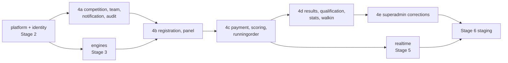

# 06 — Roadmap, agent orchestration, checklists, Definition of Done

## 1. Who does what (D4)

| Role | Who | Does |
|---|---|---|
| **Lead** | One Claude session ("lead"), on branch `migration/springboot` | Owns this plan, `backend/` structure, the shared `platform` and `engines` code, the gates, merges, `MIGRATION-STATUS.md`. Reviews every module branch before merging it |
| **Module builders** | Parallel `port-builder` agents (Sonnet by default), **one per module, each in its own git worktree** on `migration/<module>` | Port units with the `port-unit` skill from generated skeletons and context packs until `portCheck` is green (07); never edit another module's package or `platform` (they ask the lead) |
| **Reviewers** | A fresh session per module merge, running the `code-review` and `security-review` skills on the module diff | Correctness, security and principles review against §4; findings go back to the builder |
| **Test tooling** | One session in Stage 1 | `twinrun`, golden-vector generator, socket recorder, corpus |
| **Owner** | You | Approves each stage gate; owner-only steps (OCI console, Vault secrets, Razorpay dashboard, Render suspension, real-device walk-through); decides anything that changes behaviour |

Rules for parallel work: **at most 4 builders at once** (the reviewer and
lead have to keep up); builders only start when their dependencies' `api`
packages are merged (§3); two sessions never write the same files; every
builder rebases on the lead branch daily. `migration/springboot` is merged
into `master` only at cutover. Until then `master` stays Node-deployable.

## 2. Stages, tasks and exit gates

### Stage 0: before 21 Dec (now)
- [x] Plan written (this directory).
- [ ] Owner reviews and approves the plan, or asks for changes.
- Nothing else. No code, CI, VM, branch push or Render change (D2).

### Stage 1: Discovery refresh and recordings (21 → 27 Dec)
- [ ] Re-run the audit (01) against master as of 21 Dec; regenerate `openapi.json` and `API-MATRIX.md`; record every December change.
- [ ] Record the Node baseline on the OCI VM shape: `benchmarkApi.js`, `loadTest.js`, `socketLoad.js`, `meetDay.js`, `countQueries.js` → `backend/baseline/`.
- [ ] Build `backend/tools/node/golden` (engine vectors) and commit the vectors.
- [ ] Build `backend/tools/node/twinrun` and record the HTTP corpus from Node (04 §2).
- [ ] Build the socket recorder; record frames for every event in 03 §5.
- [ ] Capture the exact Helmet header set, cookie attributes, CSRF token format, error codes and messages → `backend/contract/`.
- [ ] Add `--target` to `testApi.js` if it doesn't have one.
- [ ] The **call tracer**: wrap every service and repository registered in Node's DI container in a tracing proxy while the corpus is recorded, so each operation's real call list is known (07 §2). Lives in `backend/tools/node/`; `Server/` is not changed (it's loaded with `-r`).
- [ ] Port kit, part 1 (07 §9): `context-pack`, and generators 1–2 (`gen-enums`, `gen-catalogues`) in **report mode**.
- [ ] Run `gen-enums` / `gen-catalogues` in report mode; publish `VOCABULARY-DRIFT.md`; the lead decides every drift row (08 §16) before Stage 2.
- **Gate:** corpus replays against Node twice with zero diffs (proves the harness is deterministic); vectors generated; baseline recorded.

### Stage 2: Foundation (28 Dec → 10 Jan)
- [ ] Generate `:app` with Spring Initializr using the owner's setup (Gradle – Groovy, Java, Boot 4.1.2, War, YAML, Java 25; group `com.mallakhamb`, artifact `mallakhamb-backend`), then add around it: wrapper, `settings.gradle` with `:kernel`, `:engines`, `:app`, `:tools`; `build-logic` convention plugin; `libs.versions.toml`; locking and verification metadata.
- [ ] Spike (2 days): Boot 4.1.2 + Java 25 + socketio4j netty-socketio + the real client: the S0–S14 list in 03 §3. **If any check fails with no workaround, stop and bring it to the owner** (fallback: Boot 4.0.x, or ADR-003's exit ramp).
- [ ] **Milestone 2a (target 3 Jan): shared kernel and catalogues frozen.** Generators 1–6 produce them (07 §1): the 28 `WireEnum`s + converters, typed ids, value objects, `ErrorCode`, `MessageKey` + `messages.properties`, `RealtimeEvent`/`RealtimeMessage`, `Rooms`, `CookieNames`/`HeaderNames`, `ApiRoutes`, `CacheName`, `RateLimitPolicy`, `MetricNames`, `AuditAction`, `EmailTemplate`, `*Fields`, `Capability` + `AccessMatrix`, `AppProperties`, `Clock`, `JsNumber`. Reviewed as one unit by the lead and owner; frozen before any module starts (additions only through the generators).
- [ ] Single-source tests (04 §6a) green on the kernel.
- [ ] `:app` skeleton (milestone 2b, generators 7–9 for the identity routes): profiles, `AppProperties` with Node's validations, logging, `ApiEnvelope`, `GlobalExceptionHandler`, `ErrorCode`, JS JSON serializers, `/api` + `/api/v1` mapping, case-insensitive and trailing-slash routing.
- [ ] Mongo: connection, `MongooseCompat`, `IndexReconciler` (all 18 collections' indexes declared), `MigrationRunner` reading the existing `migrations` collection.
- [ ] Security: filter chain, CSRF filter (double-submit + signed header), CORS, headers, JWT (Node tokens verify in Java and the reverse), cookie policy, revocation check, principal loading, `@Requires` + `AccessMatrix`, competition scope + lock annotations, Bucket4j limiters.
- [ ] `identity` module: all 5 logins, refresh rotation, logout, `me`, set-competition (the first module, because everything else needs a principal).
- [ ] Health endpoints; Prometheus with Node's metric names; CI workflows (05 §4).
- [ ] ArchUnit rules (04 §6) in place from the first commit.
- [ ] Port kit, part 2 (07 §9): `portCheck`, the formatting hook, `CONVENTIONS.md` + `RECIPES.md`, the exemplar module `team` (pulled forward from wave 4a and built by the lead; it shows P0, P1, P2, P6), the skill and agents installed from `agent-kit/`.
- [ ] **Kit pilot 1** on 12 units from identity, competition and team (07 §7); tune the kit until its targets are met.
- **Gate:** kernel and catalogues reviewed and frozen, every drift row decided; the **real Web app** logs in as all five roles against Java locally (cookies, CSRF, refresh, logout); identity routes `Diff-green`; CI green (including single-source tests); kit pilot targets met.

### Stage 3: Engines (4 → 17 Jan, starts after milestone 2a)
- [ ] Engines built only on kernel types (no vocabulary of their own; the kernel was built in Stage 2).
- [ ] **Rulebook runtime** (09 part A): schema, `cop-2022-11.json` generated from Node, `Rulebook` types, `RulebookRegistry`, semantic validator, procedure enums (`PanelMethod`, `TieBreakStep`, …). Every engine takes a `Rulebook`; no global rule tables.
- [ ] Scoring, Ranking + Tie-break (with draws as input), Fees, Panel (`SeatPlan` from `scripts/lib/panel-plan.js`), Eligibility, Running order.
- [ ] `JsNumber` helper and its own vector suite.
- **Gate:** every golden vector exact, for all six engines, computed through the `cop-2022-11` rulebook; rulebook schema, semantic and parity tests green.

### Stage 4: Business modules (11 Jan → 21 Feb)
Order follows the dependencies; within a wave, modules run in parallel:

| Wave | Modules (parallel builders) | Why this order |
|---|---|---|
| 4a | `competition`, `team`, `notification`, `audit` | Only need `identity` |
| 4b | `registration` (the `registeredTeams` adapter, built first by the lead as the P4 reference; then squads and entries), `panel` | Need 4a |
| 4c | `payment`, `scoring` (the `Score` adapter), `runningorder` | Need 4b. Starts with **kit pilot 2** on the hard units (save-score, the webhook, a walk-in-style upload, a superadmin correction). `scoring` is the largest and riskiest; its builder does nothing else |
| 4d | `results`, `qualification`, `stats`, `walkin` | Need 4c |
| 4e | superadmin correction routes (thin controllers over the modules' APIs) | Need everything |

- **Gate:** 220/220 operations `Diff-green` in `API-MATRIX.md`; the test ledger complete for those modules; the DB-diff step of `twinrun` clean.

### Stage 5: Real-time (25 Jan → 14 Feb, overlaps Stage 4 from wave 4c)
- [ ] `realtime` package (03 §4); `RealtimePublisher` wired into `scoring`, `runningorder`, `competition`, `team`, `registration`.
- [ ] Socket contract tests from the recordings; reconnect and forgery cases.
- **Gate:** every row of 03 §5 green; all 9 Web socket screens checked against Java in a browser (admin scoring, judge dashboard, sequence, team players, slip and panel review, Scorer, Time Keeper).

### Stage 6: Integration on staging (22 Feb → 7 Mar)
- [ ] Install Temurin 25 and `mallakhamb-backend` on both VMs (owner approves the change); Caddy snippet; drop-in.
- [ ] Standby (app-02) runs Java against the staging DB; the active stays on Node.
- [ ] Run `setup:api`, `setup:ui`, and the e2e lifecycle against Java on the standby; then a planned role switch so Java serves the sslip staging hosts for ≥ 14 days of e2e runs.
- [ ] Memory measurements under the e2e schedule (05 §2).
- **Gate:** 14 consecutive days of green e2e on Java; no memory alarms.

### Stage 7: Verification (8 → 21 Mar)
- [ ] Load, soak, failover and rollback drills (04 §8).
- [ ] Security: ported suites, PII contract, ZAP baseline, dependency scan, manual authz review (04 §9).
- [ ] Performance comparison report: `backend/baseline/COMPARISON.md`.
- [ ] Owner device walk-through (04 §10).
- **Gate:** all pass; the owner signs `MIGRATION-STATUS.md`.

### Stage 8: Cutover
- [ ] The runbook in 05 §7, in the first window with no meet within ±7 days.
- [ ] After the first clean real meet: retire Render (05 §8).

**On the dates:** they are targets for a full-time, multi-agent build. What
holds a stage back is its gate, not the calendar. If a gate fails, the stage
repeats and everything after it moves. The meet calendar beats every date in
this file.

## 3. Module dependency order (who waits for whom)

## 4. Per-module checklist (copied into each module's PR description)

1. **Understand:** read the Node routes, controllers, services, repositories, validators and the matching `Server/MEMORY/modules/*.md`; list every rule, guard, side effect (emails, socket events, audit entries, cache invalidations) in `backend/src/.../<module>/README.md`.
2. **Boundaries:** write the module's `api` interface first; the lead approves it.
3. **Dependencies:** only through other modules' `api`; ports for external systems.
4. **Design:** the simplest thing that keeps the behaviour: Spring Data repository for simple CRUD, `MongoTemplate` adapter for the hard aggregates, records for DTOs.
5. **Implement:** controllers thin; no business logic in controllers; DTOs are the PII allow-list; error codes and messages copied from Node.
6. **Test:** the module's ledger rows (04 §1), golden vectors where an engine is used, Testcontainers for adapters.
7. **Verify compatibility:** the module's corpus entries `Diff-green`; DB diffs clean; socket events (if any) match recordings.
8. **Review:** a fresh reviewer session runs `code-review` + `security-review`; the builder fixes findings; the lead checks the principles table below.
9. **Document:** the module README (rules, decisions, known divergences); new ADRs if a significant choice was made; open issues in `MIGRATION-STATUS.md`.

**Principles check for every review** (answer each, briefly, in the PR):

| Question | Looking for |
|---|---|
| Is anything in a controller that isn't HTTP mapping? | SoC |
| Does any class have more than one reason to change, or more than ~7 collaborators? | SRP, cohesion |
| Does this module touch another module's internals or repository? | Coupling, modularity |
| Is there a chain like `a.getB().getC().getD()` in business code? | Law of Demeter → add a method on the owner |
| Is any rule written twice (here and elsewhere, or here and in Node in a different form)? | DRY → move it to the engine or the owning module |
| Is any concept spelled locally instead of taken from its single source (enum, id, value object, catalogue, config, `Clock`)? | 08; CONVENTIONS §1 |
| Does any interface have one implementation and no test seam reason? | YAGNI → remove it |
| Is any exception swallowed, any thread pool unbounded, any blocking call on a Netty thread? | Strict rules 12–14 |
| Does any response expose a field the Node response didn't? | Security, contract |

## 5. Tracking files (kept current during the build)

| File | Contents |
|---|---|
| `backend/MIGRATION-STATUS.md` | Stage, gate status, module table (owner, branch, ledger %, diff-green count), outstanding issues, known limitations, sign-offs |
| `docs/springboot-migration/API-MATRIX.md` | Per-operation status (regenerated, keeps hand columns) |
| `backend/TEST-LEDGER.md` | Node test → Java test parity |
| `backend/DEPENDENCIES.md` | Every direct dependency: version, purpose, licence |
| `backend/baseline/` | Node baseline and the Java comparison |
| `docs/springboot-migration/ADRS.md` | Decisions; new ADRs appended |
| `twinrun/allowed-diffs.yml` | Every accepted difference, with reason and approval |

## 6. Node changes during the port

`Server/` keeps running production through the build. Rules:

- Bug fixes only; no features in `Server/` after Stage 1 unless the owner explicitly says so (a feature then has to be built twice).
- Every Node change re-records the affected corpus entries and regenerates `openapi.json`, `API-MATRIX.md` and the golden vectors. The diff of those files **is** the to-do list for the Java side. The `server.yml` CI check enforces it.
- **COP Reader (first follow-up after cutover, 09 part B):** the `cop-update` skill and `backend/tools/cop`; self-test: reading the current PDF must reproduce `cop-2022-11.json` exactly. Then: Web rule tables generated from the rulebooks, edition on competition create/edit, the superadmin "change edition" correction.
- **Frontend vocabulary (after cutover):** generate `Web/src/constants/vocabulary.js` from the backend's `vocabulary.json` and retire the Web literals (`'Senior Judge'` ×38, `'Male'` ×39, `scoring_` ×23) and the COP mirror (08 §15). A separate, approved change.
- Fixes that change behaviour (T4, T5, the double-sent scoring events, the dead colon-room emit, the always-404 route, the frontend `decoded.role` read) are **not** done in either backend during the port. They are queued as post-cutover changes, each made once, in Java.

## 7. Definition of Done

The migration is done when all of these are true, with evidence linked in
`MIGRATION-STATUS.md`:

- [ ] 220/220 operations `Diff-green` (or approved in `allowed-diffs.yml`), at `/api` and `/api/v1`.
- [ ] Every row of the socket event matrix green against the real client; all 9 socket screens checked in a browser.
- [ ] Golden vectors exact for all six engines.
- [ ] Test ledger complete; all 16 security suites ported and green; PII contract green for every persona.
- [ ] ArchUnit rules green; no module cycles.
- [ ] Single-source tests green: no vocabulary, event, room, code, status, message, field-path, config or clock literal outside its single source; every drift row in `VOCABULARY-DRIFT.md` decided.
- [ ] Mongoose-compatibility round trip clean; rollback drill passed.
- [ ] Stage-7 performance comparison: Java p95/p99 ≤ Node on every benchmarked route, or each exception approved; memory within budget; failover drill passed.
- [ ] 14+ days of green e2e on Java staging; the owner's real-device walk-through signed.
- [ ] Monitoring: dashboards and alerts working on Java metrics; health checks wired to `mallakhamb-role`.
- [ ] Deployment, rollback and runbooks updated (`deploy/oci/*`, `Server/MEMORY` successor docs for `backend/`).
- [ ] Cutover done and one real meet run on Java with no rollback trigger.
- [ ] Engines read all COP rules from the pinned edition's rulebook; no COP number or wording in Java code.
- [ ] No speculative infrastructure added (no Redis, broker, Kubernetes or second service), checked against `DEPENDENCIES.md`.
