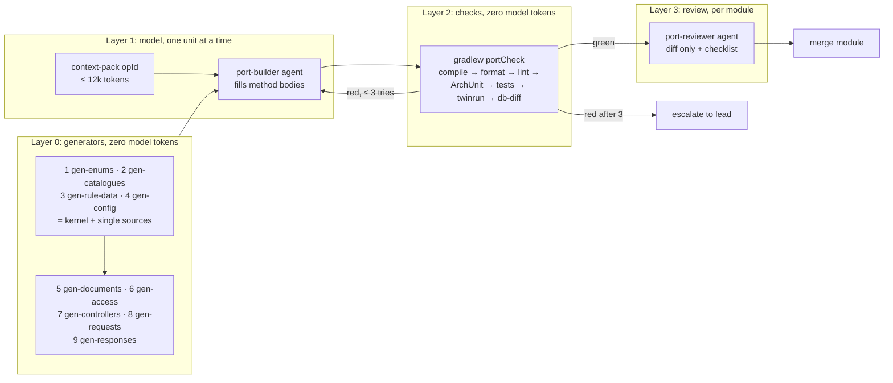

# 07 — The port kit: generators, a skill, and a checked loop

**Goal:** correct, clean, uniform Java for all 220 operations, using as few
model tokens as possible.

**Strategy in one line:** *scripts write everything mechanical, the model
writes only business logic from a small pre-cut context, and tools (not
prompts) enforce syntax, architecture and correctness.*

Prompts can't guarantee consistency across ~25 agent sessions. Formatters,
ArchUnit, generated skeletons and twin-run diffs can. So every rule that can
be checked by a tool is checked by a tool, and the model's job is narrowed to
the part only it can do.



## 1. Layer 0: generators (deterministic, no model)

Built in Stages 1–2 under `backend/tools/node/gen/` (Node, because they read
the live Node app; their own `package.json`, so `Server/` is untouched). They
are re-runnable and write two kinds of file:

- **Owned files** (enums, catalogues, documents, `*Fields`, controllers,
  request and response records, the access matrix seed): regenerated on every
  run, marked `// GENERATED by tools/node/gen/<name> — do not edit`, and
  hash-checked in CI. Nobody edits them; a needed change goes into the
  generator.
- **Scaffolds** (the application-service class and method each controller
  calls, with a body of `throw new NotPortedException(OperationId.X)`):
  created **once** if missing and never overwritten. From then on they belong
  to people. This is where builders write code.

Generators 1–6 run first and produce the kernel and catalogues (milestone 2a);
7–9 then generate controllers and DTOs against them (milestone 2b onwards).

Generators run in dependency order: **kernel and catalogues first**, then
everything that uses them. A skeleton never contains a raw id, enum string,
path string, status number or message. It references the generated single
source (08).

| # | Generator | Reads | Writes | Why it's exact |
|---|---|---|---|---|
| 1 | `gen-enums` | every Mongoose `enumValues` (77 fields), `config/judge-seats.js`, `competition-levels.js`, `cop-rules.js` type lists, `judge-slip.util.js` role map | the 28 `WireEnum`s in `kernel.vocabulary` with wire values, behaviour fields (seat no, slip role, score field, display form, rank), named subsets (`AgeGroup.ENTRY`), **and `VOCABULARY-DRIFT.md`** listing every disagreement between Node definitions (08 §16) | Reads runtime schema objects and config modules, not source text |
| 2 | `gen-catalogues` | `error-codes.js` + every code/status/message literal in `src/` (Babel AST), `event-types.js` + emit sites, `cookie.util.js`, header names in middleware, `cache.service` keys, limiter definitions, `prometheus/registry.js`, audit op names, email templates | `ErrorCode` (code + HTTP status), `MessageKey` + `messages.properties` (deduplicated by exact text), `RealtimeEvent` + sealed `RealtimeMessage` records, `CookieNames`, `HeaderNames`, `CacheName`, `RateLimitPolicy`, `MetricNames`, `AuditAction`, `EmailTemplate` | Every literal Node actually uses, deduplicated, each with its Node `file:line` |
| 3 | `gen-rule-data` | `cop-rules.js` and the rule constants in the scoring, ranking and tie-break utils; `payment.config` constants; `scripts/seed/panel-plan.json` | **`rulebooks/cop-2022-11.json` in the rulebook schema** (09), with COP section refs and verbatim checklist text; fee rule data; the seat plan | One copy of every rule table; the first rulebook edition is generated, never typed |
| 4 | `gen-config` | `config-manager.js` (keys, env names, defaults, validations) + the 17 stray `process.env` reads | `AppProperties` records with `@Validated` constraints, `application.yaml` env mappings, `FeatureFlags` | Node's defaults and refuse-to-start rules, in one tree |
| 5 | `gen-documents` | each model's `schema.paths`, `schema.indexes()`, defaults, `select:false`, timestamps, collection name, ref targets | `@Document` classes typed with **kernel enums, typed ids and value objects** (`@Field("sex") Gender gender`; `DisplayForm<CompetitionType>` on `scores`), `*Fields` path constants, `IndexCatalog`, `SensitiveFields` | Runtime schema introspection; refs decide the typed id |
| 6 | `gen-access` | Express stack: the guard chain on each of the 220 routes | `Capability` (one per distinct guard set, named from the routes it covers, renamed by the lead), the initial `AccessMatrix`, `RouteSecurityManifest.json` + its test | Same middleware chain Express runs |
| 7 | `gen-controllers` | Express stack + `openapi.json` + outputs of 2, 5, 6 | One controller method per operation, named by `operationId`, with `ApiRoutes` constants, `@Requires(Capability)`, `@CompetitionScoped`, `@LockedAfterEndDate`, `RateLimitPolicy`, typed-id `@PathVariable`s; body: `return useCase.<method>(…)` | Same paths and guards as Node by construction |
| 8 | `gen-requests` | OpenAPI `requestBody` (91 of 94) + runtime express-validator chains | Request records using **value objects and enums as field types** (`EmailAddress email`, `AgeGroup ageGroup`), constraint annotations whose messages are `MessageKey`s | Node's exact rules and messages |
| 9 | `gen-responses` | OpenAPI response schemas (67) + twinrun recordings (shapes inferred across samples) | Response records (enum and id fields typed), `@JsonInclude` per field, `static from(Document)` mappers, per-persona forbidden-field lists | Inferred from what Node actually returned |

Order matters: 1–4 produce the single sources; 5–9 consume them. A
skeleton that would need a literal the catalogues don't have makes the
generator **fail**, which exposes a missing catalogue entry instead of letting
a string slip through.

Expected effect: the vocabulary, catalogues, config, documents, DTOs,
controllers, guards, messages and rule tables are produced without the model,
match Node by construction, and share one definition per concept. The model's work shrinks to method bodies in
application services and adapters.

## 2. Layer 1: one unit at a time, from a context pack

**Unit of work = one operation** (`operationId`), or a small cluster that
shares a service method (the clusters are computed by `context-pack` from the
call graph, for example the 7 superadmin and admin judge routes).

### `context-pack <operationId>` (the main token saver)

A script that builds a single Markdown file per unit, **≤ 12k tokens**
(hard cap; over the cap it splits the unit), containing only:

1. **The Node slice:** the functions this operation **actually reached**
   while the corpus was recorded. A tracer wraps every service and repository
   registered in Node's DI container in a proxy, so calls through
   `this.scoringService.x` are seen as they happen (static analysis can't
   follow the container). Util functions called from those are added by a
   Babel AST pass, which also cuts out each function's source with
   `file:line`. **Only those functions** are included. Instead of reading
   `scoring.service.js` (2,153 lines), the builder sees the 60–200 lines that
   matter.
2. **Side effects found in the slice:** socket emits (event, room), emails,
   audit calls, cache invalidations, `arrayFilters`/`__v` writes,
   transactions.
3. **The generated Java skeleton** for the unit: controller method, request
   and response records, use-case method signature.
4. **1–3 recorded request/response pairs** (trimmed) and the DB diff of a write.
5. **Recipe tags:** which patterns from `RECIPES.md` apply (P0–P12), chosen by
   rules over the slice (uses `arrayFilters` → P4; emits → P6; a paginated
   aggregate → P3; …).
6. **Module notes:** the module README's rules section (only that section).
7. **Single sources in play:** the kernel enums, ids, value objects, `MessageKey`s, `ErrorCode`s, `RealtimeMessage` records and `Capability` the slice touches, as signatures only (not bodies). The builder uses these and never invents a string.
8. **Gotchas:** lines from `Server/MEMORY/GOTCHAS.md` and the memory files that
   mention any function in the slice (matched by name).

The builder reads the pack and the files it edits, and nothing else. Reading
other repo files is allowed only when `portCheck` names one.

### The builder's loop

```text
read pack → edit the generated skeleton (small Edits, not whole-file Writes)
→ run ./gradlew portCheck --op=<opId> → if red: read the condensed report, fix → ≤ 3 cycles
→ green: update backend/.port/units/<opId>.json (status, attempts, notes) → next unit
→ still red after 3 cycles: stop, write the blocker into the unit file, hand it to the lead
```

The 3-cycle cap is the most important token control. A unit that hasn't
converged after three tries usually needs a human or lead decision (an
ambiguous Node behaviour, a missing recipe), and more attempts just burn
tokens.

## 3. Layer 2: `portCheck` (tools decide, the model doesn't)

One command, run by the builder, CI and the reviewer alike:

```text
./gradlew portCheck --op=<operationId> | --module=<name> [--quick]      (gradlew.bat on Windows)
  1. compile (Gradle incremental, build cache, offline)        → first 10 errors only
  2. spotlessCheck (palantir-java-format)                      → file list only; a hook already formats
  3. Error Prone + NullAway                                    → first 10 findings
  4. ArchUnit (04 §6 + naming rules) + SingleSourceTest (08 §14) → rule + offending class / literal + file:line
  5. module unit/integration tests touching the unit           → failing test names + first assertion diff
  6. twinrun --op <operationId>                                → first differing JSON path, Node vs Java values
  7. db-diff for write operations                              → first differing document path
  → prints ≤ 40 lines total: one block per failing gate, PASS lines collapsed to one
```

`--quick` runs steps 1–4 (seconds, Gradle daemon warm). The full run is for
"done". The output is condensed on purpose: a raw Gradle log costs thousands
of tokens, a first-failure summary costs a few hundred.

**Parallel worktrees don't collide:** `portCheck` derives its ports (Java,
twin Node, Socket.IO) and database names from a hash of the worktree path,
reuses one Testcontainers Mongo per worktree, keeps the twin Node server
running for the whole session, and restarts only the Java app between runs.
The Gradle build cache is shared across worktrees.

**What enforces "same syntax, same architecture, same patterns":**

| Concern | Enforced by |
|---|---|
| Formatting | palantir-java-format via Spotless; a **PostToolUse hook** formats every `.java` file the agent edits (so the model never spends tokens on formatting) |
| Naming and placement | ArchUnit: `*Controller` only in `..web..`, `*Request`/`*Response` records only in `..web.dto..`, `*Document` only in `..infrastructure..`, application services end in `Service`, every controller method is named after an `operationId` that exists in `API-MATRIX.md` |
| Layering and module boundaries | ArchUnit (04 §6) |
| Null-safety, common bugs | Error Prone + NullAway (`@NullMarked` packages) |
| Forbidden constructs | ArchUnit/Error Prone custom checks: no `@Autowired` fields, no `System.out`, no catching `Exception` without rethrow, no `new Thread`, no unbounded `Executors.new*`, no Lombok, no `MongoTemplate` outside `..infrastructure..`, no rounding outside `JsNumber` |
| Behaviour | twinrun + db-diff + golden vectors |
| Security | `RouteSecurityManifest` test (guards equal Node's) + PII forbidden-field test |
| Patterns | Recipes + the exemplar module; the reviewer flags deviations |
| One definition per concept | `SingleSourceTest` (no wire value, event, cookie or header name, room prefix, error code or message as a literal outside `kernel`/generated code), Error Prone exhaustive enum switches, banned clock, env, status and rounding calls (08 §14) |

## 4. Consistency sources the model *does* read (kept short, so they cache well)

| File | Size cap | Contents |
|---|---|---|
| `backend/CONVENTIONS.md` | ≤ 150 lines | The "look it up, never spell it" table (which single source to use for each kind of concept), naming, where behaviour goes, use-case shape, errors, logging, when to add an interface |
| `backend/RECIPES.md` | 13 recipes, ~25 lines each | P0 generated controller · P1 read with projection · P2 simple write · P3 filtered/paginated aggregation · P4 team-addressed embedded write · P5 `__v`-guarded merge with retry · P6 publish after write · P7 external call · P8 superadmin correction · P9 scheduled job · P10 engine call · P11 state transition · P12 branching on an enum. Every snippet uses the single sources (08) |
| **Exemplar module** | real code | `team` (wave 4a), hand-built by the lead and reviewed hard **before** any builder starts. It shows P0, P1, P2 and P6 (`emitToUser`). The P4 and P5 references are `CompetitionEntriesStore` (built by the lead at the start of wave 4b) and `ScoreSheetStore` (start of wave 4c). Builders are told "match `modules/team`" and the store for their recipe |

These three are the **stable prefix** of every builder session (skill text →
CONVENTIONS → RECIPES), so prompt caching reuses them across units in a
session. The per-unit pack comes after them.

## 5. Model tiering and session shape

| Work | Model | Why |
|---|---|---|
| Generators, `portCheck`, ledger and status updates, matrix regeneration | none (scripts) | Mechanical |
| Engines, `ScoreSheetStore`, `CompetitionEntriesStore`, security filters, realtime, exemplar module | Opus (lead) | Highest consequence; least repetitive |
| Routine units (P1–P3, P6–P8; most of the 220) | Sonnet (`port-builder` agent) | Context pack + skeleton + recipes make it a narrow task; portCheck catches errors |
| Per-module review | Sonnet with a fresh context (`port-reviewer`), Opus for scoring, registration, payment and identity | Fresh eyes on a diff; the stakes decide the model |
| Pilot calibration | both, side by side | Decide the tiering on data (§7), not on assumption |

Sessions: one builder session per **module wave** (it loads the stable
prefix once, then processes units in call-graph order). State lives in
`backend/.port/units/*.json`, never in chat history, so a new session resumes
by reading the unit files. Long sessions are restarted at module boundaries
rather than left to grow.

## 6. Layer 3: review (per module, not per unit)

Per-unit review is mostly paid for by `portCheck`. The reviewer runs once per
module on the **diff only**, with the 8-question principles checklist (06 §4)
and the `code-review` + `security-review` skills, and looks only at what tools
can't judge: logic matching the Node slice, the right recipe, readability,
duplicated rules, Law-of-Demeter chains. Findings go back to a builder as unit
files; the module merges when they're closed.

## 7. Pilots before scale

**Pilot 1 (Stage 2, last 3 days):** 12 units from the modules that exist by
then (identity, competition, team), covering P0–P3, P6, P7 (email), P9, P11,
P12. **Pilot 2 (start of wave 4c):** the hard units, once their dependencies
exist: `POST /api/public/save-score` (P5), the Razorpay webhook, a
walk-in-style upload, a superadmin correction (P8). Measure, in both:

| Metric | Target to proceed |
|---|---|
| First-pass `portCheck` green rate | ≥ 50 % (most of the rest green by cycle 3) |
| Units needing escalation | ≤ 2 of 12 |
| Reviewer findings per unit | trending to ≤ 1 minor |
| Tokens per unit (from session usage) | recorded per recipe; used as the budget for the remaining units |
| Pack size | ≤ 12k for all 12; split rules tuned if not |

If the targets miss, fix the **kit** (recipes, pack contents, generators),
not the prompts, and re-run the pilot. Only then fan out to 4 parallel
builders.

## 8. Token budget rules (summary)

1. Generate, don't write: everything in §1 costs zero model tokens.
2. Read packs, not files: ≤ 12k tokens of exactly-relevant code per unit.
3. Edit skeletons with small edits; never rewrite whole files.
4. A stable prefix first (skill → conventions → recipes), so it caches; the variable pack last.
5. Condensed tool output: ≤ 40 lines from `portCheck`, Gradle `-q`, first failure only.
6. Hard caps: 3 check cycles per unit, then escalate; the session restarts at module boundaries.
7. Hooks format code, so the model never spends tokens on whitespace or imports.
8. Cheapest model that passes the pilot for each recipe.
9. State in files (`.port/units`), so no session re-derives what another found.
10. Review per module on diffs, after the tools have already passed.

## 9. What gets built, and when

| Item | Built in | By |
|---|---|---|
| Call tracer + `tools/node/gen/*` (generators 1–2 in report mode) | Stage 1 | test-tooling session, lead reviews |
| Generators 1–6 (kernel, catalogues, rule data, config, documents, access) | Stage 2, milestone 2a | lead |
| Generators 7–9 (controllers, requests, responses + scaffolds) | Stage 2, milestone 2b; re-run per module | lead |
| `tools/node/context-pack` | Stage 1 | test-tooling session |
| `portCheck` Gradle task (+ Node helpers) | Stage 2 (needs the skeleton) | lead |
| `CONVENTIONS.md`, `RECIPES.md` | Stage 2, finalised after the exemplar | lead |
| Exemplar module `team` | end of Stage 2 | lead |
| Skill `port-unit`, agents `port-builder` / `port-reviewer`, hooks | Stage 2 (drafts: [agent-kit/](agent-kit/)) | lead; hooks via the `update-config` skill |
| Pilot 1 / pilot 2 | last 3 days of Stage 2 / start of wave 4c | lead + 1 builder |

Draft files, to be moved into `.claude/` in Stage 2 (not before, since they
point at `backend/`, which doesn't exist yet):
[agent-kit/skills/port-unit/SKILL.md](agent-kit/skills/port-unit/SKILL.md),
[agent-kit/agents/port-builder.md](agent-kit/agents/port-builder.md),
[agent-kit/agents/port-reviewer.md](agent-kit/agents/port-reviewer.md),
[agent-kit/CONVENTIONS.md](agent-kit/CONVENTIONS.md),
[agent-kit/RECIPES.md](agent-kit/RECIPES.md).
