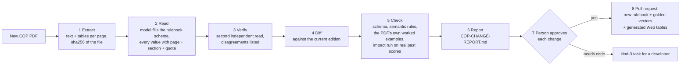

# 09 — The COP Rulebook engine: adapting when the Code of Points changes

**Goal:** when the federation publishes a new Code of Points (COP), the
software adopts it in hours, not weeks: someone hands over the new PDF, a tool
reads it, proposes the exact rule changes, a person approves them, and the
whole system (backend scoring, the judge screens, validation, the public rules
page) follows from **one rulebook file**.

**Two parts, with a hard line between them:**

| Part | What it is | Runs where | Can it change a score? |
|---|---|---|---|
| **A. Rulebook runtime** | The COP as versioned **data** (one file per edition). Every engine reads its numbers, tables, texts and step orders from the rulebook of the competition's edition | Inside the backend, always | Yes: it *is* the rules. It's deterministic and tested |
| **B. COP Reader** | A tool that reads a COP PDF and produces a **proposed** new rulebook plus a change report | Outside the running app: a Claude skill run by a developer or the owner | **Never directly.** Its output is a draft that must pass checks and be approved by a person |

A language model reads the PDF (part B). A language model **never** decides a
score at runtime and never changes rules without a person's approval. Scores
come only from part A, which is plain, tested code reading approved data.

## 1. What exists today

- `Server/src/config/cop-rules.js` (621 lines) holds the COP Nov 2022 tables **mixed with code**: point ceilings, element values (A 0.20 / B 0.40 / C 0.60), difficulty requirements per competition type, tolerance tiers, time limits and deduction tiers, combination checklists (verbatim COP §2.3.2 text), age-group ranges, apparatus by gender, and the functions that use them.
- `Web/src/utils/scoring/copRules.js` (about 800 lines) repeats the tables **and** the calculations by hand for the judge screens, kept in step by a sync test.
- `Competition.editionRef` already exists (default `'COP Nov 2022'`), but **nothing reads it**. There is one hard-coded edition.
- The source PDF is in the repo: `Server/docs/COP Mallakhamb.pdf` (15 MB).
- More rules sit outside `cop-rules.js`: the panel-size methods and tie-break cascade (`calculation.util`, `tie-breaker.util`), team championship counts, the qualification threshold, the panel seat plan.

So today a COP change means hand-editing two files in two languages plus
several utilities, and it applies to every competition at once, including
ones already scored.

## 2. Part A: the rulebook

### 2.1 One file per edition

```text
backend/engines/src/main/resources/rulebooks/
├── cop-2022-11.json        ← generated once from today's Node tables (07, gen-rule-data)
├── cop-2022-11.evidence.json ← page / section / quote per value (filled by the reader's self-test; not hashed)
├── cop-2027-xx.json        ← a future edition, produced by the COP Reader and approved
└── rulebook.schema.json    ← the JSON Schema every edition must satisfy
```

The rulebook holds **rule values only** (numbers, tables, step orders, and
the verbatim wording shown to judges). Where each value comes from in the PDF
(page, section, quote) lives in a sidecar, `cop-<edition>.evidence.json`,
keyed by JSON pointer. The sidecar is outside the immutability hash, so
evidence can be added later (for example by the reader's self-test on the
2022 PDF) without touching a published edition.

```jsonc
{
  "edition": { "id": "cop-2022-11", "label": "COP Nov 2022", "effectiveFrom": "2022-11-01",
               "sourcePdfSha256": "…", "approvedBy": "…", "approvedAt": "…" },
  "pointCeilings":   { "difficulty": 0.0, "combination": 0.0, "execution": 0.0, "originality": 0.0 },
  "elementValues":   { "A": 0.20, "B": 0.40, "C": 0.60 },
  "difficultyRequirements": { 
      "competition_1": { "A": 4, "B": 6, "C": 1 }, "competition_2": { "A": 1, "B": 6, "C": 2 }, "competition_3": { "A": 1, "B": 6, "C": 2 } },
  "difficultySubstitution": { "order": ["C", "B", "A"] },
  "execution":       { "minimum": 0.10, "grid": 0.05, "averageRounding": { "to": 0.1, "mode": "HALF_DOWN" } },
  "tolerance":       { "tiers": [ { "minAverage": 0.0, "allowed": 0.0 } ], "belowMinimum": 1.00 },
  "time":            { "minimumSeconds": 60, "limitSeconds": 90,
                       "deductionTiers": [ { "overUpToSeconds": 0, "deduction": 0.0 } ], "maximumDeduction": 0.50 },
  "panel":           { 
      "methods": { "3": "AVERAGE_ALL", "4": "FOUR_AS_FIVE_WITH_CHIEF", "5": "DROP_HIGH_LOW_AVERAGE_MIDDLE" } },
  "tieBreak":        { 
      "3": ["FASTER_TIME", "LUCKY_DRAW"],
      "4": ["BASE_SCORE", "FOUR_JUDGE_AVERAGE", "FOUR_JUDGE_AVERAGE_WITH_CHIEF", "LUCKY_DRAW"],
      "5": ["BASE_SCORE", "FOUR_JUDGE_AVERAGE", "FOUR_JUDGE_AVERAGE_WITH_CHIEF", "LUCKY_DRAW"] },
  "finalScore":      { "scale": 3 },
  "ageGroups":       { "ranges": { "Under10": { "maxAge": 0 } }, "byGender": { "Male": [], "Female": [] }, "cutoff": "…" },
  "apparatusByGender": { "Male": [], "Female": [] },
  "teamChampionship":  { "sizes": { "4": { "counted": 3 }, "6": { "counted": 5 } } },
  "qualification":     { "thresholdPct": 60 },
  "combinationChecklists": { 
      "Pole Mallakhamb": [ { "id": "…", "text": "…verbatim COP wording…", "value": 0.0 } ] }
}
```

(Zeros and empty lists above are placeholders for layout only. There is no
seat list: the seats are the kernel's `JudgeSeat` enum, and the rulebook only
says which method each panel size uses. The real
`cop-2022-11.json` is **generated from the Node tables**, never typed, and the
golden vectors prove the Java engines produce identical results with it.)

### 2.2 Three kinds of rule, three kinds of change

This is the honest limit of "adapts quickly", stated up front:

| Kind | Examples | A COP change means | Code change? |
|---|---|---|---|
| **1. Parameters** | tolerance tiers, ceilings, element values, required A/B/C counts, time window and deduction tiers, age ranges, apparatus by gender, team counts, qualification %, checklist text and values | Edit numbers and text in the new rulebook | **None** |
| **2. Named procedures** | which averaging method a panel size uses; the order of tie-break steps; the substitution order; the rounding mode | Re-order or re-select from the **procedures the engine already has** | **None** |
| **3. New procedures** | a tie-break step that has never existed, a new way of averaging, a brand-new score section | The Reader names it as *"not expressible: needs code"*, with the COP section and wording. A developer adds one small strategy class and its tests; the rulebook then refers to it by name | **Yes, small and isolated** |

Most COP revisions are kinds 1 and 2: values, counts, wording, an order.
Kind 3 can't be avoided by any design, but this one makes it a single
named class behind an enum (`TieBreakStep`, `PanelMethod`, `RoundingMode`),
found by the compiler through the exhaustive switches of 08.

Procedures are **a closed, named set in code** (enums with behaviour). There
is deliberately **no formula language or scripting inside the rulebook**: a
rulebook that could contain arbitrary expressions would be untestable and
could be made to produce any score.

### 2.3 Engines take the rulebook as an argument

```java
public record Rulebook(EditionId edition, PointCeilings ceilings, ElementValues elementValues,
                       Map<CompetitionType, DifficultyRequirement> difficulty, ExecutionRules execution,
                       ToleranceTable tolerance, TimeRules time, PanelRules panel,
                       Map<PanelSize, List<TieBreakStep>> tieBreak, /* … */) { }

ScoreResult result = scoreCalculator.calculate(rulebook, panelInput);     // pure; no global rule tables
```

- `RulebookRegistry` loads every edition at startup, validates each against the schema **and** its semantic checks (§4), and **refuses to start** on an invalid rulebook.
- `rulebooks.forCompetition(competition)` resolves `Competition.editionRef` (the field that already exists) to a `Rulebook`. The label `'COP Nov 2022'` maps to `cop-2022-11`, so no stored data changes.
- This replaces `CopRules` as a single global in 08: the kernel still owns the *vocabulary* (enums), and the rulebook owns the *numbers, texts and step orders*, per edition.

### 2.4 Editions and competitions

- **A competition is pinned to its edition** when it is created (default: the newest edition whose `effectiveFrom` is on or before the competition's start date). It keeps that edition for life.
- **Old results never change.** A meet scored under COP 2022 is ranked, displayed and re-calculated under COP 2022 forever, even after a new edition is active.
- **Changing a competition's edition** is a superadmin correction, allowed only while the competition has no finalized scores, and it is audited.
- Two editions can be in use on the same day (a meet that started before the changeover and one after).

### 2.5 The judge screens follow the same file

`GET /api/public/cop-rules` already serves the tables with an ETag. It gains
an edition (`?edition=` or by competition), keeping today's response shape
for the current edition.

The Web mirror is the second half of every COP change, so after cutover it
stops being hand-written: a build step **generates**
`Web/src/utils/scoring/copRules.generated.js` (tables and checklist text) from
the same rulebook files, keyed by edition, and the Web calculation code reads
the tables for the competition's edition. The bundle still carries the rules,
so judge tablets keep working on venue wifi. That is a Web change, so it is a
separate approved step (§8), not part of the port.

## 3. Part B: the COP Reader (a skill, `cop-update`)



| Step | Detail |
|---|---|
| 1. Extract | The `pdf` skill pulls text and tables page by page. Scanned pages go through OCR; pages that can't be read confidently are listed, not guessed |
| 2. Read | The model fills the **rulebook schema** section by section. Every value must come with its **page number, section number and the quoted sentence or table cell** it was read from. A value with no quote is rejected by the tool |
| 3. Verify | A second, independent pass (fresh context) reads the same sections. Any field where the two reads differ is flagged for the person, with both quotes |
| 4. Diff | Field-by-field comparison with the current edition: changed numbers, changed text (word-level, since judge screens quote the COP verbatim), added and removed items |
| 5. Check | (a) JSON Schema; (b) semantic checks (§4); (c) **the COP's own worked examples** are extracted as test cases and run through the engine with the proposed rulebook: the engine must reproduce the PDF's answers; (d) **impact run**: recompute a sample of past score sheets **from a restored backup or the staging copy, never production** under the proposed rulebook and show how results would differ (for information only; stored scores are not touched) |
| 6. Report | `COP-CHANGE-REPORT.md`: every change with old value → new value, the COP quote and page, its kind (1, 2 or 3), which screens and engines it affects, the impact numbers, and an explicit list of **"could not read / not expressible / needs a decision"** |
| 7. Approve | A person (owner or a technical official who knows the COP) ticks or corrects each change against the PDF. Nothing proceeds on the model's word alone |
| 8. Publish | The tool writes `cop-<year>-<month>.json`, regenerates the golden vectors for the new edition, regenerates the Web tables, and opens a pull request. CI runs everything. After merge and deploy, the edition exists; **existing competitions are unaffected**, new ones pick it up from `effectiveFrom` |

Typical kind-1/kind-2 update, end to end: PDF in, report out in minutes;
review time depends on the reviewer; merge and deploy the same day.

**Why the Reader is a skill and not an "Upload COP" button in the app:**
a COP changes rarely (the current one is from November 2022); reading it
needs a person's review anyway; and an in-app version would add a paid model
API, a key to protect, and a way to change scoring rules from a browser. The
skill needs no new infrastructure and leaves a reviewable pull request.
Recommended now. An in-app, superadmin-only upload that produces the same
report can be added later on the same pipeline if the owner wants officials
to run it themselves (ADR-015 records this choice; it's the owner's to flip).

## 4. Guardrails (what stops a wrong rulebook)

| Guard | Stops |
|---|---|
| Quote-or-reject (every value cites page, section, quote in the evidence sidecar) | Invented or misread values |
| Two independent reads, differences flagged | A single misreading |
| JSON Schema | Wrong shapes, missing sections, unknown procedure names |
| Semantic checks: tolerance tiers ordered and gap-free; deduction tiers increasing and ≤ the maximum; ceilings sum to the stated total; every competition type has a difficulty requirement; minimum time < limit; age ranges don't overlap wrongly; every apparatus has a checklist; every tie-break list ends in a deciding step | Internally inconsistent rules |
| The PDF's worked examples as tests | A rulebook that doesn't reproduce the COP's own answers |
| Golden vectors per edition, committed | Any later accidental change to an edition's behaviour |
| **Editions are immutable once published** (CI hash check of the rulebook file; the evidence sidecar is not hashed); a correction is a new edition id (`cop-2027-03-r1`) | Silent edits to rules that already scored meets |
| Competitions pinned to an edition | New rules leaking into old or in-progress meets |
| Person approval in the pull request | Everything else |
| `RulebookRegistry` refuses to start on an invalid file | A bad file reaching production |

## 5. What it changes in the rest of the plan

| Document | Change |
|---|---|
| 02 §4 engines | Engines take a `Rulebook` parameter; a seventh piece, **Rulebook** (registry, schema, semantic validator, edition resolution), sits beside the six engines. Procedures are enums with behaviour: `PanelMethod`, `TieBreakStep`, `SubstitutionOrder`, `ExecutionRounding` |
| 07 generators | `gen-rule-data` now writes `rulebooks/cop-2022-11.json` in the rulebook schema (including section refs and checklist text). New `gen-web-rules` (post-cutover) writes the Web tables |
| 08 single source | `CopRules` (global) → `Rulebook` (per edition). The vocabulary stays in the kernel; rules that vary by edition live only in rulebooks |
| 04 tests | Golden vectors are **per edition**; `RulebookSchemaTest`, `RulebookSemanticTest`, `EditionImmutabilityTest`, `EditionPinningTest` (an old meet's results don't move when a new edition is added) |
| 06 roadmap | Part A is built **inside Stage 3** (it is how the engines are written, at almost no extra cost). Part B and the Web generation come **after cutover** (§8) |
| API | No change for the current edition (the twin-run still has to match Node). `?edition=` on `/public/cop-rules` and edition on competition create/edit are additive, post-cutover |

**Port rule kept:** during the port there is exactly one edition,
`cop-2022-11`, generated from Node, and Java must still match Node on every
golden vector. Making the engines edition-aware changes how the rules are
*supplied*, not what they compute.

## 6. Where a rule lives (decision table for builders)

| The thing | Lives in |
|---|---|
| A name the code branches on (seat, apparatus, competition type, tie-break step) | kernel enum (08) |
| A number, table, required count, wording or step order that the COP defines | the rulebook, per edition |
| How a named procedure computes | one strategy on its enum, in the engine |
| A product setting unrelated to the COP (fees, OTP length, limits) | `AppProperties` |
| A per-competition choice the COP allows (team size 4 or 6, apparatus offered) | the competition document, validated against its rulebook |

## 7. Limits (stated plainly)

- The Reader **proposes**; it can misread a table or a scanned page. That is why every value carries a quote and a person approves it.
- A genuinely new kind of rule needs a developer (kind 3). The Reader's job there is to say so clearly, with the COP text, instead of forcing it into the wrong field.
- If a new COP adds an apparatus, a seat or a competition type, the kernel enum gets a new value too (08 §13); the compiler lists what else must decide about it.
- Wording changes on judge screens ship with the next Web build, since the bundle carries the text for offline use.

## 8. When each piece is built

| Piece | When | Why then |
|---|---|---|
| Rulebook schema, `cop-2022-11.json` generated from Node, `Rulebook` types, `RulebookRegistry`, engines parameterised, procedure enums, per-edition golden vectors, schema/semantic/immutability tests | **Stage 3** (with the engines) | Costs little while the engines are being written; very costly to retrofit |
| Edition resolution from `Competition.editionRef`, pinning rule | Stage 4 (`competition` module) | Reads a field that already exists; one edition, so behaviour is unchanged |
| **COP Reader skill** (`cop-update`), tested by feeding it the **current** PDF: it must reproduce `cop-2022-11.json` with zero differences | Right after cutover (first follow-up) | Needs the Java engines to run its checks; a perfect self-test exists |
| Web tables generated from rulebooks; Web calculations read the competition's edition | After cutover, with the Web vocabulary follow-up (08 §15) | A Web change; approved separately |
| Edition on competition create/edit; superadmin "change edition" correction; `?edition=` on the rules endpoint | After cutover | New (additive) API |
| Optional in-app upload for officials | Only if the owner asks | ADR-015 |

**If a new COP is published before cutover** (while Node is still live), it
is applied by hand to Node as it would be today, the rulebook JSON and golden
vectors are regenerated from Node, and Java follows through the normal
corpus-diff rule (06 §6).
